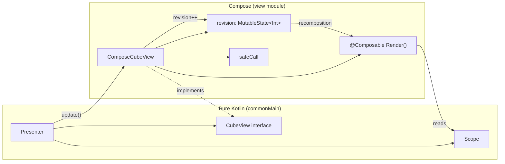
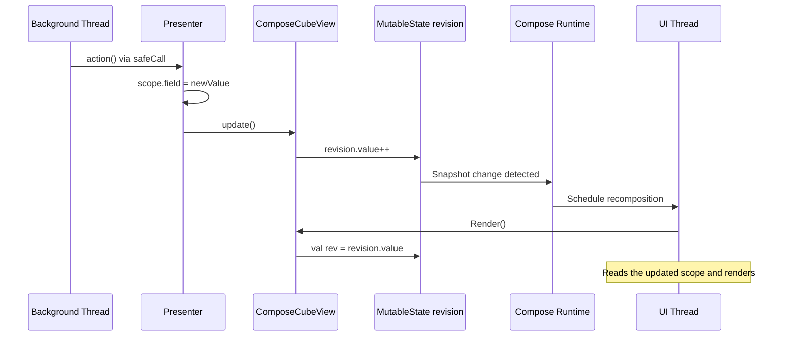
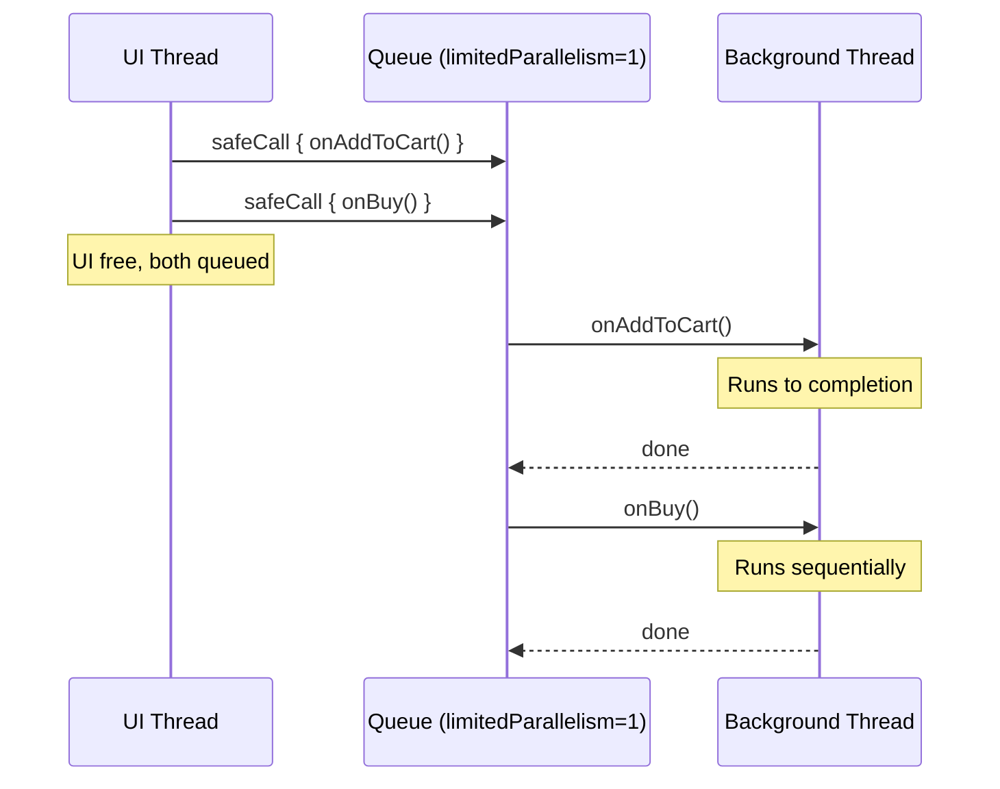
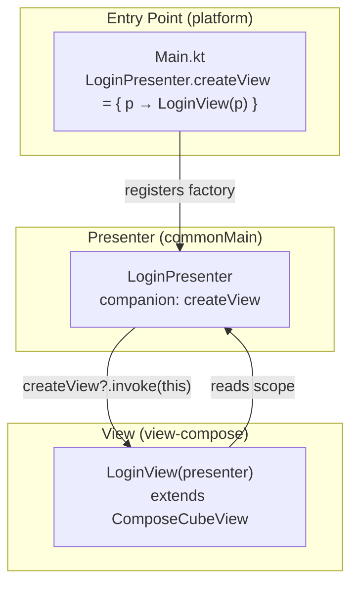
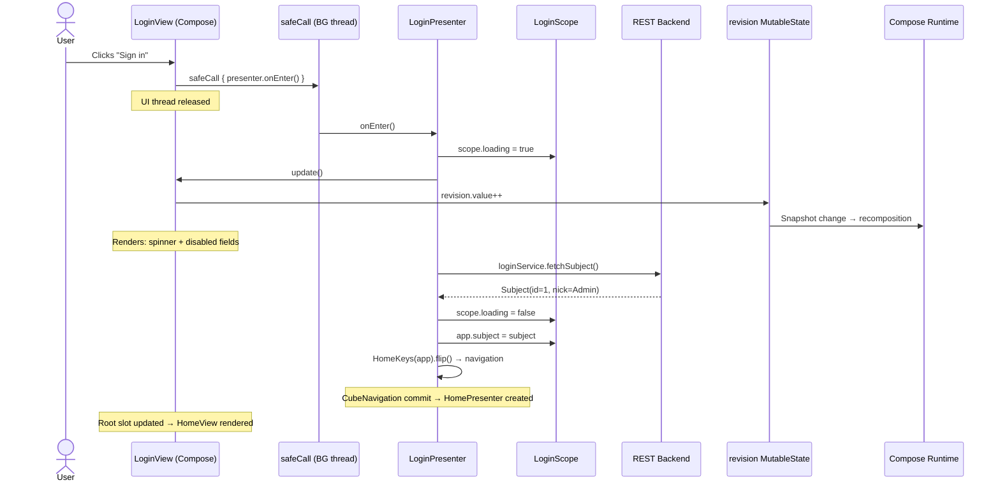
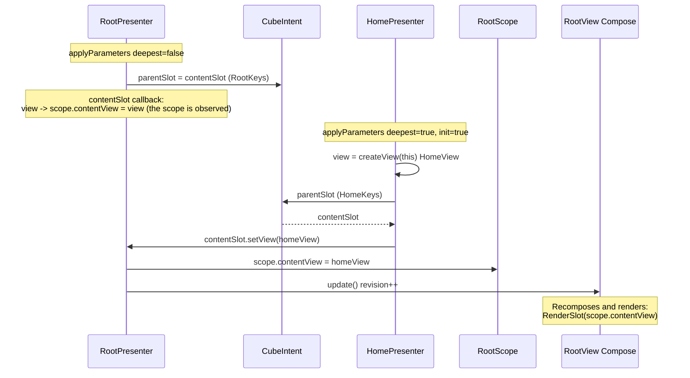
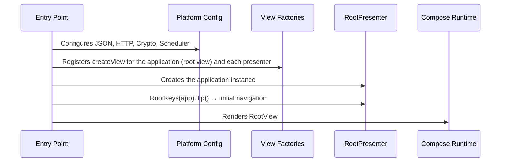
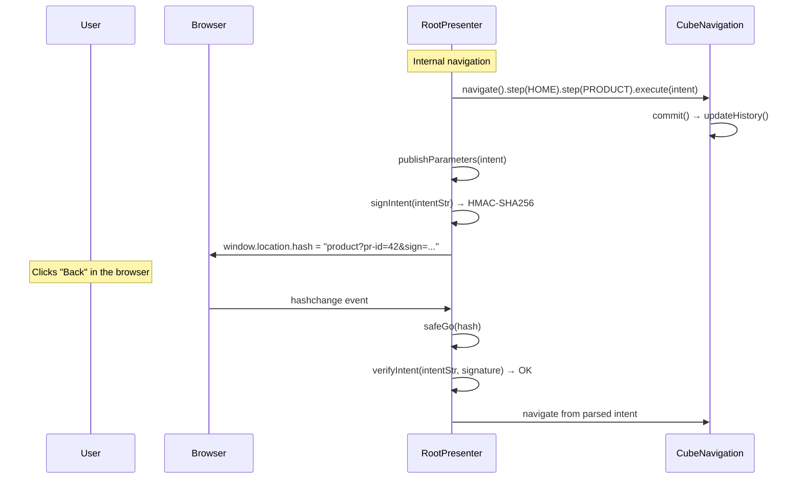
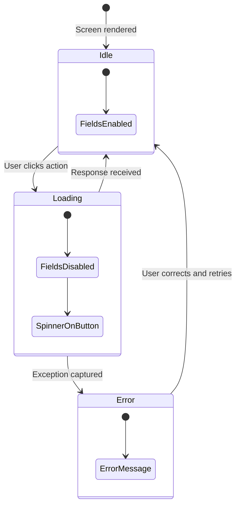

# Cube + Compose Architecture — Integration with Compose Multiplatform

## Contents

- [Overview](#overview)
- [Bridge Layer — ComposeCubeView](#bridge-layer--composecubeview)
  - [Revision Counter](#revision-counter)
  - [safeCall — Serialized Asynchronous Execution](#safecall--serialized-asynchronous-execution)
  - [RenderSlot — View Composition](#renderslot--view-composition)
- [Registering View Factories](#registering-view-factories)
- [Complete Flow: From Action to Pixel](#complete-flow-from-action-to-pixel)
- [View Implementation Pattern](#view-implementation-pattern)
- [Slot Mechanism in Compose](#slot-mechanism-in-compose)
- [Per-Platform Initialization](#per-platform-initialization)
  - [Desktop (JVM)](#desktop-jvm)
  - [Web (wasmJs)](#web-wasmjs)
  - [Android](#android)
  - [iOS](#ios)
- [Deep-Linking and History (Web)](#deep-linking-and-history-web)
- [Loading Pattern](#loading-pattern)

---

## Overview

Cube integrates with Compose Multiplatform through a minimal **bridge layer** — the `ComposeCubeView` class. This layer solves three problems:

1. **Recomposition** — how to notify Compose that state has changed, without relying on `MutableState` in presenters
2. **Threading** — how to run presenter logic off the UI thread, keeping the UI responsive
3. **Hierarchical composition** — how to render child views inside parent views, without coupling

The presenter stays **pure Kotlin** — it knows nothing about Compose and imports no `androidx` package. The whole Compose dependency is concentrated in the view.



---

## Bridge Layer — ComposeCubeView

### Revision Counter

`ComposeCubeView` implements `CubeView` and exposes a `MutableState<Int>` named `revision`. The presenter calls `update()`, which increments `revision.value`. Because `@Composable Render()` reads that value, Compose detects the change and schedules a recomposition.

```kotlin
abstract class ComposeCubeView(
    private val id: String,
    protected val app: RootPresenter
) : CubeView {

    val revision: MutableState<Int> = mutableIntStateOf(0)

    override fun update() {
        revision.value++  // Thread-safe, triggers recomposition
    }

    @Composable
    abstract fun Render()
}
```

**Why it works:**



1. Compose's `MutableState` is **thread-safe** — changes on any thread are detected by the snapshot system
2. Reading `revision.value` inside the `@Composable` creates an automatic **subscription**
3. When the value changes, Compose schedules a **recomposition** on the UI thread
4. Multiple calls to `update()` in the same frame are **coalesced** into a single recomposition

### safeCall — Serialized Asynchronous Execution

`safeCall` dispatches the presenter action to a **coroutine with parallelism limited to 1**:

```kotlin
protected fun safeCall(action: () -> Unit) {
    presenterScope.launch {
        try {
            action()
        } catch (e: Exception) {
            app.alertUnexpectedError(LOG, "Unexpected error in $id", e)
        }
    }
}

companion object {
    private val presenterScope = CoroutineScope(
        Dispatchers.Default.limitedParallelism(1)
    )
}
```

This guarantees:

| Property | How |
|----------|-----|
| **Free UI thread** | The action runs in the background — the interface stays responsive |
| **Serial execution** | `limitedParallelism(1)` — scope mutations never run concurrently |
| **Synchronous code in the presenter** | The presenter writes linear code, with no callbacks or suspending functions |
| **Captured errors** | Unhandled exceptions are delegated to `RootPresenter.alertUnexpectedError()` |



### RenderSlot — View Composition

The `RenderSlot` function turns a generic `CubeView` into a `@Composable` call:

```kotlin
@Composable
fun RenderSlot(view: CubeView) {
    (view as? ComposeCubeView)?.Render()
}
```

Parent views use it to render child views without knowing their concrete type. The parent view only knows that the presenter's `scope` holds a `CubeView`:

```kotlin
// Inside RootView.Render():
val contentView = scope.contentView
if (contentView != null) {
    RenderSlot(contentView)
}
```

---

## Registering View Factories

Each presenter declares a static `createView` variable that accepts a factory function:

```kotlin
// In the presenter (pure Kotlin — no Compose dependency):
class LoginPresenter(app: RootPresenter) : AbstractCubePresenter<RootPresenter>(app) {

    companion object {
        var createView: ((LoginPresenter) -> CubeView)? = null
    }

    override fun applyParameters(intent: CubeIntent, initialization: Boolean, deepest: Boolean): Boolean {
        if (initialization) {
            view = createView?.invoke(this)  // ← calls the factory
        }
        // ...
    }
}
```

In each platform's **entry point**, the factories are registered, binding presenters to concrete views:

```kotlin
// At startup (e.g. Desktop Main.kt):
RootPresenter.createView = { p -> RootView(p) }
LoginPresenter.createView    = { p -> LoginView(p) }
HomePresenter.createView     = { p -> HomeView(p) }
CartPresenter.createView     = { p -> CartView(p) }
ProductPresenter.createView  = { p -> ProductView(p) }
ReceiptPresenter.createView  = { p -> ReceiptView(p) }
ProductsPanelPresenter.createView  = { p -> ProductsPanelView(p) }
PurchasesPanelPresenter.createView = { p -> PurchasesPanelView(p) }
```



This mechanism lets:

- The presenter **not know** the concrete view class
- Different platforms register **different views** for the same presenter
- Tests leave the factory `null` — the presenter works without a view
- The React modality skip registering factories — the Skeletons take the role of the view

---

## Complete Flow: From Action to Pixel

The diagram below shows the complete flow from a user action to rendering:



---

## View Implementation Pattern

Every Compose view follows the same pattern:

```kotlin
class LoginView(private val presenter: LoginPresenter)
    : ComposeCubeView("login-view", presenter.app) {

    @Composable
    override fun Render() {
        // (1) Subscribes to recomposition
        @Suppress("UNUSED_VARIABLE")
        val rev = revision.value

        // (2) Reads the presenter's scope
        val scope = presenter.scope
        val loading = scope.loading

        // (3) Uses remember for local UI state (text fields)
        var userName by remember { mutableStateOf(scope.userName ?: "") }

        // (4) Renders the UI by reading the scope
        OutlinedTextField(
            value = userName,
            onValueChange = {
                userName = it
                scope.userName = it  // ← direct mutation of the scope
            },
            enabled = !loading,
        )

        // (5) Actions delegate to the presenter via safeCall
        Button(
            onClick = { safeCall { presenter.onEnter() } },
            enabled = !loading,
        ) {
            if (loading) {
                CircularProgressIndicator()
            } else {
                Text("Sign in")
            }
        }
    }
}
```

**Key points:**

| Step | What it does | Why |
|------|--------------|-----|
| `revision.value` | Creates a Compose subscription | Without it, the view does not recompose when `update()` is called |
| `presenter.scope` | Accesses the presenter's mutable scope | The scope is read directly — no copies, no mapping |
| `remember` | Keeps local UI state | Text fields need local state for smooth typing |
| `scope.userName = it` | Direct mutation | The scope is mutable by design — simplicity > ceremony |
| `safeCall { ... }` | Dispatches the action to the background | Free UI thread, guaranteed serial execution |

---

## Slot Mechanism in Compose

The slot connects parent and child views without direct coupling. The flow:



**In the RootPresenter code** (the root presenter is the application: it extends `CubeApplication`, is the root of the place tree and the presenter of the root view):

```kotlin
abstract class RootPresenter : CubeApplication(), PresenterBase {

    val scope = RootScope().also { it.observe(::update) }

    var view: CubeView? = null
        private set

    // Callback that receives the child view and stores it in the scope (observed: the root view repaints)
    private val contentSlot = CubeViewSlot { v -> if (scope.contentView !== v) scope.contentView = v }

    fun update() {
        view?.update()
    }

    // Runs in every navigation, before the first step
    override suspend fun applyParameters(intent: CubeIntent, initialization: Boolean, deepest: Boolean): Boolean {
        if (initialization) {
            view = createView?.invoke(this)
            restoreSubjectFromSession()
        }
        if (deepest) {                       // navigation to the root itself: go on to the home
            HomeKeys(this, intent).flip()
            return false
        }
        // Publishes the slot in the intent so the first step can use it
        RootKeys(this, intent).parentSlot = contentSlot
        return true
    }

    companion object {
        var createView: ((RootPresenter) -> CubeView)? = null
    }
}
```

**In the RootView code (Compose):**

```kotlin
class RootView(private val presenter: RootPresenter)
    : ComposeCubeView("root-view", presenter) {

    @Composable
    override fun Render() {
        val rev = revision.value

        val scope = presenter.scope
        Box(modifier = Modifier.fillMaxSize()) {
            val contentView = scope.contentView
            if (contentView != null) {
                RenderSlot(contentView)  // ← renders the child view
            }
            // scope.errorMessage → Snackbar (the unexpected-error alert)
        }
    }
}
```

`RootScope.contentView` has type `CubeView` — the parent view does not know whether it is `HomeView`, `LoginView` or another one. It just calls `RenderSlot`, and Compose renders the right content.

---

## Per-Platform Initialization

Each platform has an entry point that follows the same pattern:



### Desktop (JVM)

```kotlin
fun main() {
    initializePlatform(baseUrl)  // JSON, HTTP, Crypto, Scheduler, View Factories

    val app = DesktopRootPresenter()
    RootKeys(app).flip()

    application {
        Window(title = "Storefront", ...) {
            ShoppingTheme {
                (app.view as? RootView)?.Render()
            }
        }
    }
}
```

- `ScheduledExecutor`: Swing `javax.swing.Timer`
- `SessionStorage`: `java.util.prefs.Preferences`
- `updateHistory()`: no-op (no browser)

### Web (wasmJs)

```kotlin
fun main() {
    initializePlatform(baseUrl)

    val app = ComposeRootPresenter()
    restoreAuthState(app)

    val hash = getLocationHash()
    if (hash.isNotBlank()) app.safeGo(hash) else RootKeys(app).flip()

    jsOnHashChange {
        val newHash = getLocationHash()
        if (newHash != app.fragment) app.safeGo(newHash)
    }

    ComposeViewport(document.getElementById("ComposeTarget")!!) {
        ShoppingTheme {
            (app.view as? RootView)?.Render()
        }
    }
}
```

- `ScheduledExecutor`: `setTimeout` / `setInterval`
- `SessionStorage`: `window.sessionStorage`
- `updateHistory()`: updates `window.location.hash` with an HMAC-signed intent

### Android

```kotlin
class MainActivity : ComponentActivity() {
    override fun onCreate(savedInstanceState: Bundle?) {
        initializePlatform(baseUrl)

        val app = AndroidRootPresenter(this)
        RootKeys(app).flip()

        setContent {
            ShoppingTheme {
                (app.view as? RootView)?.Render()
            }
        }
    }
}
```

- `ScheduledExecutor`: Android `Handler` + `Looper`
- `SessionStorage`: `SharedPreferences`
- `updateHistory()`: no-op

### iOS

```kotlin
fun MainViewController() = ComposeUIViewController {
    initializePlatform(baseUrl)

    val app = IosRootPresenter()
    RootKeys(app).flip()

    ShoppingTheme {
        (app.view as? RootView)?.Render()
    }
}
```

- `ScheduledExecutor`: `dispatch_queue`
- `SessionStorage`: `NSUserDefaults`
- `updateHistory()`: no-op

---

## Deep-Linking and History (Web)

On the Web platform, Cube navigation is synchronized with the browser's `location.hash`, enabling deep-linking and the back/forward buttons.



The HMAC signature ensures that manually tampered URLs are rejected. The signing secret is:
- **Before login:** a fixed anonymous key
- **After login:** a per-session secret received from the server

---

## Loading Pattern

With `safeCall` running off the UI thread, loading indicators come naturally:



**In the presenter** (synchronous, linear code):

```kotlin
fun onEnter() {
    scope.loading = true  // → UI shows spinner (the scope is observed: no update() call)

    try {
        val subject = loginService.fetchSubject(scope.userName ?: "", scope.password ?: "")
        scope.loading = false

        if (subject?.id != null) {
            app.subject = subject
            HomeKeys(app).flip()
        } else {
            scope.errorMessage = "Username or password not recognized!"
        }
    } catch (caught: Exception) {
        scope.loading = false
        scope.errorMessage = "Failed to communicate with the server. Check your connection."
    }
}
```

**In the view** (Compose reacts automatically):

```kotlin
Button(
    onClick = { safeCall { presenter.onEnter() } },
    enabled = !loading,
) {
    if (loading) CircularProgressIndicator() else Text("Sign in")
}
```

The presenter changes `scope.loading`; the observed `Scope` calls `update()`, and Compose recomposes. No callbacks, no observers, no explicit bindings.
