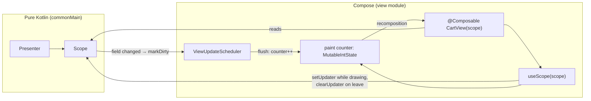
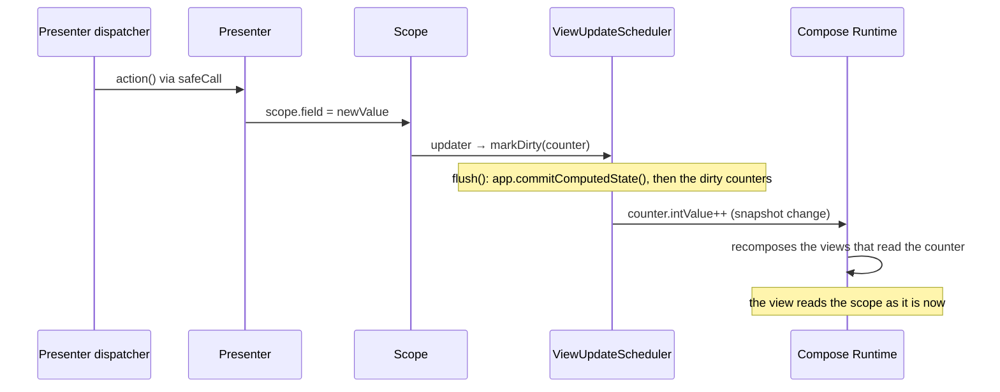
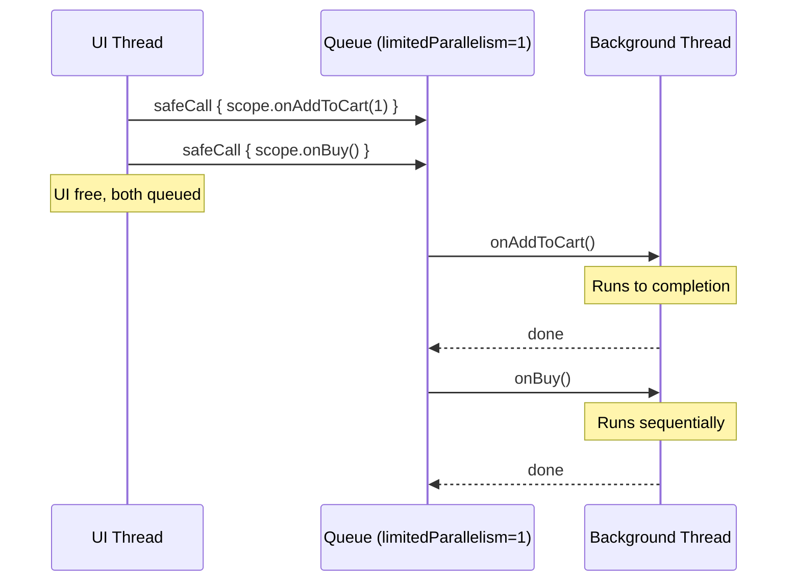
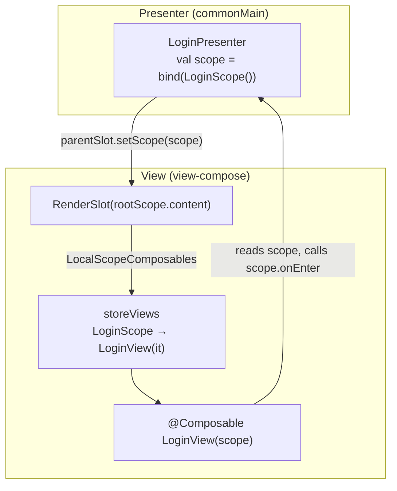
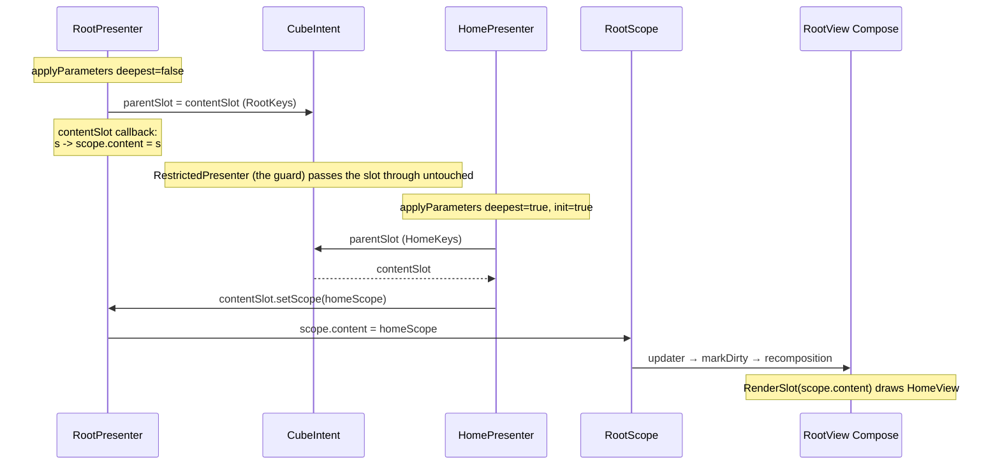
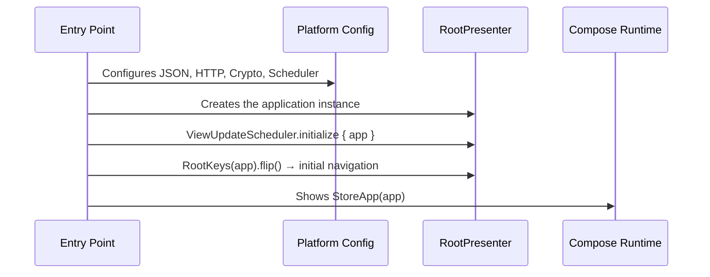
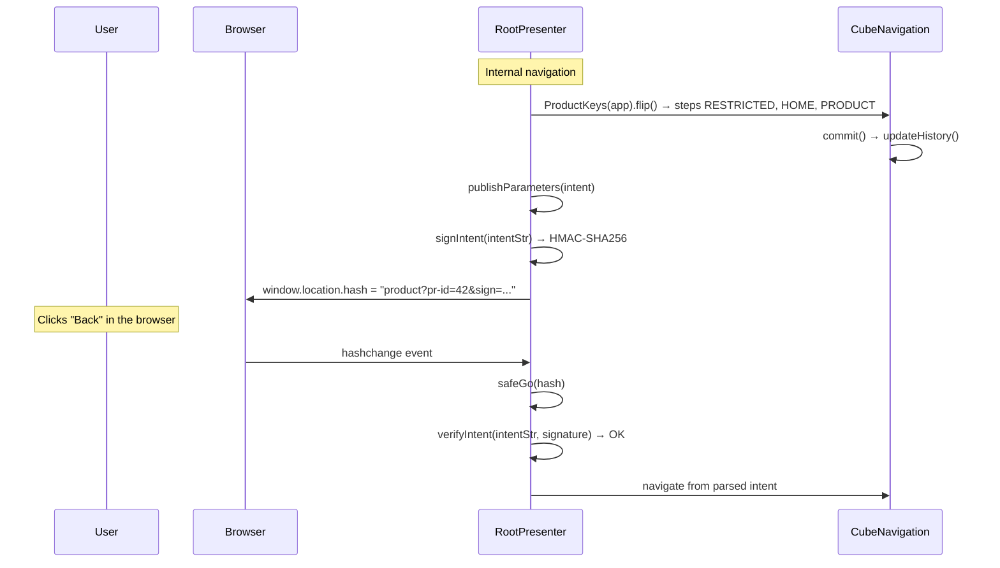
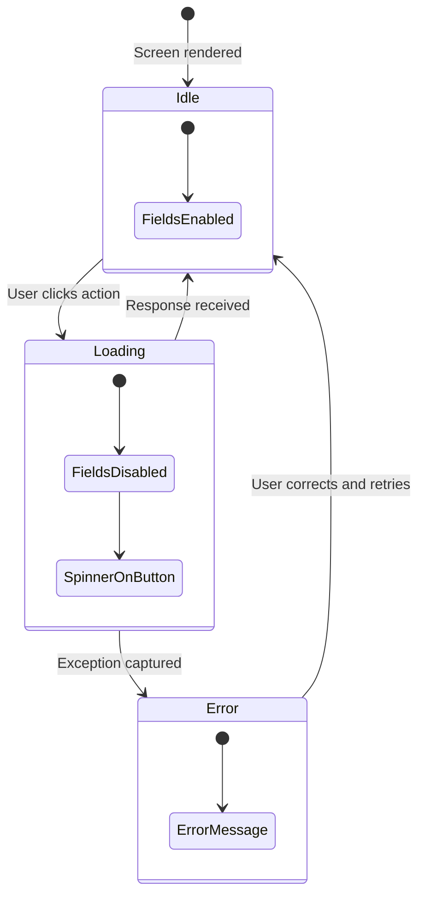

# Cube + Compose Architecture — Integration with Compose Multiplatform

## Contents

- [Overview](#overview)
- [Bridge Layer](#bridge-layer)
  - [useScope — the Updater and the Lifecycle](#usescope--the-updater-and-the-lifecycle)
  - [The Paint Cycle](#the-paint-cycle)
  - [safeCall — Serialized Asynchronous Execution](#safecall--serialized-asynchronous-execution)
  - [RenderSlot — View Composition](#renderslot--view-composition)
- [The View Catalog](#the-view-catalog)
- [Complete Flow: From Action to Pixel](#complete-flow-from-action-to-pixel)
- [View Implementation Pattern](#view-implementation-pattern)
- [Slot Mechanism in Compose](#slot-mechanism-in-compose)
- [Per-Platform Initialization](#per-platform-initialization)
  - [Desktop (JVM)](#desktop-jvm)
  - [Web (wasmJs)](#web-wasmjs)
  - [Android](#android)
  - [iOS](#ios)
- [Deep-Linking and History (Web)](#deep-linking-and-history-web)
- [Loading Pattern](#loading-pattern)

---

## Overview

Cube integrates with Compose Multiplatform through a small **bridge layer** (`bridge/` in `:view-compose`). It solves four problems:

1. **Recomposition** — how to tell Compose that a scope changed, without `MutableState` in presenters
2. **Lifecycle** — when a view starts and stops listening to its scope, without anyone releasing views
3. **Threading** — how to run presenter logic off the UI thread, keeping the UI responsive
4. **Hierarchical composition** — how to render a child view inside a parent view, without coupling

A Compose view is a **function of its scope** — `@Composable fun CartView(scope: CartScope)` — with no object behind it, as in the TypeScript version of the framework. The presenter stays **pure Kotlin**: it knows nothing about Compose and imports no `androidx` package.



---

## Bridge Layer

### useScope — the Updater and the Lifecycle

Every view starts with `useScope(scope)`. It keeps a paint counter (`MutableIntState`) for that view, reads it (so Compose recomposes the view when it changes), and installs itself as the scope's **updater** (`scope.setUpdater`) as it starts drawing — in the composable's body, before it reads the scope, so no change is lost. On each change, the scope calls the updater, which marks the counter dirty in the `ViewUpdateScheduler`. When the view leaves the composition, a `DisposableEffect` takes the updater back (`clearUpdater`, which does nothing if another view has installed its own since).

```kotlin
@Composable
fun <S : Scope> useScope(scope: S): S {
    val painted = remember(scope) { mutableIntStateOf(0) }
    val updater: () -> Unit = remember(scope) { { ViewUpdateScheduler.markDirty(painted) } }
    painted.intValue // read here, so the scheduler's bump recomposes this view
    scope.setUpdater(updater)
    DisposableEffect(scope) {
        onDispose {
            scope.clearUpdater(updater)
            ViewUpdateScheduler.removeDirty(painted)
        }
    }
    return scope
}
```

So **no view is released by hand**: the composition is the lifecycle, and Compose drops what leaves the screen. A view on screen draws its scope; a view that left does not. A scope has one updater, so one view draws a scope at a time (the Home draws each panel in its compact *or* its wide layout, never both). The technologies that keep view objects (native iOS and Android, the remote React host) release them themselves — see [architecture-cube.md](architecture-cube.md#the-views-and-their-lifecycle).

### The Paint Cycle

`ViewUpdateScheduler` collects the dirty views and paints them once per cycle. A change schedules a flush on the presenters' dispatcher (once per round, like `requestAnimationFrame` on the web), so a change made outside a view action — the initial navigation, a timer — still reaches the screen; `safeCall` also flushes when the action ends. The flush:

1. runs the application's `commitComputedState()` once (every live presenter's) — what it changes marks views dirty and joins the same cycle;
2. bumps the paint counter of each dirty view, which Compose recomposes on the UI thread.



Several changes in a row cost one recomposition per view. The dirty set is touched only on the presenters' single-threaded dispatcher; the composition (UI thread) reaches it through `removeDirty`, which launches on it.

### safeCall — Serialized Asynchronous Execution

`safeCall` (a top-level function of the bridge) dispatches a scope action to the application's **coroutine with parallelism limited to 1** (`RootPresenter.presenterScope`, reached through the scheduler):

```kotlin
fun safeCall(action: suspend () -> Unit) {
    ViewUpdateScheduler.safeCall(action)   // presenterScope.launch { try action() catch → alertUnexpectedError finally flush() }
}
```

The view calls the action fields of its scope: `safeCall { scope.onBuy() }`. Each action has its own guard in the presenter (an unhandled failure becomes `"Unexpected error: <cause>"`), so the `catch` only sees failures of the view's own code.

| Property | How |
|----------|-----|
| **Free UI thread** | The action runs in the background — the interface stays responsive |
| **Serial execution** | `limitedParallelism(1)` — scope mutations never run concurrently |
| **Linear code in the presenter** | The presenter writes linear `suspend` code, with no callbacks |
| **Captured errors** | Unhandled exceptions are delegated to `RootPresenter.alertUnexpectedError()` |



### RenderSlot — View Composition

`RenderSlot(scope)` draws the view of a scope (nothing for `null`), found in the catalog the entry point provides (`LocalScopeComposables`), keyed by the scope:

```kotlin
@Composable
fun RenderSlot(scope: Scope?) {
    if (scope == null) return
    val views = LocalScopeComposables.current
    key(scope) { views.Render(scope) }
}
```

The parent's scope holds the child's **scope**, and the parent view hands it to the slot: `RenderSlot(scope.content)`. Views in slots are **independent of their parent**: the Compose compiler (strong skipping) skips `RenderSlot` while it gets the same scope, and remembers the lambdas created in a render, so a parent repaint repaints neither the child in the slot nor a child that receives `{ scope.onX(id) }`. The key makes a different scope in the same slot a new view, with fresh `remember` state (the quantity being chosen on another product starts over).

In a list, key each row **where the list calls it**, so a row keeps its view when the rows before it come or go (the key inside `RenderSlot` only tells apart the scopes of one slot):

```kotlin
for (row in scope.rows) key(row) { RenderSlot(row) }
```

`RecompositionTest` (jvmTest of `:view-compose`) pins all of this down: the parent does not repaint the child, the child does not repaint the parent, another scope in the slot is a new view, rows repaint one by one and keep their views when the list changes.

---

## The View Catalog

Presenters do not create views. The Compose layer has **one catalog** (`ScopeComposables`: scope class → composable), `storeViews` in `views/StoreViews.kt`, and one root composable that provides it and draws the root scope:

```kotlin
val storeViews: ScopeComposables = ScopeComposables()
    .register<RootScope> { RootView(it) }
    .register<LoginScope> { LoginView(it) }
    .register<HomeScope> { HomeView(it) }
    .register<CartScope> { CartView(it) }
    .register<CartItemScope> { CartItemView(it) }
    .register<ProductScope> { ProductView(it) }
    .register<ReceiptScope> { ReceiptView(it) }
    .register<ProductsPanelScope> { ProductsPanelView(it) }
    .register<PurchasesPanelScope> { PurchasesPanelView(it) }

@Composable
fun StoreApp(app: RootPresenter) {
    CompositionLocalProvider(LocalScopeComposables provides storeViews) {
        RenderSlot(app.scope)
    }
}
```

Every Compose entry point (web, desktop, Android, iOS) shows `StoreApp(app)`.



This lets:

- The presenter **not know** any view: it only shows its scope
- Different view layers draw **different views** for the same scope (Compose, native, the remote React skeleton)
- A new screen be registered **once per view layer**; a scope with no view in the catalog fails naming its class

---

## Complete Flow: From Action to Pixel

```mermaid
sequenceDiagram
    actor User as User
    participant View as LoginView (Compose)
    participant SC as safeCall (BG thread)
    participant P as LoginPresenter
    participant S as LoginScope
    participant API as REST Backend
    participant SCH as ViewUpdateScheduler
    participant CR as Compose Runtime

    User->>View: Clicks "Sign in"
    View->>SC: safeCall { scope.onEnter() }
    Note over View: UI thread released

    SC->>P: onEnter → enter() (guarded)
    P->>S: scope.loading = true
    S->>SCH: markDirty (LoginView's counter)
    Note over SCH: flush: commitComputedState(), counter++
    SCH->>CR: snapshot change → recomposition
    Note over View: Renders: spinner + disabled fields

    P->>API: CredentialsCheck(userName, password).run()
    API-->>P: Subject(id, nickName)

    P->>S: scope.loading = false
    P->>P: app.subject = subject; HomeKeys(app).flip()
    Note over P: CubeNavigation commit → HomePresenter created,<br/>LoginPresenter released
    Note over View: RootScope.content = HomeScope → RenderSlot draws HomeView;<br/>LoginView leaves the composition and takes its updater back
```

---

## View Implementation Pattern

Every Compose view follows the same pattern:

```kotlin
@Composable
fun LoginView(scope: LoginScope) {
    // (1) Subscribes to the scope while on screen
    useScope(scope)

    // (2) Reads the scope it draws
    val loading = scope.loading

    // (3) remember for local UI state (text fields): fresh for each scope, since the slot keys it
    var userName by remember { mutableStateOf(scope.userName ?: "") }

    // (4) Renders the UI by reading the scope
    OutlinedTextField(
        value = userName,
        onValueChange = {
            userName = it
            scope.userName = it  // ← direct mutation of the scope
        },
        enabled = !loading,
    )

    // (5) Actions are fields of the scope, called via safeCall
    Button(
        onClick = { safeCall { scope.onEnter() } },
        enabled = !loading,
    ) {
        if (loading) CircularProgressIndicator() else Text("Sign in")
    }
}
```

**Key points:**

| Step | What it does | Why |
|------|--------------|-----|
| `useScope(scope)` | Installs the view as the scope's updater while it is in the composition | Without it, the view does not recompose when its scope changes |
| `scope` | The scope the slot passed | Read directly — no copies, no mapping, no reference to the presenter |
| `remember` | Keeps local UI state | Text fields need local state for smooth typing |
| `scope.userName = it` | Direct mutation | The scope is mutable by design — simplicity > ceremony |
| `safeCall { scope.onX(...) }` | Dispatches the action to the background | Free UI thread, guaranteed serial execution |

---

## Slot Mechanism in Compose

The slot connects parent and child presenters without direct coupling: the child hands its **scope** to the parent, which keeps it in a field of its own scope; the parent's view draws it with `RenderSlot`.



**In the RootPresenter code** (the root presenter is the application: it extends `CubeApplication`, is the root of the place tree and the presenter of the root scope):

```kotlin
abstract class RootPresenter : CubeApplication(PLACES), PresenterBase {

    // What the root view shows; each view layer draws it
    val scope = RootScope()

    // Callback that receives the child's scope and stores it in the root scope
    private val contentSlot = ScopeSlot { if (scope.content !== it) scope.content = it }

    // Runs in every navigation, before the first step
    override suspend fun applyParameters(intent: CubeIntent, initialization: Boolean, deepest: Boolean): Boolean {
        if (initialization) restoreSubjectFromSession()
        if (deepest) {                       // navigation to the root itself: the restricted area decides (home or login)
            RestrictedKeys(this, intent).flip()
            return false
        }
        // Publishes the slot in the intent so the first step can use it
        RootKeys(this, intent).parentSlot = contentSlot
        return true
    }
}
```

**In the RootView code (Compose):**

```kotlin
@Composable
fun RootView(scope: RootScope) {
    useScope(scope)

    Box(modifier = Modifier.fillMaxSize()) {
        RenderSlot(scope.content)  // ← draws the child view
        // scope.errorMessage → Snackbar (the unexpected-error alert)
    }
}
```

`RootScope.content` has type `Scope` — neither the root presenter nor the root view knows whether it is the home or the login; the catalog picks the view. The same holds for the Home's content and its two panels (segments: `HomeScope.productsPanel`, `purchasesPanel`), and for the cart rows (`CartScope.rows`, each drawn by `CartItemView`).

---

## Per-Platform Initialization

Each platform has an entry point that follows the same pattern:



### Desktop (JVM)

```kotlin
fun main() {
    initializePlatform(baseUrl)  // JSON, HTTP, Crypto, Scheduler

    val app = DesktopRootPresenter()
    ViewUpdateScheduler.initialize { app }
    runBlocking { RootKeys(app).flip() }

    application {
        Window(title = "WDC Store", ...) {
            StoreTheme {
                StoreApp(app)
            }
        }
    }
}
```

- `ScheduledExecutor`: Swing `javax.swing.Timer`
- `SessionStorage`: `JvmSessionStorage` (in memory, lost when the app closes)
- `updateHistory()`: no-op (no browser)

### Web (wasmJs)

```kotlin
fun main() {
    initializePlatform(baseUrl)

    val app = ComposeRootPresenter()
    ViewUpdateScheduler.initialize { app }
    restoreAuthState(app)

    ViewUpdateScheduler.launchPresenterAction {
        val hash = getLocationHash()
        if (hash.isNotBlank()) app.safeGo(hash) else RootKeys(app).flip()
    }

    jsOnHashChange {
        ViewUpdateScheduler.launchPresenterAction {
            val newHash = getLocationHash()
            if (newHash != app.fragment) {
                if (newHash.isNotBlank()) app.safeGo(newHash) else RootKeys(app).flip()
            }
        }
    }

    ComposeViewport(document.getElementById("ComposeTarget")!!) {
        StoreTheme {
            StoreApp(app)
        }
    }
}
```

- `ScheduledExecutor`: `setTimeout`
- `SessionStorage`: `window.sessionStorage`
- `updateHistory()`: updates `window.location.hash` with an HMAC-signed intent

### Android

```kotlin
class MainActivity : ComponentActivity() {
    override fun onCreate(savedInstanceState: Bundle?) {
        initializePlatform(BuildConfig.BASE_URL)

        val prefs = getSharedPreferences("wdc_session", MODE_PRIVATE)
        app = AndroidRootPresenter(AndroidPersistentSessionStorage(prefs))
        ViewUpdateScheduler.initialize { app }
        runBlocking { RootKeys(app).flip() }

        setContent {
            StoreTheme {
                StoreApp(app)
            }
        }
    }
}
```

- `ScheduledExecutor`: Android `Handler` + `Looper`
- `SessionStorage`: `AndroidPersistentSessionStorage` (`SharedPreferences`, each value encrypted with a key in the Android Keystore)
- `updateHistory()`: no-op

### iOS

```kotlin
fun MainViewController(baseUrl: String): UIViewController {
    initializePlatform(baseUrl)

    val app = IosRootPresenter()
    ViewUpdateScheduler.initialize { app }
    runBlocking { RootKeys(app).flip() }

    return ComposeUIViewController {
        StoreTheme {
            StoreApp(app)
        }
    }
}
```

- `ScheduledExecutor`: `dispatch_async` / `dispatch_after` on the main queue
- `SessionStorage`: `IosPersistentSessionStorage` (the Keychain)
- `updateHistory()`: no-op

---

## Deep-Linking and History (Web)

On the Web platform, Cube navigation is synchronized with the browser's `location.hash`, enabling deep-linking and the back/forward buttons.



The HMAC signature ensures that manually tampered URLs are rejected. The signing secret is:
- **Before login:** a fixed anonymous key
- **After login:** a per-session secret received from the server

---

## Loading Pattern

With `safeCall` running off the UI thread, loading indicators come naturally:



**In the presenter** (linear code; the body of the `onEnter` action, bound in the constructor with `scope.onEnter = action(1) { enter() }`; the view has put the user name and password in the scope):

```kotlin
private suspend fun enter() {
    scope.loading = true  // → UI shows spinner (the view is the scope's updater)

    try {
        val subject = CredentialsCheck(
            userName = scope.userName ?: "",
            password = scope.password ?: "",
        ).run()
        scope.loading = false

        if (subject?.id != null) {
            app.subject = subject
            HomeKeys(app).flip()
        } else {
            scope.errorMessage = "Username or password not recognized!"
        }
    } catch (caught: Exception) {
        scope.loading = false
        scope.errorMessage = "Failed to communicate with the server. Check your connection."
    }
}
```

**In the view** (Compose reacts automatically):

```kotlin
Button(
    onClick = { safeCall { scope.onEnter() } },
    enabled = !loading,
) {
    if (loading) CircularProgressIndicator() else Text("Sign in")
}
```

The presenter changes `scope.loading`; the scope tells the view that draws it (its updater, installed by `useScope`), and Compose recomposes. No callbacks in the presenter, no explicit bindings.
