# Cube Architecture — Navigation Mechanism

## Table of Contents

- [Overview](#overview)
- [Core Components](#core-components)
  - [CubePlace](#cubeplace)
  - [CubePresenter](#cubepresenter)
  - [CubeIntent](#cubeintent)
  - [ScopeSlot](#scopeslot)
  - [Scope](#scope)
  - [Actions](#actions)
  - [Segments](#segments)
  - [Keys classes](#keys-classes)
  - [CubeView and the view catalog](#cubeview-and-the-view-catalog)
  - [CubeApplication](#cubeapplication)
  - [CubeNavigation](#cubenavigation)
- [Internal Data Model](#internal-data-model)
- [Navigation Cycle — Step by Step](#navigation-cycle--step-by-step)
  - [1. Building the Route](#1-building-the-route)
  - [2. Executing the Steps](#2-executing-the-steps)
  - [3. Commit — Successful Navigation](#3-commit--successful-navigation)
  - [4. Rollback — Navigation Failure](#4-rollback--navigation-failure)
- [Interruption and Redirect](#interruption-and-redirect)
  - [The Problem](#the-problem)
  - [The Solution — Presenter Migration](#the-solution--presenter-migration)
  - [Detailed Flow of an Interruption](#detailed-flow-of-an-interruption)
  - [Chained Interruptions](#chained-interruptions)
- [Mechanism Guarantees](#mechanism-guarantees)
- [Release Order — Leaf-First](#release-order--leaf-first)
- [Protection Against Infinite Recursion](#protection-against-infinite-recursion)
- [Complete Scenarios](#complete-scenarios)
  - [Normal Navigation with Reuse](#normal-navigation-with-reuse)
  - [Redirect during Navigation](#redirect-during-navigation)
  - [Rollback after an Exception](#rollback-after-an-exception)
- [Suspend and Coroutines in Cube MVP](#suspend-and-coroutines-in-cube-mvp)
  - [The Execution Model](#the-execution-model)
  - [The presenterScope — Serializing Actions](#the-presenterscope--serializing-actions)
  - [The Suspend / Synchronous Boundary](#the-suspend--synchronous-boundary)
  - [The safeCall Pattern — Bridge between View and Presenter](#the-safecall-pattern--bridge-between-view-and-presenter)
  - [Presenter Lifecycle and Suspend](#presenter-lifecycle-and-suspend)
  - [Segments — Panels without a Presenter](#segments--panels-without-a-presenter)
  - [When to Use and When NOT to Use Suspend](#when-to-use-and-when-not-to-use-suspend)
  - [Practical Rules for the Developer](#practical-rules-for-the-developer)
  - [Parallel Asynchronous Dispatch — Fire-and-Forget with a Result](#parallel-asynchronous-dispatch--fire-and-forget-with-a-result)

---

## Overview

Cube is an **application state management** solution based on the MVP (Model-View-Presenter) pattern. Unlike approaches that require immutable, unidirectional state, Cube uses **mutable scopes**: presenters manipulate the values their views show (a `Scope`) directly, and the view re-renders when they change. This decision simplifies presentation code by eliminating the ceremony of immutable copies and reducers.

A central principle of the architecture is the **complete decoupling of presentation logic from the view technology**. Presenters are plain Kotlin classes with no dependency on any UI framework. The rendering technology (Compose Multiplatform, React, SwiftUI or anything else) is a **project choice**, not something the framework imposes. This lets the same presentation code be shared across different platforms, each implementing only the view layer.

`CubeNavigation` is the framework's navigation engine. It orchestrates the **presenter lifecycle** during screen transitions, treating navigation as an **atomic transaction**: either all steps are applied successfully (commit), or the previous state is restored (rollback).

The mechanism was designed to handle a critical scenario: **redirects during navigation**. A presenter may, inside `applyParameters()`, start a new navigation (for example, redirecting an unauthenticated user to the login screen). This **interrupts** the current navigation and starts another, and the framework guarantees that no created presenter is lost without having `release()` called.

---

## Core Components

### CubePlace

Represents a **navigation destination**. Each Place has:

- **`id: Int`**: unique numeric identifier, used as the key in the presenter map
- **`placeName: String`**: symbolic name for deep-linking (e.g. `"home"`, `"product"`)
- **`presenterFactory()`**: factory function that creates the associated `CubePresenter` instance

```kotlin
interface CubePlace {
    val id: Int
    val placeName: String
    fun <A : CubeApplication> presenterFactory(): (A) -> CubePresenter
}
```

IDs follow a **hierarchical convention**: lower IDs represent nodes closer to the root, and higher IDs represent leaves. The release order relies on this convention (leaf-first, i.e. higher IDs first).

**`CubeTreePlace`** is the implementation applications use: a place that knows its `parent`, so its `path` from the root is the navigation that reaches it. The tree hangs from `CubeTreePlace.ROOT`, which stands for the application itself: it has no presenter, its id is -1, its name is empty, and it is not a step of any path (`path` leaves it out). Top-level places are `CubeTreePlace.ROOT.child(name, factory)`, and `place.child(name, factory)` nests a place in another. Ids grow in creation order and a child is always created after its parent, so the convention above holds by construction. `placeName` is what the address carries, given as is. `app.flip(place, intent)` steps through the path: it is what the keys classes call (next section).

### CubePresenter

Interface every presenter must implement. It defines the lifecycle contract:

```kotlin
interface PresenterBase {
    val app: CubeApplication
    fun commitComputedState() {}
    fun release()
}

interface CubePresenter : PresenterBase {
    suspend fun applyParameters(intent: CubeIntent, initialization: Boolean, deepest: Boolean): Boolean
    fun publishParameters(intent: CubeIntent) {}
    override fun release()
}
```

| Method | When it is called | Responsibility |
|--------|-----------------|------------------|
| `applyParameters` | During `execute()` | Receive parameters, load what to show, hand the scope to the parent's slot (`parentSlot?.setScope(scope)`). Returns `true` to continue, `false` to stop. |
| `publishParameters` | During `newIntent()` | Export the presenter's current state to the intent (for deep-linking and history). |
| `commitComputedState` | Once per paint cycle, right before the scopes are read for painting | Compute the derived fields the view reads. The view layer's scheduler calls `CubeApplication.commitComputedState()`, which runs every live presenter's. |
| `release` | When the presenter is discarded | Free resources (listeners, connections) and the views of its scope and segments. **Called exactly once.** |

Presenters extend **`AbstractCubePresenter`**, which extends **`AbstractPresenter`**: the application, the bound scope (`bind`), the segments (`segment`, `detach`) and the guarded actions (`action`, `actionOf`, `actionOf2`, `onEvent`). A presenter never creates a view.

### CubeIntent

Data container that travels through the navigation hierarchy. It carries two kinds of data:

- **Parameters** (`MutableMap<String, Any?>`): serializable route data, used for deep-linking and browser history (e.g. `pr-id=42`)
- **Attributes** (`MutableMap<String, Any?>`): ephemeral transaction data, such as the `ScopeSlot`s for parent-child wiring

```kotlin
class CubeIntent {
    var place: CubePlace?
    // Parameters: getParameterAsString(), setParameter(), etc.
    // Attributes: setAttribute(), getAttribute(), setScopeSlot(), getScopeSlot()
}
```

### ScopeSlot

Composition mechanism. A presenter shows its **scope**, not a view: the parent creates a slot, publishes it in the intent (the keys' `parentSlot`), and keeps what it receives in a field of its own scope. The parent's view asks the application for the view of that scope (`app.viewOf(scope)`). `null` empties the slot. There is no direct coupling between parent and child, and neither knows a view.

```kotlin
fun interface ScopeSlot {
    fun setScope(scope: Scope?)
}

// parent (HomePresenter)
private val contentSlot = ScopeSlot { setContent(it) }   // scope.content = it
HomeKeys(app, intent).parentSlot = contentSlot           // offered to the level below

// child (CartPresenter.applyParameters)
ownerSlot = CartKeys(app, intent).parentSlot             // read on every call
ownerSlot?.setScope(scope)
```

### Scope

A scope is what a presenter shows: the values its view paints, as plain mutable fields, and the actions the view calls. Extend `Scope` and declare each field with `field(...)`: assigning a value different from the current one (`!=`, so lists compare by content) asks for a repaint. The presenter binds it once, with `bind(...)`, and never calls `update()` after a change:

```kotlin
class CartScope : Scope() {
    /** One row per product in the cart, each a view of its own. */
    var rows: List<CartItemScope> by scopes()

    var total: Double by field(0.0)
    var errorCode: Int by field(0)
    var errorMessage: String? by field(null)

    var onBuy: Action = Action.NOOP
    var onOpenProducts: Action = Action.NOOP
}

class CartPresenter(app: RootPresenter) : AbstractCubePresenter<RootPresenter>(app) {
    val scope = bind(CartScope())

    private fun alertPurchaseOfEmptyCart() {
        scope.errorCode = 3
        scope.errorMessage = "…" // the view repaints; several changes in a row still cost one paint
    }
}
```

**A scope writes itself as JSON** (`write(instanceId, json, viewOf)`, `toJson(instanceId, viewOf)`), for views that receive it serialized (the remote React view), with no code per scope. `field(...)` registers each field as it is declared, and `write` follows these rules:

- the fields go out in declaration order, after `"id"` (the view instance);
- `null` and blank strings are left out; numbers and booleans always go;
- a field holding a `Scope` (the scope of the level below, a segment) goes as `"<name>ViewId"`, with the instance id of the view that draws it (`app.viewOf`); a list declared with `scopes()` goes as `"<name>ViewIds"`, empty included;
- a `CubeView` goes as `"<name>Id"`; lists, maps, enums, `ScopeValue` and `Externalizable` values are written as themselves; any other type fails, naming the field;
- a field declared with `field(initial, sent = false)` never goes (the password the user types in `LoginScope`), and plain `var`s (the actions) never go.

A struct of the presentation that a field holds implements **`ScopeValue`** (`fun writeJson(json: ExtensibleObjectOutput)`) and writes itself as one JSON value. Override `write` only for a shape these rules can't give.

**What the fields cannot see:** a change *inside* an object already assigned — an element added to a mutable list, a field of a nested object, or an object shared with someone who mutates it. Assign a new value (a copy), or call `scope.changed()`. `CartManager.getCartItems()` returns copies for this reason.

A new view needs no `update()` either: every view layer paints the current scope when the view is created. Keep in the scope what the view shows — the WDC Store home keeps the cart count as a field, set by the cart's change listener — and the presenter never calls `update()`. It is still there for state the view reads from somewhere else.

### Actions

An action is an entry point of a presenter, kept in a **field of its scope**: `Action` (no value), `ActionOf<T>` (one value) and `ActionOf2<T, U>` (two values), each with a `suspend operator fun invoke`. They start as `Action.NOOP` / `ActionOf.noop()` / `ActionOf2.noop()` and the presenter binds them once, in its constructor, with `action { … }`, `actionOf { … }` or `actionOf2 { … }` (`AbstractPresenter`):

```kotlin
init {
    scope.onBuy = action(1) { buy() }
    scope.onOpenProducts = action(3) { HomeKeys(app).flip() }
}
```

The view calls the field, inside its own launch: `safeCall { scope.onBuy() }` (Compose, native web, iOS), `safeAction("buy") { scope.onBuy() }` (native Android). A test calls it directly and sees the result on the next line. The body is a private method of the presenter; presenters no longer have public `onXxx` methods.

**The guard.** Every bound action catches what its body did not handle and hands it to `onActionFailure`, which by default calls `CubeApplication.alertUnexpectedError` (in the WDC Store the user sees `"Unexpected error: <cause>"` and the log gets the stack trace). At the end, failing or not, it calls `app.updateHistory()`, since the action may have changed what the presenters publish. Expected failures (an invalid item, an offline database) stay in the body, which turns them into messages of its own. `CancellationException` passes through.

**Remote views: event codes.** An action a remote view fires is bound with its **event code**, and with how to read its values from the form data the client sends (`FormParam.long/int/string(name)`):

```kotlin
scope.onAddToCart = actionOf(2, FormParam.int("p.quantity")) { addToCart(it) }
```

The code goes to the bound scope (or to `target`, a segment), and `Scope.dispatch(eventCode, formData)` runs it; an unknown code is an error (`IllegalArgumentException`), and binding a code twice fails. What the user typed arrives before the event by `Scope.sync(formData)`, which runs what the presenter set with `scope.onSync { … }`. An action whose values the form data can't give is handled by hand with `onEvent(code) { … }` — the login reads the user name and the ciphered password by sync, then `onEvent(1) { scope.onEnter(null, null) }`.

### Segments

A piece of the screen without navigation of its own (a panel, a row of a list) gets **no presenter**: it is a smaller scope in a field of the owner's, with a view of its own. The owner declares it with `segment(scope)` and binds its actions with `target`:

```kotlin
// HomePresenter
private val products = segment(ProductsPanelScope())
private val purchases = segment(PurchasesPanelScope())

init {
    products.onOpenProduct = actionOf(1, FormParam.long("p.productId"), target = products) { openProduct(it) }
    purchases.onPageChange = actionOf(2, FormParam.int("p.page"), target = purchases) { changePage(it ?: 0) }
}
// in applyParameters: scope.productsPanel = products; scope.purchasesPanel = purchases
```

A change in a segment repaints its view, or the owner's until the segment has one. Its view is released with the owner; `detach(segment)` releases one that left the screen (a cart row whose product was removed). See [Segments — Panels without a Presenter](#segments--panels-without-a-presenter).

### Keys classes

The names a place reads from and writes to the `CubeIntent` live in **one keys class per place**, named after it (`RootKeys`, `LoginKeys`, `HomeKeys`, `CartKeys`, `ProductKeys`, `ReceiptKeys`), with typed properties, on the framework's `CubeKeys` (the application, the intent and `flip()`). **The keys class declares its place**: presenters never use a literal name, and navigate through the keys of the destination (`CartKeys(app).flip()`). A place with no names of its own still has its keys (`LoginKeys`, `CartKeys`): they declare the place, read its slot and navigate to it, and they are where its names will go.

- **Each keys class declares its place**, in its companion, from the place of the keys it extends: `val PLACE = HomeKeys.PLACE.child("product", ::ProductPresenter)`; the root keys use `CubeTreePlace.ROOT` (the application itself, so `LoginKeys` and `HomeKeys` declare `RootKeys.PLACE.child(...)`). So the class tree is the place tree, by construction, and there is no separate table of places to keep in step. The application lists every place an address can name, by hand, in `RootPresenter.PLACES` (a place is created when its keys are first used; the list creates them all before the first navigation) and hands it to `CubeApplication(places)`, whose `flip(address)` resolves an address to its place by name (`placeOf`), or to the root (the root is not in the list: an address that names no place goes to the root, which goes on to the home). `PlaceKeysTest` checks that each place is declared by one keys class, child of the place of the keys it extends, and that they are the places of the list.

- **A two-letter prefix per class, unique in the application.** Every name the class declares starts with it (`pr-id`), in a private table: `P` for parameters, which go in the address, and `A` for attributes, which don't. To create a name, look only at your own file. `PlaceKeysTest` checks that the prefixes are unique.
- **Inheritance is the place tree:** `RootKeys` → `HomeKeys` → `ProductKeys`. A name is declared once, in the keys of whoever publishes it, and the places below inherit it to read.
- **The one name reused on purpose is the composition slot, `parentSlot`.** Each level reads the slot it got and republishes, under the same name, the slot of its content for the level below. A reused presenter reads it on every `applyParameters`, because the parent may now offer another slot.
- **Validation is in the getter, which never throws.** The address is input from outside, so a getter returns a usable value or `null`: an id must be positive. A setter given the default or `null` removes the name from the address.
- **The address follows the state through `publishParameters`.** Each presenter publishes what it shows — the product publishes `pr-id`, the home publishes the purchases page (`hm-page`, left out when it is the first page) — and the address is rebuilt from them at the end of every navigation. A change that is not a navigation, such as turning a page, calls `app.updateHistory()` so the address follows it; `applyParameters` reads the value back from the address.
- **Navigating starts from the state.** Without an intent, the keys start from `app.newIntent()`, which asks every live presenter what it shows: `ProductKeys(app).apply { productId = id }.flip()`.
- **Redirecting from inside `applyParameters` uses the intent in transit**, as in `HomeKeys(app, intent).flip(); return false`, not a new intent: the presenter is not accepted yet, and a new intent would lose what the address brought. The WDC Store does this when an address has no usable id: it goes to the home.

```kotlin
class ProductKeys(app: RootPresenter, intent: CubeIntent? = null) : HomeKeys(app, intent, PLACE) {
    companion object {
        const val PREFIX = "pr"
        val PLACE: CubeTreePlace = HomeKeys.PLACE.child("product", ::ProductPresenter)
    }

    private object P { const val PRODUCT_ID = "$PREFIX-id" }

    var productId: Long?
        get() = intent.getParameterAsLong(P.PRODUCT_ID)?.takeIf { it > 0 }
        set(value) = intent.setParameter(P.PRODUCT_ID, value?.takeIf { it > 0 })
}
```

### CubeView and the view catalog

Interface for the rendering layer. Each UI technology (Compose, React, etc.) implements this interface:

```kotlin
interface CubeView {
    val instanceId: String
    fun update()
    fun release()
}
```

**Presenters do not create views.** Each view layer fills a **`ScopeViews`** catalog (scope class → view factory) and gives it to the application before the first navigation; the application creates the view of a scope the first time it is asked (`app.viewOf(scope)`) and keeps it until `app.releaseView(scope)` (a presenter releases its own on `release()`). Views take `(app, scope)`. The match is by the exact class of the scope; `fallback { … }` answers the ones not registered, and a scope with no view fails naming its class.

```kotlin
app.scopeViews = ScopeViews()
    .register<CartScope> { CartView(app, it) }
    .register<CartItemScope> { CartItemView(app, it) }
    .register<HomeScope> { HomeView(app, it) }
```

A parent view draws a child by asking for the view of the scope in its field: `scope.content?.let(app::viewOf)`. A new screen is registered once per view layer, in its catalog (`composeScopeViews(app)` for every Compose entry point).

### CubeApplication

Abstract base class that holds the global application state:

- **`presenterMap`**: `<Int, CubePresenter>` map of the active presenters (key = `Place.id`)
- **`lastPlace`**: last place navigated to (for deep-linking)
- **`navigation`**: reference to the navigation in progress (or `null` if none)
- **`navigate()`**: entry point for starting a navigation
- **`applyParameters(intent, initialization, deepest)`**: the application's own part in every navigation (below)
- **`scopeViews`, `viewOf(scope)`, `viewOrNull(scope)`, `releaseView(scope)`**: the view catalog and the views alive, one per scope
- **`commitComputedState()`**: runs every live presenter's; the view layer calls it once per paint cycle
- **`alertUnexpectedError(logger, message, e)`**: where the guard of an action sends a failure nobody handled (only logged by default)

```kotlin
abstract class CubeApplication {
    internal var presenterMap: MutableMap<Int, CubePresenter>
    internal var lastPlace: CubePlace?
    internal var navigation: CubeNavigation<*>?

    fun <T : CubeApplication> navigate(): CubeNavigation<T>
    suspend fun flip(place: CubeTreePlace, intent: CubeIntent = newIntent()): Boolean
    open suspend fun applyParameters(intent: CubeIntent, initialization: Boolean, deepest: Boolean): Boolean = true
    fun newIntent(): CubeIntent
    fun getPresenter(placeId: Int): CubePresenter?
    fun release()
    open fun updateHistory()

    var scopeViews: ScopeViews
    fun viewOf(scope: Scope): CubeView
    fun viewOrNull(scope: Scope): CubeView?
    fun releaseView(scope: Scope)
    open fun commitComputedState()
    open fun alertUnexpectedError(logger: Log, message: String, e: Throwable)
}
```

**The application is the root of the place tree** (`CubeTreePlace.ROOT`) and takes part in every navigation, before the first step: `execute()` calls its `applyParameters`, in the same redirect-marked context as a presenter's (a navigation requested from in there is a redirect). `initialization` is `true` only the first time; `deepest` is `true` when there are no steps, that is, a flip to the root itself (`app.flip(CubeTreePlace.ROOT)` runs only this); `false` stops the navigation at the root. On rollback the application is restored first, with the source intent (`false, false`), then the presenters. The WDC Store's `RootPresenter` uses it to own the page frame — it is the presenter of the root view: it creates the root view (`viewOf(scope)`) and restores the session on initialization, goes on to the home when the root itself is the target, and otherwise offers the slot of the first level (`RootKeys(this, intent).parentSlot`).

### CubeNavigation

The navigation transaction orchestrator. Created by `CubeApplication.navigate()`, it manages two presenter maps and drives the `execute()` → `commit()` or `rollback()` flow.

---

## Internal Data Model

`CubeNavigation` keeps two internal maps, each with a well-defined role:

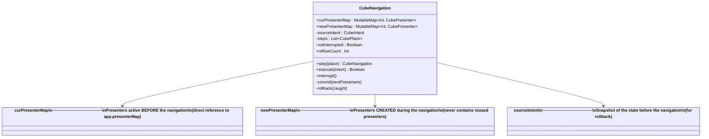

**Core invariant:** the IDs in `newPresenterMap` **never collide** with those in `curPresenterMap`. A presenter is added to `newPresenterMap` only when both lookups (`curPresenterMap[id]` and `newPresenterMap[id]`) return `null`. If the presenter already existed, it is reused, with no insertion into `newPresenterMap`.

---

## Navigation Cycle — Step by Step

### 1. Building the Route

Navigation starts by building the route through a fluent API:

```kotlin
app.navigate<StoreApp>()
    .step(HomeKeys.PLACE)       // id=1
    .step(ProductKeys.PLACE)    // id=3
    .execute(intent)
```

The `step()` calls register the sequence of Places that make up the hierarchical route, from the top level to the leaf; `app.flip(place)` does this with `place.path`. The root (`CubeTreePlace.ROOT`, the application) is never a step: the application's `applyParameters` runs before the first one.

### 2. Executing the Steps

`execute(intent)` first calls `app.applyParameters(intent, initialization, steps.isEmpty())`; if it returns `false` the navigation stops at the root. Then it iterates over the steps in the declared order. For each step:


The `deepest` parameter is `true` only for the last step of the route.

### 3. Commit — Successful Navigation

When all steps complete without interruption:

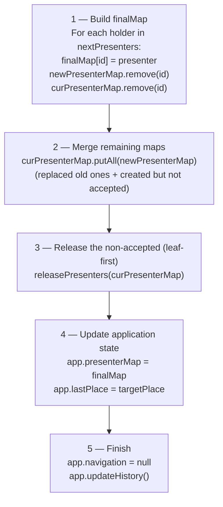

**Why merge the maps before releasing?** This guarantees a **single release pass** with global leaf-first ordering (descending IDs), covering both old presenters and created presenters that did not make it into the final route.

### 4. Rollback — Navigation Failure

If an exception occurs in `applyParameters()`:

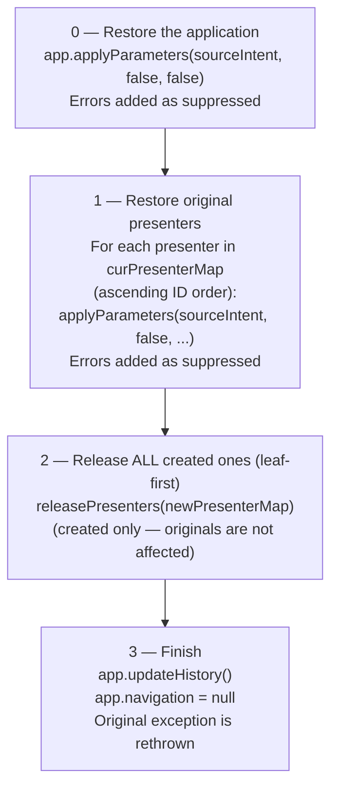

`sourceIntent` is captured when the `CubeNavigation` is created, via `app.newIntent()`. It holds the snapshot of the parameters published by all active presenters before the navigation.

---

## Interruption and Redirect

### The Problem

During `applyParameters()`, a presenter may decide the user must be redirected to another screen. Classic example:

```kotlin
class HomePresenter(app: StoreApp) : AbstractCubePresenter<StoreApp>(app) {
    override fun applyParameters(intent: CubeIntent, initialization: Boolean, deepest: Boolean): Boolean {
        if (app.subject == null) {
            // Unauthenticated user — redirect to login
            LoginKeys(app, intent).flip()  // ← calls app.navigate() internally
            return false
        }
        // ...
        return true
    }
}
```

The `LoginKeys(app, intent).flip()` call triggers `app.navigate()` **from inside** the execution of another navigation. This creates a **recursion**: the current navigation must be interrupted and a new one must take over, without losing the presenters already created.

### The Solution — Presenter Migration

`navigate()` only creates the navigation. What to do with a navigation in progress is decided by `execute()`, which
runs each `applyParameters` with its own navigation marked in the coroutine context. That way it knows where the
request came from:

```kotlin
// CubeNavigation.join(), called at the start of execute()
val current = app.navigation
when {
    current == null -> app.startNavigation(this)                    // none in progress: start
    coroutineContext.navigation === current -> {                     // from inside: it is a redirect
        current.interrupt()                                          // (1) the current one stops
        if (current.reflowCount > 10) throw AssertionError("Navigation recursion detected")
        reflowCount = current.reflowCount + 1
        newPresenterMap.putAll(current.newPresenterMap)              // (2) inherits what it created
        app.replaceNavigation(this)
    }
    else -> waitForCurrentToFinish()                                 // from outside: see below
}
```

The **migration** (`putAll`) transfers the created presenters to the new context. This guarantees that:

- If the new navigation **reuses** a presenter created by the interrupted one, it is found via `newPresenterMap[id]` and is not created again
- If the new navigation **does not use** the presenter, it is released in the new navigation's commit or rollback
- **No created presenter is forgotten**: `release()` is guaranteed

### Request from outside during a navigation

`presenterScope` is serial, but a suspended action (the I/O inside `applyParameters`) lets the next one in.
A click during a slow load calls `navigate()` + `execute()` while a navigation is in progress, **outside** its
context. That request **waits** for the current navigation (with its redirects) to finish, instead of interrupting it:

- only the latest request waits; an earlier one gives up and its `execute` returns `false`;
- if the current navigation fails, the waiting request also gives up (`false`);
- that is why several clicks during a load do not exceed the 10-redirect limit.

A presenter that launches another coroutine to navigate and waits for it inside its own `applyParameters` would end up
waiting for itself: navigate directly, from inside `applyParameters`, which is a redirect.

### `false` in applyParameters

`false` means the presenter was accepted, but composition stops at it: the visited levels are committed, and the
**current place** (`lastPlace`, what history and the deep link show) is this presenter's, not the last step of the
route, which was never visited.

### Detailed Flow of an Interruption

Consider the scenario: navigate to `HOME → PRODUCT`, but `HOME` redirects to `LOGIN`. The application (the root) takes part in both, before the first step.

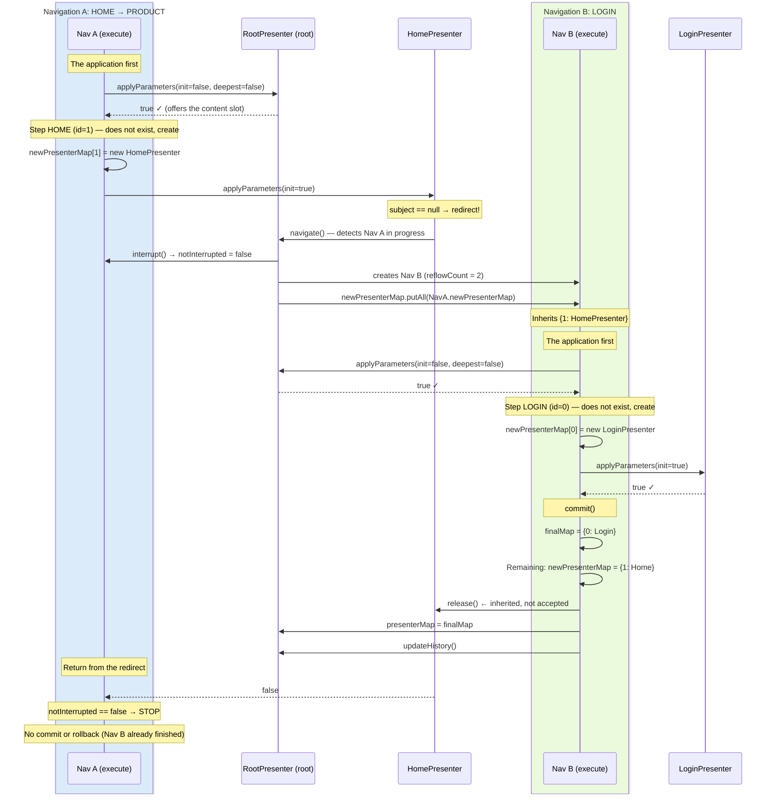

### Chained Interruptions

The mechanism supports multiple chained interruptions. If navigation B is interrupted by a navigation C, the presenters created by A and B that were in B's `newPresenterMap` are migrated to C:

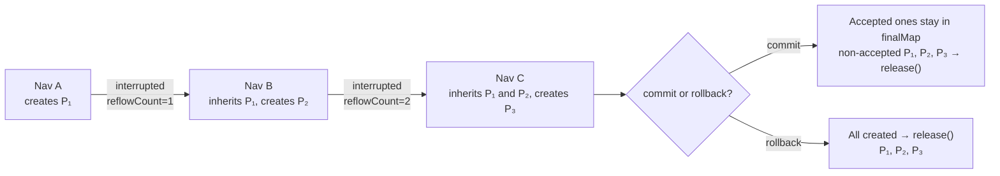

`reflowCount` is incremented at each level to detect infinite loops.

---

## Mechanism Guarantees

| Guarantee | How it is implemented |
|----------|-------------------|
| **Every created presenter will have `release()` called** | `newPresenterMap` only contains created presenters. On commit, the non-accepted ones are released. On rollback, all are released. On interruption, they are migrated to the next navigation. |
| **No presenter is released twice** | IDs in `newPresenterMap` never collide with `curPresenterMap`. Reused presenters do not enter `newPresenterMap`. |
| **The original state can be restored** | `sourceIntent` captures the snapshot before the navigation. On rollback, each original presenter receives `applyParameters(sourceIntent)`. |
| **Navigation is atomic** | Either all accepted steps enter `finalMap` (commit), or no effect remains (rollback). |
| **Release is leaf-first** | `releasePresenters()` sorts IDs in descending order. Children (higher IDs) are released before parents (lower IDs). |
| **Recursion is bounded** | `reflowCount > 10` throws `AssertionError`. |
| **History is updated** | `updateHistory()` is called on both commit and rollback (in the `finally` block). |

---

## Release Order — Leaf-First

The `releasePresenters()` function always releases presenters in **descending ID** order:

```kotlin
private fun releasePresenters(presenterMap: MutableMap<Int, CubePresenter>) {
    val presenterIds = presenterMap.keys.sortedDescending().toList()
    for (presenterId in presenterIds) {
        val presenter = presenterMap.remove(presenterId)
        presenter?.release()
    }
}
```

This guarantees that children (leaves, higher IDs) are released before parents (root, lower IDs), respecting the dependency hierarchy. A child presenter may depend on the parent's resources, so the parent must be the last to be released.

**Example:** If the active route was `HOME(1) → PRODUCT(3)` and a new navigation goes to `LOGIN(0)`, the `HOME(1)` and `PRODUCT(3)` presenters must be released. The order is: `PRODUCT(3)` first, then `HOME(1)`.

---

## Protection Against Infinite Recursion

If a presenter always redirects during `applyParameters()`, an infinite loop of interruptions can arise. The framework guards against this with `reflowCount`:

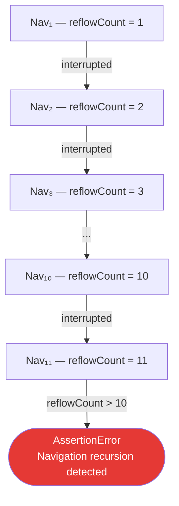

This 10-level limit is enough for legitimate chained-redirect scenarios, but it detects infinite-loop bugs before they cause a stack overflow.

---

## Complete Scenarios

### Normal Navigation with Reuse

Initial state: `presenterMap = {1: HomePresenter}`
Navigation: `HOME(1) → PRODUCT(3)`

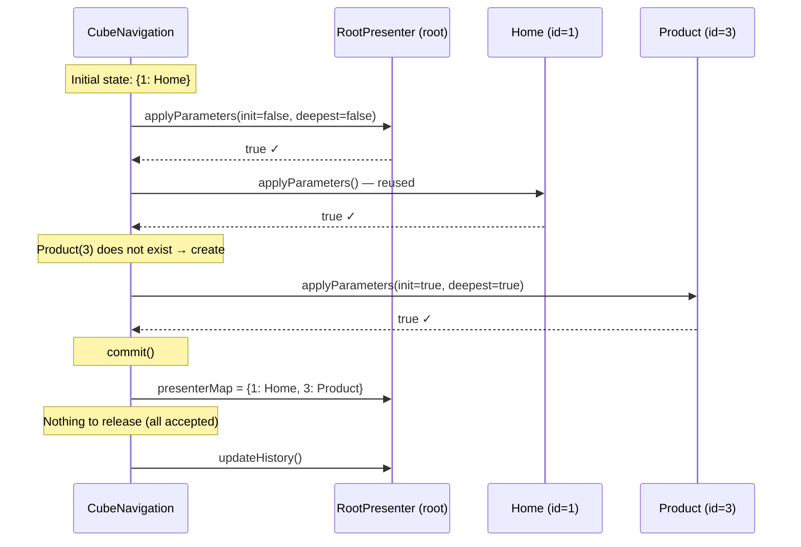

### Redirect during Navigation

Initial state: `presenterMap = {0: LoginPresenter}`
Navigation A: `HOME(1)`, but HOME redirects to `LOGIN(0)`

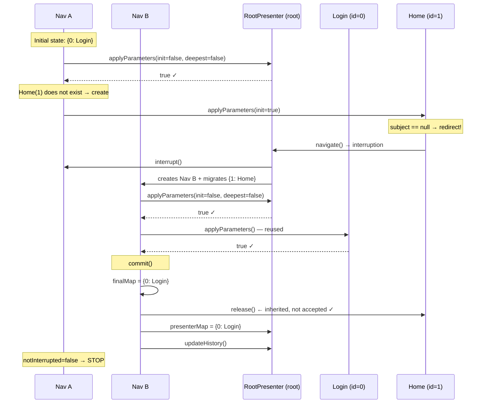

### Rollback after an Exception

Initial state: `presenterMap = {1: HomePresenter}`
Navigation: `HOME(1) → CART(2)`, but CART throws an exception

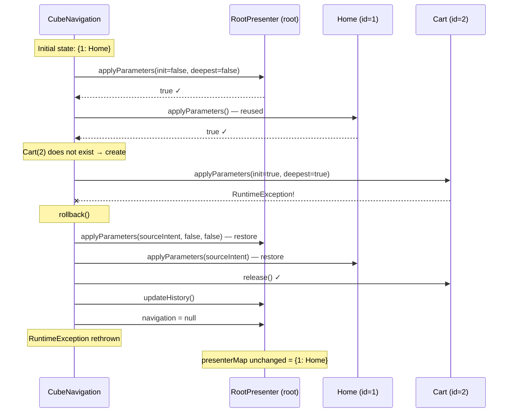

---

## Suspend and Coroutines in Cube MVP

Cube MVP uses **Kotlin coroutines** as its concurrency mechanism. Which methods are `suspend` and which are synchronous follows one fundamental rule: **suspend marks operations that cross I/O or navigation boundaries; scope mutation and view notification are always synchronous.**

### The Execution Model

The architecture defines two complementary execution "worlds":

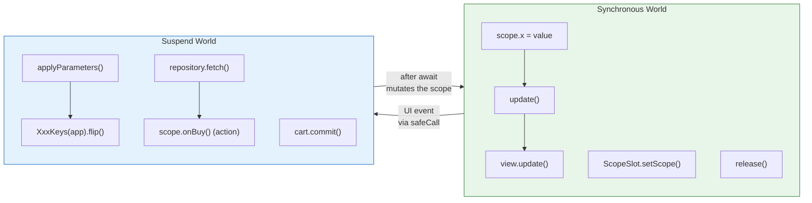

**Principle:** suspend code **never mutates state directly in the view**. It does the I/O, gets the data, and then mutates the presenter's `scope`, synchronously; the scope asks for the repaint.

### The presenterScope — Serializing Actions

`RootPresenter` defines a `CoroutineScope` with parallelism limited to 1:

```kotlin
val presenterScope = CoroutineScope(Dispatchers.Default.limitedParallelism(1))
```

This guarantees that **all presenter actions run serially**, eliminating race conditions without locks or mutexes:

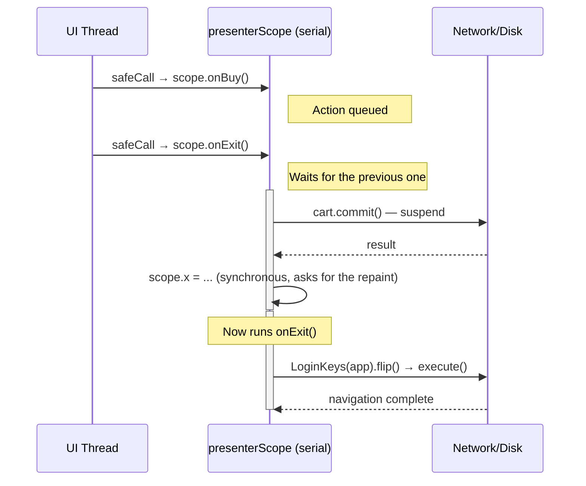

**Practical consequence:** developers can write presenters as if they were single-threaded, reading and writing `scope` without concurrency concerns.

### The Suspend / Synchronous Boundary

The table below summarizes which framework operations are `suspend` and which are synchronous:

| Operation | Suspend? | Why |
|----------|:--------:|---------|
| `scope.field = value` | ❌ | Plain in-memory assignment |
| `update()` | ❌ | Notifies the view to re-render (synchronous) |
| `CubeView.update()` | ❌ | Only marks dirty / recomposes |
| `ScopeSlot.setScope(scope)` | ❌ | Hands the scope to the parent's slot (assignment) |
| `app.viewOf(scope)` | ❌ | Creates (once) or returns the view of a scope |
| `release()` | ❌ | Frees local resources |
| `commitComputedState()` | ❌ | Synchronous derived computation |
| `CubeNavigation.execute()` | ✅ | Calls each presenter's `applyParameters()` |
| `CubePresenter.applyParameters()` | ✅ | May load data for its scope and segments (I/O), or redirect |
| `Action` / `ActionOf` / `ActionOf2` `invoke` | ✅ | Runs the guarded body, which may do I/O or navigate |
| `XxxKeys(app).flip()` | ✅ | Calls `navigate().execute()` |
| `repository.fetch/insert/update()` | ✅ | Network or database access |
| Action bodies with I/O (`buy()`) | ✅ | Call repositories or navigate |
| Action bodies without I/O (`modifyQuantity()`) | ❌ | Only mutate the scope (the action field itself is still `suspend`) |

### The safeCall Pattern — Bridge between View and Presenter

The view layer **never calls suspend functions directly**. It uses the `safeCall` pattern to dispatch actions on the `presenterScope`:

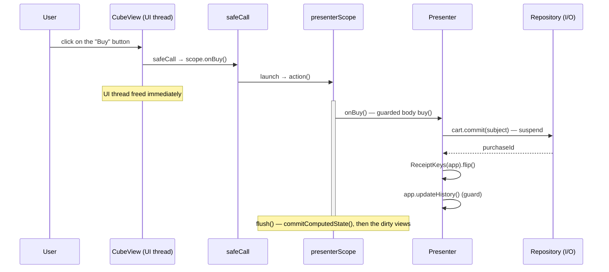

The `safeCall` implementation is the same on all platforms (`ComposeCubeView`, `ReactCubeView`, `AbstractViewIos`; `safeAction` in `AbstractViewAndroid`):

```kotlin
// ComposeCubeView
protected fun safeCall(action: suspend () -> Unit) {
    ViewUpdateScheduler.presenterScope.launch {
        try {
            action()
        } catch (e: Exception) {
            app.alertUnexpectedError(LOG, "Unexpected error in $id", e)
        } finally {
            ViewUpdateScheduler.flush()  // commitComputedState(), then the dirty views
        }
    }
}
```

The actions already have their own guard, so the `catch` here only sees failures of the view's own code.

**In practice, in the view:**

```kotlin
// Compose
Button(onClick = { safeCall { scope.onBuy() } }) { Text("Buy") }

// Native Android
setOnClickListener { safeAction("buy") { scope.onBuy() } }

// Native Web (React/MUI via Kotlin/JS), products panel
onClick = { safeCall { scope.onOpenProduct(productId) } }
```

### Presenter Lifecycle and Suspend

`applyParameters()` is the only lifecycle method that is `suspend`. This lets presenters do asynchronous work during navigation:

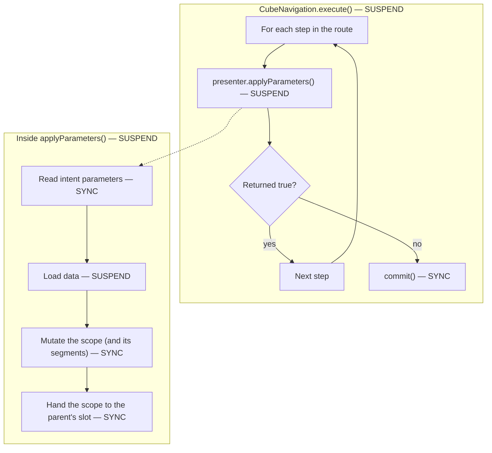

**Concrete example — ReceiptPresenter:**

```kotlin
override suspend fun applyParameters(intent: CubeIntent, initialization: Boolean, deepest: Boolean): Boolean {
    val keys = ReceiptKeys(app, intent)
    val pPurchaseId = keys.purchaseId ?: purchaseId ?: run {
        HomeKeys(app, intent).flip()  // no usable id in the address: redirect, with the intent in transit
        return false
    }

    scope.notifySuccess = keys.purchaseMade

    // (1) Load data from the server — SUSPEND (I/O)
    if (scope.receipt == null || pPurchaseId != purchaseId) {
        val receipt = loadReceipt(pPurchaseId)  // ← suspend
        purchaseId = pPurchaseId
        scope.receipt = receipt   // ← sync: mutates the scope, which asks the view to repaint
    }

    // (2) Hand the scope to the parent — SYNC. The slot is read on every call: a reused presenter goes where its
    // parent puts it now, which may differ from where it was first put. No view here: the parent's view asks
    // app.viewOf(scope), and the view layer's catalog creates it.
    ownerSlot = keys.parentSlot
    ownerSlot?.setScope(scope)
    return true
}
```

### Segments — Panels without a Presenter

A panel inside a screen (the Home's products and purchases panels) or a row of a list (a cart row) has no navigation of its own, so it has **no presenter**: it is a segment, a smaller scope in a field of the owner's scope, with a view of its own. The owner loads its data in its own `applyParameters` (suspend) and binds its actions:

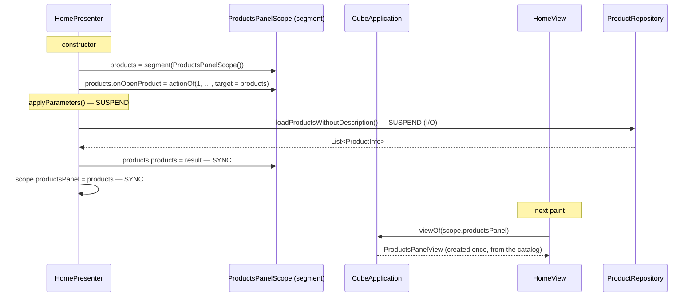

```kotlin
// AbstractPresenter
protected fun <S : Scope> segment(scope: S): S {
    scope.observe { (app.viewOrNull(scope) ?: boundScope?.let { app.viewOrNull(it) })?.update() }
    segments += scope
    return scope
}

protected fun detach(segment: Scope) {
    segments.remove(segment)
    app.releaseView(segment)
}
```

A change in a segment repaints its own view (or the owner's until the segment has one), not the owner's whole screen. The cart uses the same mechanism for its rows: `CartScope.rows` is a list declared with `scopes()`, each row a `CartItemScope` segment with its own `onRemove` and `onModifyQuantity`. The presenter reuses a row while its product stays in the cart and `detach`es the one that leaves, so changing a quantity repaints that row and the total, not the list.

### When to Use and When NOT to Use Suspend

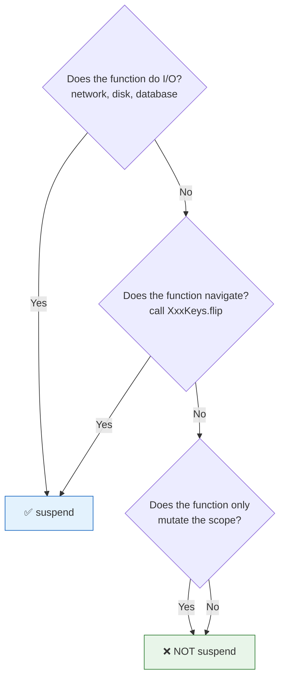

**Examples in CartPresenter:**

```kotlin
// the bodies behind the row's actions (onModifyQuantity, onRemove) and the cart's onBuy

// ❌ NOT suspend — only works on the local (in-memory) cart
private fun modifyQuantity(productId: Long?, quantity: Int?) {
    // … validation …
    val found = cart.modifyProductQuantity(productId, quantity)  // sync
    if (found) {
        syncRows()  // sync: updates the rows and the total; the scope asks for the repaint
    }
}

// ✅ suspend — may navigate (HomeKeys.flip)
private suspend fun removeProduct(productId: Long?) {
    val modified = cart.removeProduct(productId)  // sync
    if (modified) {
        if (cart.getSize() == 0) {
            HomeKeys(app).flip()  // ← suspend: navigates
        } else {
            syncRows()  // the row that left is detached
        }
    }
}

// ✅ suspend — does I/O (cart.commit) and navigates (ReceiptKeys.flip)
private suspend fun buy() {
    val purchaseId = cart.commit(app.subject!!)  // ← suspend: persists the purchase
    ReceiptKeys(app).apply { this.purchaseId = purchaseId; purchaseMade = true }.flip()  // ← suspend: navigates
}
```

The action fields that call them (`action { … }`, `actionOf { … }`) are always `suspend`; the bodies follow the rule above.

### Practical Rules for the Developer

1. **Mark a function `suspend` if and only if** it calls another suspend function (repository, `flip`, an action). Do not add `suspend` "just in case".

2. **Never call `runBlocking` inside a presenter.** The `presenterScope` already is the coroutine; using `runBlocking` inside it causes a deadlock.

3. **Views are never suspend.** The `update()` and `release()` methods and all UI construction are synchronous. Use `safeCall` (or `safeAction`) to call the scope's actions from UI events.

4. **`safeCall` is fire-and-forget.** There is no return value. If you need the result of an async operation to update the UI, mutate `scope` inside the block: the scope asks for the repaint.

5. **Listeners can be suspend.** `CartManager` supports `suspend () -> Unit` as a commit listener. The framework calls these listeners sequentially with `await`.

6. **`ScopeSlot.setScope()` is synchronous.** It assigns a scope to the parent's slot and never involves I/O.

7. **Navigation actions (`flip`) are always suspend.** Any method that may navigate must be marked `suspend`, because `CubeNavigation.execute()` is suspend.

8. **The typical flow inside a `safeCall`:**

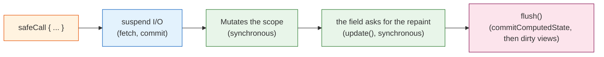

### Parallel Asynchronous Dispatch — Fire-and-Forget with a Result

There are cases where the presenter needs to fire an I/O operation **without blocking** the current action: for example, preloading data, sending telemetry, or fetching secondary information while the UI already shows the main content.

Because `presenterScope` is serial (`limitedParallelism(1)`), `app.presenterScope.launch { ... }` only **queues** the task for later. If the goal is **truly parallel** execution, use a separate scope and, once the result is available, dispatch back to `presenterScope` to mutate the scope safely.

Presenters reach `presenterScope` through `app.presenterScope` (defined in `RootPresenter`).

#### Pattern: Parallel Scope with Return to presenterScope

```kotlin
// Inside a presenter (app is RootPresenter)
private suspend fun enter() {
    // Show immediately with partial data
    scope.loading = true

    // Fire the heavy operation in parallel — does NOT block
    CoroutineScope(Dispatchers.Default).launch {
        try {
            val extra = repository.fetchExtraInfo(id)  // parallel I/O

            // Return to presenterScope to mutate the scope
            app.presenterScope.launch {
                scope.extraInfo = extra
                scope.loading = false
            }
        } catch (e: Exception) {
            app.presenterScope.launch {
                scope.errorMessage = e.message
                scope.loading = false
            }
        }
    }
}
```

#### Sequence Diagram

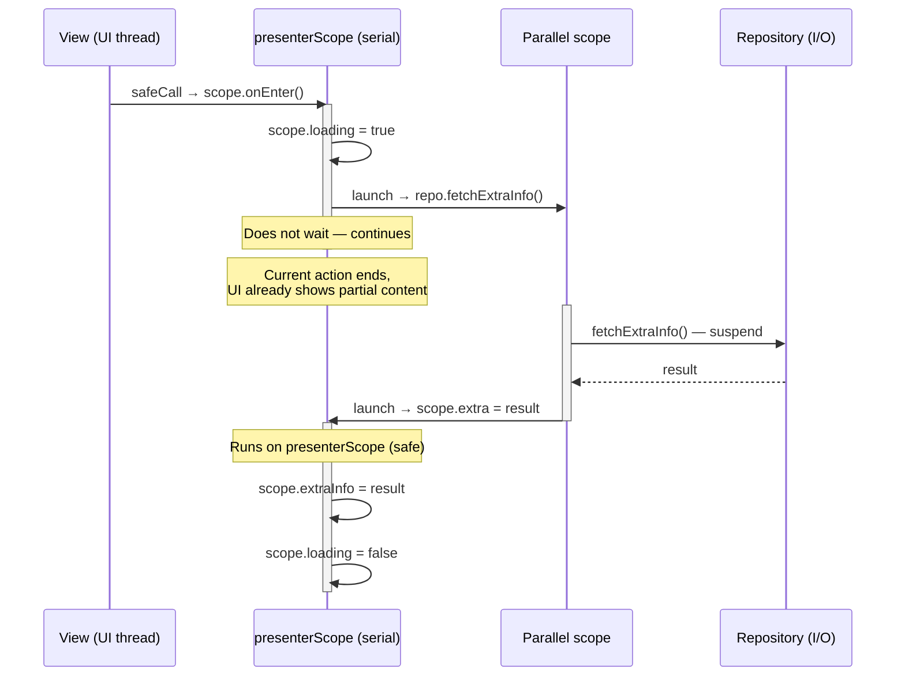

#### Contrast with Serial (Queued) Mode

If the operation does not need to be parallel, only decoupled from the current action, just queue it on `presenterScope` itself:

```kotlin
// Queued — runs AFTER the current action ends (serial, no parallelism)
app.presenterScope.launch {
    val data = repository.sendAnalytics(payload)
    // Can mutate the scope directly here (already on presenterScope)
    scope.analyticsConfirmed = true // the scope asks for the repaint
}
```

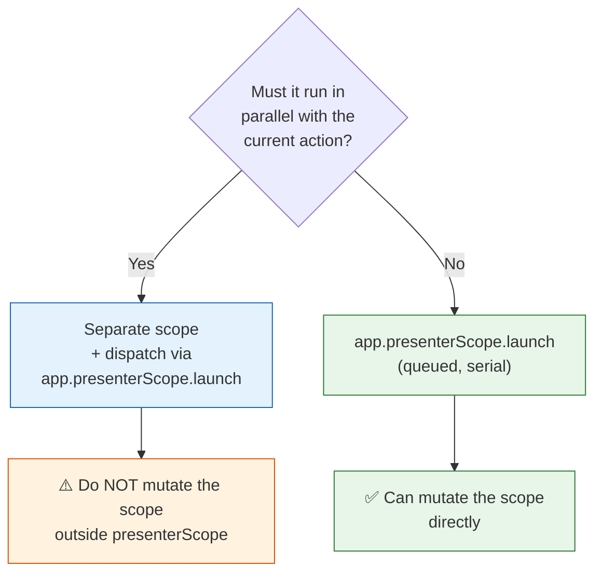

#### Safety Rule

> **Every `scope` mutation (and so every repaint request) must happen inside `presenterScope`.**
>
> If code is running on a parallel scope, it must dispatch back via `app.presenterScope.launch { ... }` before touching the presenter's scope. Breaking this rule causes silent race conditions.
