# Cube Architecture — Navigation Mechanism

## Table of Contents

- [Overview](#overview)
- [Core Components](#core-components)
  - [CubePlace](#cubeplace)
  - [CubePresenter](#cubepresenter)
  - [CubeIntent](#cubeintent)
  - [CubeViewSlot](#cubeviewslot)
  - [CubeView](#cubeview)
  - [CubeApplication](#cubeapplication)
  - [CubeNavigation](#cubenavigation)
- [Internal Data Model](#internal-data-model)
- [Navigation Cycle — Step by Step](#navigation-cycle--step-by-step)
  - [1. Building the Route](#1-building-the-route)
  - [2. Executing the Steps](#2-executing-the-steps)
  - [3. Commit — Successful Navigation](#3-commit--successful-navigation)
  - [4. Rollback — Navigation Failure](#4-rollback--navigation-failure)
- [Interruption and Redirect](#interruption-and-redirect)
  - [The Problem](#the-problem)
  - [The Solution — Presenter Migration](#the-solution--presenter-migration)
  - [Detailed Flow of an Interruption](#detailed-flow-of-an-interruption)
  - [Chained Interruptions](#chained-interruptions)
- [Mechanism Guarantees](#mechanism-guarantees)
- [Release Order — Leaf-First](#release-order--leaf-first)
- [Protection Against Infinite Recursion](#protection-against-infinite-recursion)
- [Complete Scenarios](#complete-scenarios)
  - [Normal Navigation with Reuse](#normal-navigation-with-reuse)
  - [Redirect during Navigation](#redirect-during-navigation)
  - [Rollback after an Exception](#rollback-after-an-exception)
- [Suspend and Coroutines in Cube MVP](#suspend-and-coroutines-in-cube-mvp)
  - [The Execution Model](#the-execution-model)
  - [The presenterScope — Serializing Actions](#the-presenterscope--serializing-actions)
  - [The Suspend / Synchronous Boundary](#the-suspend--synchronous-boundary)
  - [The safeCall Pattern — Bridge between View and Presenter](#the-safecall-pattern--bridge-between-view-and-presenter)
  - [Presenter Lifecycle and Suspend](#presenter-lifecycle-and-suspend)
  - [Child Presenters — Asynchronous Initialization](#child-presenters--asynchronous-initialization)
  - [When to Use and When NOT to Use Suspend](#when-to-use-and-when-not-to-use-suspend)
  - [Practical Rules for the Developer](#practical-rules-for-the-developer)
  - [Parallel Asynchronous Dispatch — Fire-and-Forget with a Result](#parallel-asynchronous-dispatch--fire-and-forget-with-a-result)

---

## Overview

Cube is an **application state management** solution based on the MVP (Model-View-Presenter) pattern. Unlike approaches that require immutable, unidirectional state, Cube uses **mutable view states**: presenters manipulate state objects (`ViewState`) directly, and the view re-renders when they change. This decision simplifies presentation code by eliminating the ceremony of immutable copies and reducers.

A central principle of the architecture is the **complete decoupling of presentation logic from the view technology**. Presenters are plain Kotlin classes with no dependency on any UI framework. The rendering technology (Compose Multiplatform, React, SwiftUI or anything else) is a **project choice**, not something the framework imposes. This lets the same presentation code be shared across different platforms, each implementing only the view layer.

`CubeNavigation` is the framework's navigation engine. It orchestrates the **presenter lifecycle** during screen transitions, treating navigation as an **atomic transaction**: either all steps are applied successfully (commit), or the previous state is restored (rollback).

The mechanism was designed to handle a critical scenario: **redirects during navigation**. A presenter may, inside `applyParameters()`, start a new navigation (for example, redirecting an unauthenticated user to the login screen). This **interrupts** the current navigation and starts another, and the framework guarantees that no created presenter is lost without having `release()` called.

---

## Core Components

### CubePlace

Represents a **navigation destination**. Each Place has:

- **`id: Int`**: unique numeric identifier, used as the key in the presenter map
- **`placeName: String`**: symbolic name for deep-linking (e.g. `"home"`, `"product"`)
- **`presenterFactory()`**: factory function that creates the associated `CubePresenter` instance

```kotlin
interface CubePlace {
    val id: Int
    val placeName: String
    fun <A : CubeApplication> presenterFactory(): (A) -> CubePresenter
}
```

IDs follow a **hierarchical convention**: lower IDs represent nodes closer to the root, and higher IDs represent leaves. The release order relies on this convention (leaf-first, i.e. higher IDs first).

### CubePresenter

Interface every presenter must implement. It defines the lifecycle contract:

```kotlin
interface CubePresenter {
    fun applyParameters(intent: CubeIntent, initialization: Boolean, deepest: Boolean): Boolean
    fun publishParameters(intent: CubeIntent)
    fun commitComputedState()
    fun release()
}
```

| Method | When it is called | Responsibility |
|--------|-----------------|------------------|
| `applyParameters` | During `execute()` | Receive parameters, create the view (if `initialization=true`), connect slots. Returns `true` to continue, `false` to stop. |
| `publishParameters` | During `newIntent()` | Export the presenter's current state to the intent (for deep-linking and history). |
| `commitComputedState` | After the navigation commits | Finish derived computations that depend on the complete navigation state. |
| `release` | When the presenter is discarded | Free resources (views, listeners, connections). **Called exactly once.** |

### CubeIntent

Data container that travels through the navigation hierarchy. It carries two kinds of data:

- **Parameters** (`MutableMap<String, Any?>`): serializable route data, used for deep-linking and browser history (e.g. `productId=42`)
- **Attributes** (`MutableMap<String, Any?>`): ephemeral transaction data, such as `CubeViewSlot`s for parent-child wiring

```kotlin
class CubeIntent {
    var place: CubePlace?
    // Parameters: getParameterAsString(), setParameter(), etc.
    // Attributes: setAttribute(), getAttribute(), setViewSlot(), getViewSlot()
}
```

### CubeViewSlot

View composition mechanism. A parent presenter creates a slot and publishes it in the intent. The child presenter gets the slot and inserts its view into it, with no direct coupling between parent and child.

```kotlin
fun interface CubeViewSlot {
    fun setView(view: CubeView)
}
```

### ViewState

The state a presenter keeps for its view, as plain mutable fields. Extend `ObservableViewState` and declare each field with `field(...)`: assigning a value different from the current one (`!=`, so lists compare by content) asks for a repaint. The presenter wires it once, with `observed(...)`, and no longer calls `update()` after each change:

```kotlin
class CartViewState : ObservableViewState() {
    var items: List<CartItem> by field(emptyList())
    var errorMessage: String? by field(null)
}

class CartPresenter(app: ShoppingApplication) : AbstractCubePresenter<ShoppingApplication>(app) {
    val state = observed(CartViewState())

    fun onAlert() {
        state.errorMessage = "…" // the view repaints; several changes in a row still cost one paint
    }
}
```

**What the fields cannot see:** a change *inside* an object already assigned — an element added to a mutable list, a field of a nested object, or an object shared with someone who mutates it. Assign a new value (a copy), or call `state.changed()`. `CartManager.getCartItems()` returns copies for this reason.

A new view needs no `update()` either: every view layer paints the current state when the view is created. Keep in the state what the view shows — the Storefront home keeps the cart count as a field, set by the cart's change listener — and the presenter never calls `update()`. It is still there for state the view reads from somewhere else.

### CubeView

Interface for the rendering layer. Each UI technology (Compose, React, etc.) implements this interface:

```kotlin
interface CubeView {
    fun instanceId(): String
    fun update()
    fun release()
}
```

### CubeApplication

Abstract base class that holds the global application state:

- **`presenterMap`**: `<Int, CubePresenter>` map of the active presenters (key = `Place.id`)
- **`lastPlace`**: last place navigated to (for deep-linking)
- **`navigation`**: reference to the navigation in progress (or `null` if none)
- **`navigate()`**: entry point for starting a navigation

```kotlin
abstract class CubeApplication {
    internal var presenterMap: MutableMap<Int, CubePresenter>
    internal var lastPlace: CubePlace?
    internal var navigation: CubeNavigation<*>?

    fun <T : CubeApplication> navigate(): CubeNavigation<T>
    fun newIntent(): CubeIntent
    fun getPresenter(placeId: Int): CubePresenter?
    fun release()
    abstract fun updateHistory()
}
```

### CubeNavigation

The navigation transaction orchestrator. Created by `CubeApplication.navigate()`, it manages two presenter maps and drives the `execute()` → `commit()` or `rollback()` flow.

---

## Internal Data Model

`CubeNavigation` keeps two internal maps, each with a well-defined role:


**Core invariant:** the IDs in `newPresenterMap` **never collide** with those in `curPresenterMap`. A presenter is added to `newPresenterMap` only when both lookups (`curPresenterMap[id]` and `newPresenterMap[id]`) return `null`. If the presenter already existed, it is reused, with no insertion into `newPresenterMap`.

---

## Navigation Cycle — Step by Step

### 1. Building the Route

Navigation starts by building the route through a fluent API:

```kotlin
app.navigate<ShoppingApp>()
    .step(Place.ROOT)       // id=0
    .step(Place.HOME)       // id=2
    .step(Place.PRODUCT)    // id=4
    .execute(intent)
```

The `step()` calls register the sequence of Places that make up the hierarchical route, from the root node to the leaf.

### 2. Executing the Steps

`execute(intent)` iterates over the steps in the declared order. For each step:

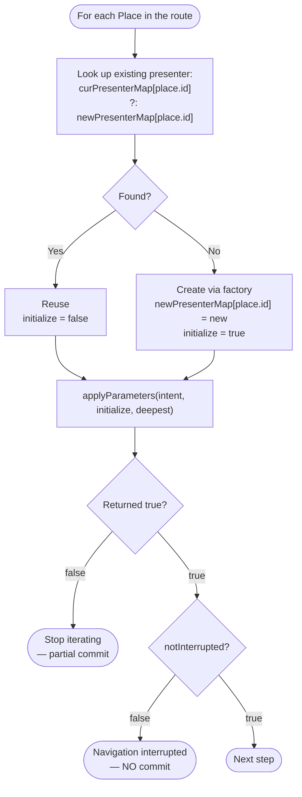

The `deepest` parameter is `true` only for the last step of the route.

### 3. Commit — Successful Navigation

When all steps complete without interruption:

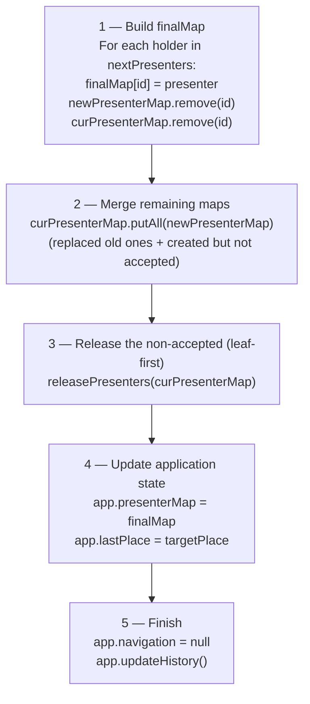

**Why merge the maps before releasing?** This guarantees a **single release pass** with global leaf-first ordering (descending IDs), covering both old presenters and created presenters that did not make it into the final route.

### 4. Rollback — Navigation Failure

If an exception occurs in `applyParameters()`:

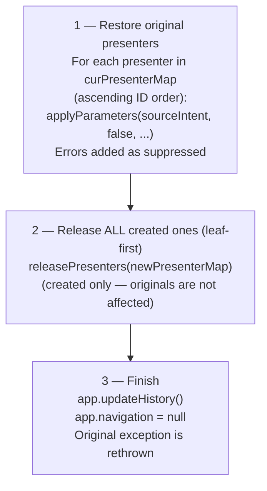

`sourceIntent` is captured when the `CubeNavigation` is created, via `app.newIntent()`. It holds the snapshot of the parameters published by all active presenters before the navigation.

---

## Interruption and Redirect

### The Problem

During `applyParameters()`, a presenter may decide the user must be redirected to another screen. Classic example:

```kotlin
class HomePresenter(app: ShoppingApp) : AbstractCubePresenter<ShoppingApp>(app) {
    override fun applyParameters(intent: CubeIntent, initialization: Boolean, deepest: Boolean): Boolean {
        if (app.subject == null) {
            // Unauthenticated user — redirect to login
            Routes.login(app)  // ← calls app.navigate() internally
            return false
        }
        // ...
        return true
    }
}
```

The `Routes.login(app)` call triggers `app.navigate()` **from inside** the execution of another navigation. This creates a **recursion**: the current navigation must be interrupted and a new one must take over, without losing the presenters already created.

### The Solution — Presenter Migration

`navigate()` only creates the navigation. What to do with a navigation in progress is decided by `execute()`, which
runs each `applyParameters` with its own navigation marked in the coroutine context. That way it knows where the
request came from:

```kotlin
// CubeNavigation.join(), called at the start of execute()
val current = app.navigation
when {
    current == null -> app.startNavigation(this)                    // none in progress: start
    coroutineContext.navigation === current -> {                     // from inside: it is a redirect
        current.interrupt()                                          // (1) the current one stops
        if (current.reflowCount > 10) throw AssertionError("Navigation recursion detected")
        reflowCount = current.reflowCount + 1
        newPresenterMap.putAll(current.newPresenterMap)              // (2) inherits what it created
        app.replaceNavigation(this)
    }
    else -> waitForCurrentToFinish()                                 // from outside: see below
}
```

The **migration** (`putAll`) transfers the created presenters to the new context. This guarantees that:

- If the new navigation **reuses** a presenter created by the interrupted one, it is found via `newPresenterMap[id]` and is not created again
- If the new navigation **does not use** the presenter, it is released in the new navigation's commit or rollback
- **No created presenter is forgotten**: `release()` is guaranteed

### Request from outside during a navigation

`presenterScope` is serial, but a suspended action (the I/O inside `applyParameters`) lets the next one in.
A click during a slow load calls `navigate()` + `execute()` while a navigation is in progress, **outside** its
context. That request **waits** for the current navigation (with its redirects) to finish, instead of interrupting it:

- only the latest request waits; an earlier one gives up and its `execute` returns `false`;
- if the current navigation fails, the waiting request also gives up (`false`);
- that is why several clicks during a load do not exceed the 10-redirect limit.

A presenter that launches another coroutine to navigate and waits for it inside its own `applyParameters` would end up
waiting for itself: navigate directly, from inside `applyParameters`, which is a redirect.

### `false` in applyParameters

`false` means the presenter was accepted, but composition stops at it: the visited levels are committed, and the
**current place** (`lastPlace`, what history and the deep link show) is this presenter's, not the last step of the
route, which was never visited.

### Detailed Flow of an Interruption

Consider the scenario: navigate to `ROOT → HOME → PRODUCT`, but `HOME` redirects to `ROOT → LOGIN`.

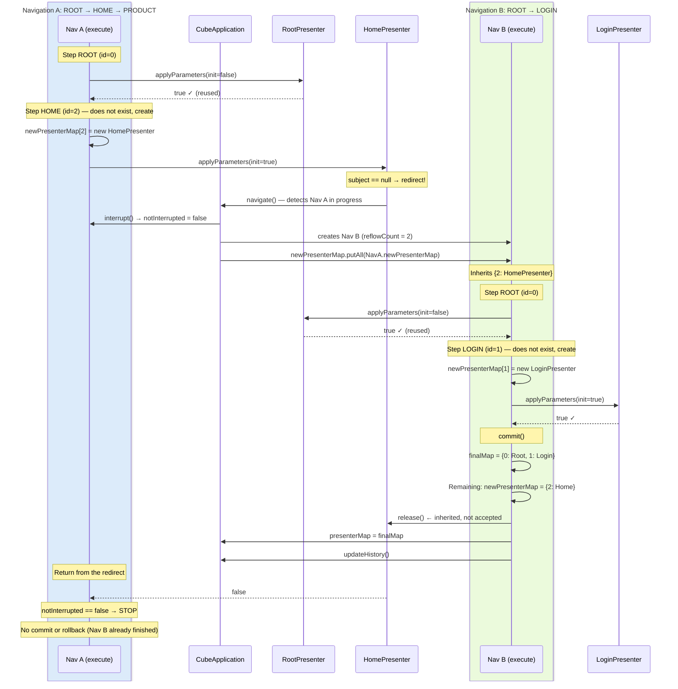

### Chained Interruptions

The mechanism supports multiple chained interruptions. If navigation B is interrupted by a navigation C, the presenters created by A and B that were in B's `newPresenterMap` are migrated to C:

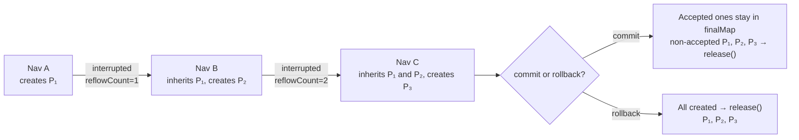

`reflowCount` is incremented at each level to detect infinite loops.

---

## Mechanism Guarantees

| Guarantee | How it is implemented |
|----------|-------------------|
| **Every created presenter will have `release()` called** | `newPresenterMap` only contains created presenters. On commit, the non-accepted ones are released. On rollback, all are released. On interruption, they are migrated to the next navigation. |
| **No presenter is released twice** | IDs in `newPresenterMap` never collide with `curPresenterMap`. Reused presenters do not enter `newPresenterMap`. |
| **The original state can be restored** | `sourceIntent` captures the snapshot before the navigation. On rollback, each original presenter receives `applyParameters(sourceIntent)`. |
| **Navigation is atomic** | Either all accepted steps enter `finalMap` (commit), or no effect remains (rollback). |
| **Release is leaf-first** | `releasePresenters()` sorts IDs in descending order. Children (higher IDs) are released before parents (lower IDs). |
| **Recursion is bounded** | `reflowCount > 10` throws `AssertionError`. |
| **History is updated** | `updateHistory()` is called on both commit and rollback (in the `finally` block). |

---

## Release Order — Leaf-First

The `releasePresenters()` function always releases presenters in **descending ID** order:

```kotlin
private fun releasePresenters(presenterMap: MutableMap<Int, CubePresenter>) {
    val presenterIds = presenterMap.keys.sortedDescending().toList()
    for (presenterId in presenterIds) {
        val presenter = presenterMap.remove(presenterId)
        presenter?.release()
    }
}
```

This guarantees that children (leaves, higher IDs) are released before parents (root, lower IDs), respecting the dependency hierarchy. A child presenter may depend on the parent's resources, so the parent must be the last to be released.

**Example:** If the active route was `ROOT(0) → HOME(2) → PRODUCT(4)` and a new navigation goes to `ROOT(0) → LOGIN(1)`, the `HOME(2)` and `PRODUCT(4)` presenters must be released. The order is: `PRODUCT(4)` first, then `HOME(2)`.

---

## Protection Against Infinite Recursion

If a presenter always redirects during `applyParameters()`, an infinite loop of interruptions can arise. The framework guards against this with `reflowCount`:


This 10-level limit is enough for legitimate chained-redirect scenarios, but it detects infinite-loop bugs before they cause a stack overflow.

---

## Complete Scenarios

### Normal Navigation with Reuse

Initial state: `presenterMap = {0: RootPresenter, 2: HomePresenter}`
Navigation: `ROOT(0) → HOME(2) → PRODUCT(4)`

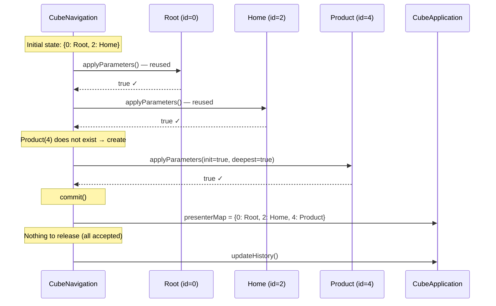

### Redirect during Navigation

Initial state: `presenterMap = {0: RootPresenter, 1: LoginPresenter}`
Navigation A: `ROOT(0) → HOME(2)`, but HOME redirects to `ROOT(0) → LOGIN(1)`

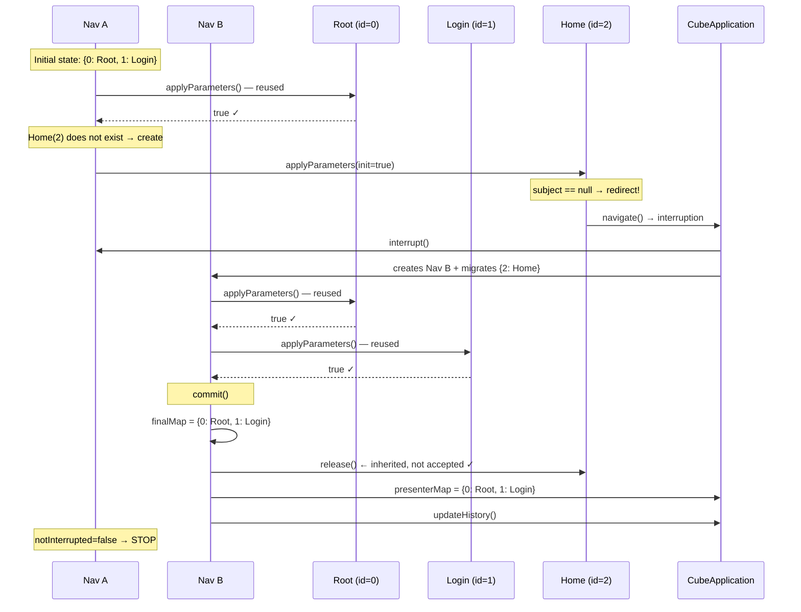

### Rollback after an Exception

Initial state: `presenterMap = {0: RootPresenter, 2: HomePresenter}`
Navigation: `ROOT(0) → HOME(2) → CART(5)`, but CART throws an exception

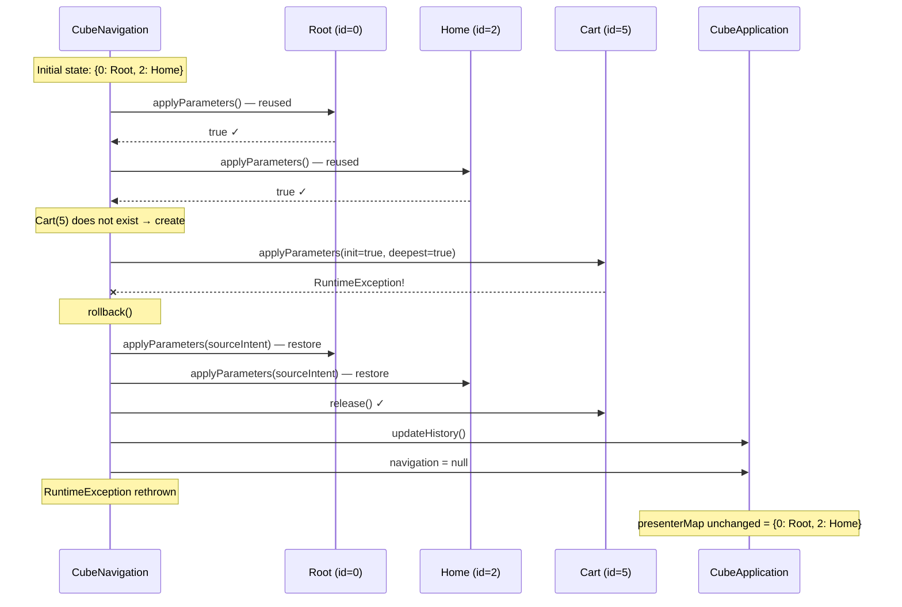

---

## Suspend and Coroutines in Cube MVP

Cube MVP uses **Kotlin coroutines** as its concurrency mechanism. Which methods are `suspend` and which are synchronous follows one fundamental rule: **suspend marks operations that cross I/O or navigation boundaries; state mutation and view notification are always synchronous.**

### The Execution Model

The architecture defines two complementary execution "worlds":

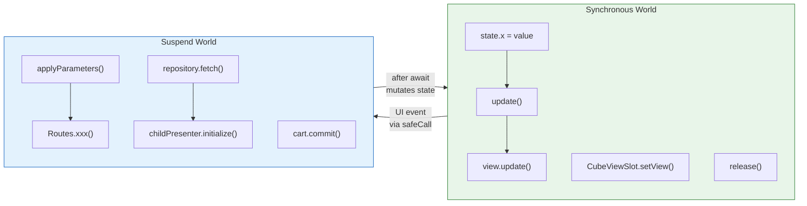

**Principle:** suspend code **never mutates state directly in the view**. It does the I/O, gets the data, and then mutates the `ViewState`, synchronously; the observed state asks for the repaint.

### The presenterScope — Serializing Actions

`ShoppingApplication` defines a `CoroutineScope` with parallelism limited to 1:

```kotlin
val presenterScope = CoroutineScope(Dispatchers.Default.limitedParallelism(1))
```

This guarantees that **all presenter actions run serially**, eliminating race conditions without locks or mutexes:

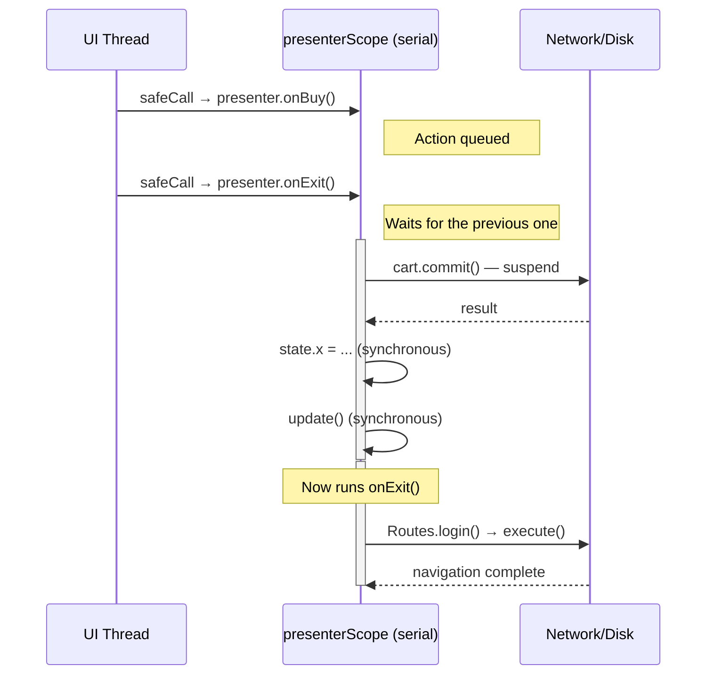

**Practical consequence:** developers can write presenters as if they were single-threaded, reading and writing `state` without concurrency concerns.

### The Suspend / Synchronous Boundary

The table below summarizes which framework operations are `suspend` and which are synchronous:

| Operation | Suspend? | Why |
|----------|:--------:|---------|
| `state.field = value` | ❌ | Plain in-memory assignment |
| `update()` | ❌ | Notifies the view to re-render (synchronous) |
| `CubeView.update()` | ❌ | Only marks dirty / recomposes |
| `CubeViewSlot.setView(view)` | ❌ | Connects the view to the parent's slot (assignment) |
| `release()` | ❌ | Frees local resources |
| `commitComputedState()` | ❌ | Synchronous derived computation |
| `CubeNavigation.execute()` | ✅ | Calls each presenter's `applyParameters()` |
| `CubePresenter.applyParameters()` | ✅ | May initialize child presenters (I/O) |
| `AbstractChildPresenter.initialize()` | ✅ | Calls `onInitialize()`, which may load data |
| `Routes.xxx(app)` | ✅ | Calls `navigate().execute()` |
| `repository.fetch/insert/update()` | ✅ | Network or database access |
| User actions with I/O (`onBuy()`) | ✅ | Call repositories or navigate |
| User actions without I/O (`onModifyQuantity()`) | ❌ | Only mutate local state |

### The safeCall Pattern — Bridge between View and Presenter

The view layer **never calls suspend functions directly**. It uses the `safeCall` pattern to dispatch actions on the `presenterScope`:

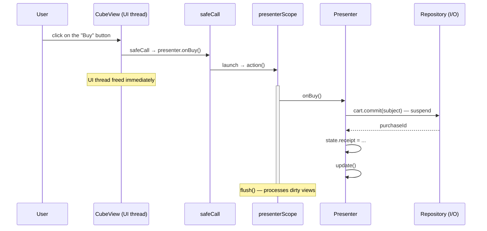

The `safeCall` implementation is identical on all platforms:

```kotlin
// In ComposeCubeView, ReactCubeView, AbstractViewAndroid
protected fun safeCall(action: suspend () -> Unit) {
    app.presenterScope.launch {
        try {
            action()
        } catch (e: Exception) {
            app.alertUnexpectedError(LOG, "Unexpected error", e)
        } finally {
            ViewUpdateScheduler.flush()  // Processes dirty views
        }
    }
}
```

**In practice, in the view:**

```kotlin
// Compose
Button(onClick = { safeCall { presenter.onBuy() } }) { Text("Buy") }

// Native Android
buyButton.setOnClickListener { safeAction("onBuy") { presenter.onBuy() } }

// Native Web (React/MUI via Kotlin/JS)
onClick = { safeCall { presenter.onOpenProduct(productId) } }
```

### Presenter Lifecycle and Suspend

`applyParameters()` is the only lifecycle method that is `suspend`. This lets presenters do asynchronous work during navigation:

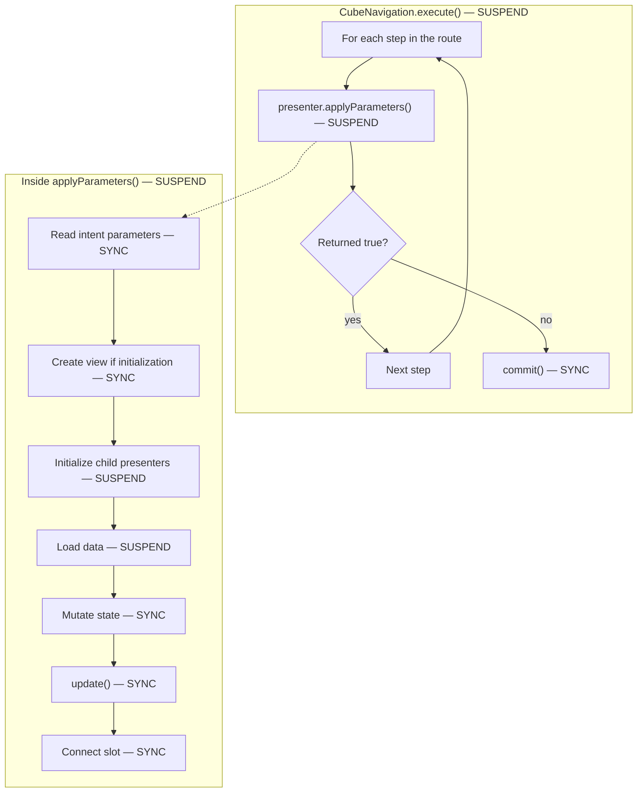

**Concrete example — ReceiptPresenter:**

```kotlin
override suspend fun applyParameters(intent: CubeIntent, initialization: Boolean, deepest: Boolean): Boolean {
    val pPurchaseId = intent.getParameterAsLong(PlaceParameters.PURCHASE_ID, purchaseId)
        ?: throw AssertionError("Missing PURCHASE_ID")

    // (1) Load data from the server — SUSPEND (I/O)
    if (state.receipt == null || pPurchaseId != purchaseId) {
        val receipt = receiptService.loadReceipt(pPurchaseId)  // ← suspend
        purchaseId = pPurchaseId
        state.receipt = receipt   // ← sync: mutates state
        update()                  // ← sync: notifies the view
    }

    // (2) Create view and connect slot — SYNC
    if (initialization) {
        ownerSlot = intent.getViewSlot(PlaceAttributes.SLOT_OWNER)
        view = createView?.invoke(this)
        update()
    }

    ownerSlot?.setView(view!!)   // ← sync: connects to the parent
    return true
}
```

### Child Presenters — Asynchronous Initialization

Child presenters (embedded panels) follow a two-step pattern:

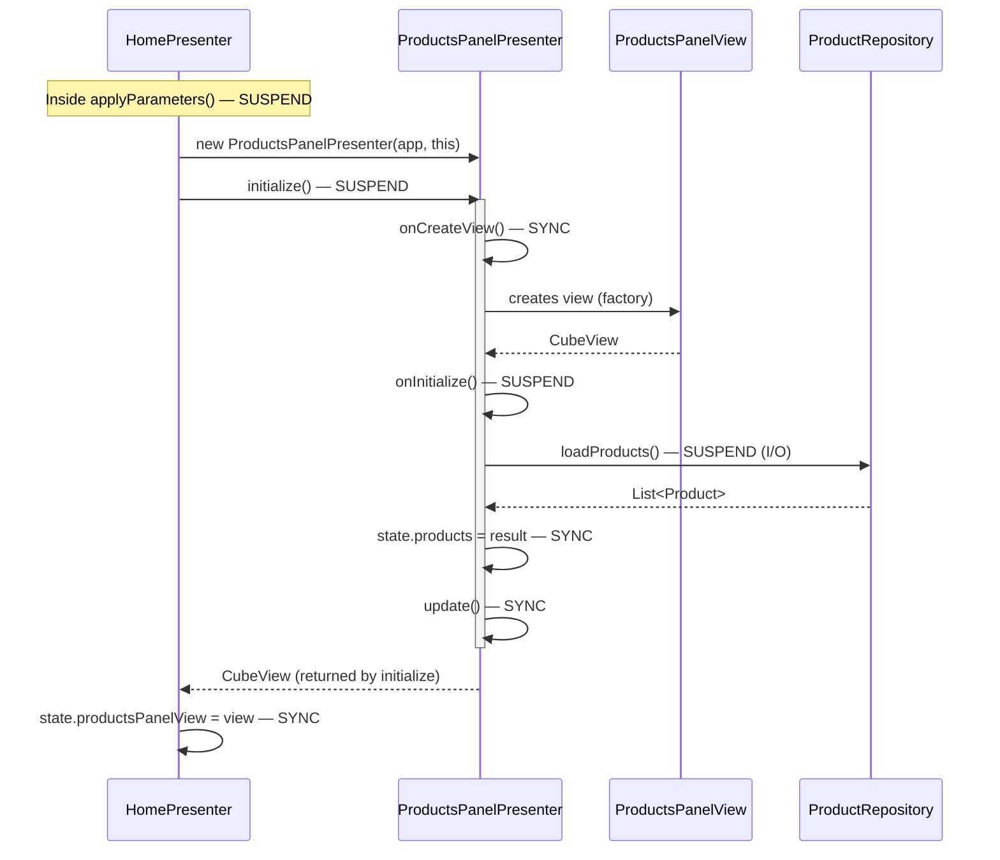

```kotlin
// AbstractChildPresenter — lifecycle
abstract class AbstractChildPresenter<A : CubeApplication>(override val app: A) : PresenterBase {

    suspend fun initialize(): CubeView {
        val v = onCreateView()       // SYNC — creates the view instance
        view = v
        onInitialize()               // SUSPEND — may do I/O
        return v
    }

    protected abstract fun onCreateView(): CubeView           // SYNC
    protected abstract suspend fun onInitialize()             // SUSPEND
}
```

**The split is intentional:** `onCreateView()` is synchronous because creating a view is fast and involves no I/O. `onInitialize()` is suspend because it typically loads initial data from the server.

### When to Use and When NOT to Use Suspend

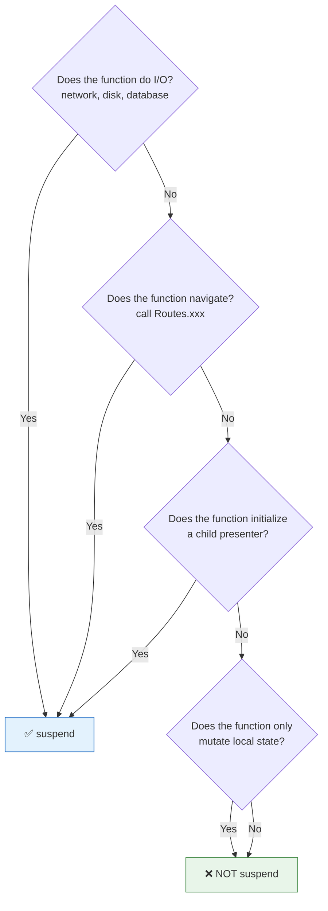

**Examples in CartPresenter:**

```kotlin
// ❌ NOT suspend — only works on the local (in-memory) cart
fun onModifyQuantity(productId: Long?, quantity: Int?) {
    val found = cart.modifyProductQuantity(productId, quantity)  // sync
    if (found) {
        state.items = cart.getCartItems()  // sync
        update()                            // sync
    }
}

// ✅ suspend — may navigate (Routes.home)
suspend fun onRemoveProduct(productId: Long?) {
    val modified = cart.removeProduct(productId)  // sync
    if (modified) {
        if (cart.getSize() == 0) {
            Routes.home(app)  // ← suspend: navigates
        } else {
            state.items = cart.getCartItems()
            update()
        }
    }
}

// ✅ suspend — does I/O (cart.commit) and navigates (Routes.receipt)
suspend fun onBuy() {
    val purchaseId = cart.commit(app.subject!!)  // ← suspend: persists the purchase
    val intent = app.newIntent()
    intent.setParameter(PlaceParameters.PURCHASE_ID, purchaseId)
    Routes.receipt(app, intent)                  // ← suspend: navigates
}
```

### Practical Rules for the Developer

1. **Mark a function `suspend` if and only if** it calls another suspend function (repository, Routes, initialize). Do not add `suspend` "just in case".

2. **Never call `runBlocking` inside a presenter.** The `presenterScope` already is the coroutine; using `runBlocking` inside it causes a deadlock.

3. **Views are never suspend.** The `update()`, `release()` and `setView()` methods and all UI construction are synchronous. Use `safeCall` to dispatch suspend actions from UI events.

4. **`safeCall` is fire-and-forget.** There is no return value. If you need the result of an async operation to update the UI, mutate `state` inside the block: the observed state asks for the repaint.

5. **Listeners can be suspend.** `CartManager` supports `suspend () -> Unit` as a commit listener. The framework calls these listeners sequentially with `await`.

6. **`CubeViewSlot.setView()` is synchronous.** It assigns a view to the parent's slot and never involves I/O.

7. **Navigation actions (Routes) are always suspend.** Any method that may navigate must be marked `suspend`, because `CubeNavigation.execute()` is suspend.

8. **The typical flow inside a `safeCall`:**

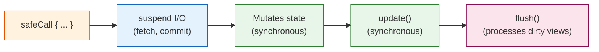

### Parallel Asynchronous Dispatch — Fire-and-Forget with a Result

There are cases where the presenter needs to fire an I/O operation **without blocking** the current action: for example, preloading data, sending telemetry, or fetching secondary information while the UI already shows the main content.

Because `presenterScope` is serial (`limitedParallelism(1)`), `app.presenterScope.launch { ... }` only **queues** the task for later. If the goal is **truly parallel** execution, use a separate scope and, once the result is available, dispatch back to `presenterScope` to mutate the state safely.

Presenters reach `presenterScope` through `app.presenterScope` (defined in `ShoppingApplication`).

#### Pattern: Parallel Scope with Return to presenterScope

```kotlin
// Inside a presenter (app is ShoppingApplication)
suspend fun onEnter() {
    // Show immediately with partial data
    state.loading = true
    update()

    // Fire the heavy operation in parallel — does NOT block
    CoroutineScope(Dispatchers.Default).launch {
        try {
            val extra = repository.fetchExtraInfo(id)  // parallel I/O

            // Return to presenterScope to mutate state
            app.presenterScope.launch {
                state.extraInfo = extra
                state.loading = false
                update()
            }
        } catch (e: Exception) {
            app.presenterScope.launch {
                state.errorMessage = e.message
                state.loading = false
                update()
            }
        }
    }
}
```

#### Sequence Diagram

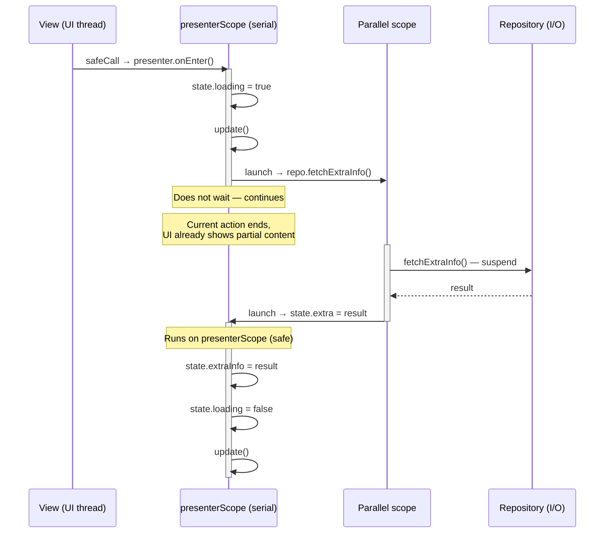

#### Contrast with Serial (Queued) Mode

If the operation does not need to be parallel, only decoupled from the current action, just queue it on `presenterScope` itself:

```kotlin
// Queued — runs AFTER the current action ends (serial, no parallelism)
app.presenterScope.launch {
    val data = repository.sendAnalytics(payload)
    // Can mutate state directly here (already on presenterScope)
    state.analyticsConfirmed = true
    update()
}
```

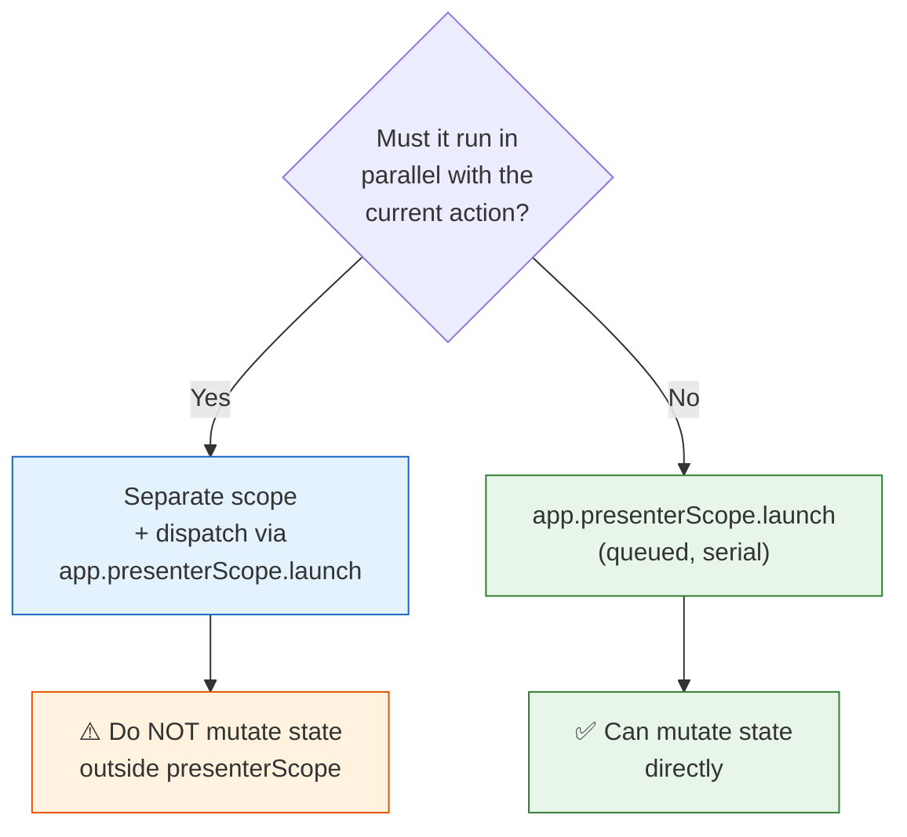

#### Safety Rule

> **Every `state` mutation and `update()` call must happen inside `presenterScope`.**
>
> If code is running on a parallel scope, it must dispatch back via `app.presenterScope.launch { ... }` before touching the presenter's state. Breaking this rule causes silent race conditions.
