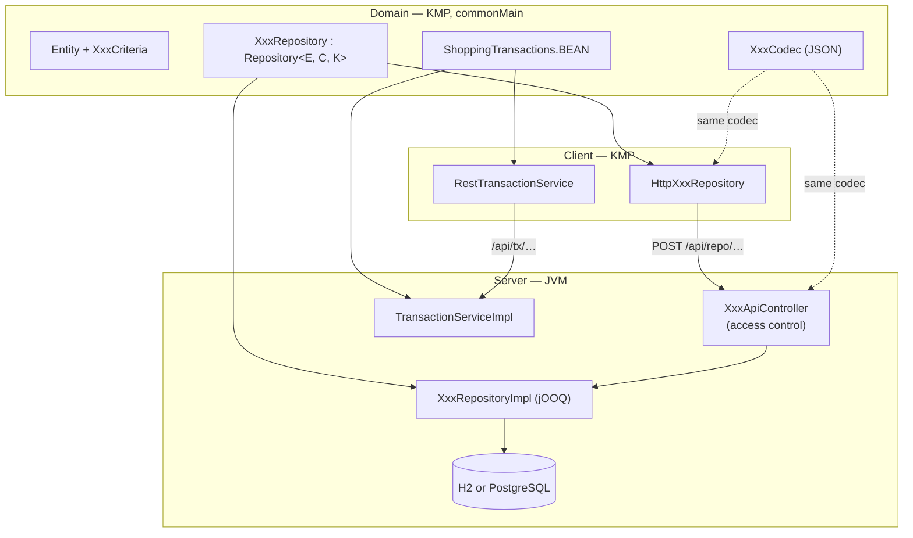

# Persistence Architecture

How Storefront stores and queries data: the repository contract, criteria, projection, transactions, and the REST path. The same use case runs on the server, talking to the database, and on a client, talking HTTP — guaranteeing that is why this architecture exists.

## Contents

- [Overview](#overview)
- [Modules](#modules)
- [Repository](#repository)
- [Criteria](#criteria)
- [Projection](#projection)
- [Server implementation (jOOQ)](#server-implementation-jooq)
- [Schema, migrations, and codegen](#schema-migrations-and-codegen)
- [Transactions](#transactions)
- [REST API](#rest-api)
- [HTTP client](#http-client)
- [Security](#security)
- [Configuration and supported databases](#configuration-and-supported-databases)
- [Tests](#tests)
- [How to add an entity](#how-to-add-an-entity)

---

## Overview



Three ideas underpin the design:

1. **One contract, two implementations.** `Repository<E, C, K>` is implemented on the server on top of jOOQ and on the client on top of HTTP. Whoever writes a presenter or a service doesn't know which side they are on.
2. **The same codec on both sides.** Each entity has an `XxxCodec` that reads and writes the entity and the criteria as JSON. The REST controller and the HTTP client use the same class, without reflection — what one writes, the other reads.
3. **The transaction belongs to whoever knows the unit of work.** Repositories neither open nor close transactions: they join whichever one is open. The use case draws the boundaries.

---

## Modules

| Module | Platform | Contents |
|---|---|---|
| `:framework-domain` | KMP | `Repository`, `Page`, criteria, projection, codecs, transaction contract, exceptions |
| `:framework-persistence` | JVM | `TransactionServiceImpl` (JDBC), `TransactionScope`, remote transaction coordinator |
| `:framework-jooq` | JVM | `JsonQueryBuilder`, H2 and PostgreSQL dialects, `CriterionTranslator` |
| `:framework-rest` | JVM | REST APIs on Javalin: routes, pluggable security, exception map, per-request context and transaction, OpenAPI, `RepositoryRpc` |
| `:shopping-domain` | KMP | Entities, `XxxCriteria`, `XxxCodec`, `XxxRepository`, `ShoppingTransactions` |
| `:shopping-persistence` | JVM | `XxxRepositoryImpl`, generated jOOQ classes, authentication, bootstrap |
| `:persistence-rest` | JVM | The Storefront API on `framework-rest`: each entity's RPC with access control, `/api/tx`, `/api/auth`, `/openapi.json` |
| `:shopping-persistence-client` | KMP | `HttpRepository`, per-platform transports, `RestTransactionService` |
| `:shopping-scripts` | JVM | `DBCreate`, `DBReset`, migrations, jOOQ class generator |

The three Storefront persistence modules are grouped under the `br.com.wdc.kt.shopping.persistence/` directory, as `persistence.impl` (`:shopping-persistence`), `persistence.rest`, and `persistence.client`.

In the domain, each entity has its own package: `domain.product`, `domain.user`, `domain.purchase`, `domain.purchaseitem`.

---

## Repository

The contract has two levels: code that only queries implements (or asks for) the read-only one; the full one adds writing.

```kotlin
interface ReadOnlyRepository<E, C, K> {
    suspend fun count(criteria: C): Int
    suspend fun fetch(criteria: C, offset: Int = 0, limit: Int = 0): List<E>
    suspend fun fetchPage(criteria: C, page: Int, pageSize: Int): Page<E>
    suspend fun fetchById(id: K, projection: E? = null): E?
    fun ownFieldsProjection(): E
}

interface Repository<E, C, K> : ReadOnlyRepository<E, C, K> {
    suspend fun insert(bean: E, projection: E? = null): Boolean
    suspend fun update(newBean: E, oldBean: E? = null, projection: E? = null): Boolean
    suspend fun insertOrUpdate(newBean: E, oldBean: E?, projection: E? = null): Boolean
    suspend fun delete(criteria: C): Int
}
```

`ReadOnlyRepository` serves two situations:

- **Data that isn't written through here** — a dashboard view, a report, an aggregate computed in the database. The repository implements only the queries, without having to invent what to do with an `insert`.
- **Code that only reads** — a service that declares a dependency on `ReadOnlyRepository` states, through the type, that it changes nothing, and accepts either a read-only repository or a full one.

All four Storefront entities have a full repository.

- **`update` is partial.** The `projection` says which fields to consider, and a marked field with a null value clears the column. With `oldBean`, only the fields that changed are included. With neither, only fields with a value, as in `insert`: a bean read with a narrow projection and handed back does not erase what it didn't read. To clear a column, mark it in a projection.
- **`insert` also accepts a projection.** It says which fields go into the `INSERT`; whatever is left out gets the column default. Without a projection, the fields that have a value go in (null ones are left out). The bean comes back complete: the generated key and whatever the database filled in.
- **`insertOrUpdate`** inserts when `oldBean` is `null` and updates otherwise — it doesn't query the database to decide. The projection applies to both.
- **`fetch`**: `0` in `offset` or `limit` means "no skip" and "no limit". Watch the positional order: `fetch(c, 10)` skips ten rows; to limit, name the argument — `fetch(c, limit = 10)`.
- **`fetchPage`** returns `Page(items, page, totalPages, totalItems)`.
- **`delete` with empty criteria is refused** (`InvalidRequestException`) for all four entities. Deleting everything because a filter was forgotten is not a use case.
- **`fetchById`** is a default method on each entity's interface: it builds the criteria from the key and calls `fetch`. Fetching by id thus goes through the same projection, security, and transaction rules as other queries.

Repositories are registered in holders (`ProductRepository.BEAN`, …) by the composition root: the backend and the tests register the jOOQ implementations; the clients, the HTTP ones.

---

## Criteria

Each entity has an `XxxCriteria` with one field per filter. The field is created with the criteria and is never `null`; it accumulates **comparison requests**.

```kotlin
val criteria = ProductCriteria()
    .withName("Wilson Ball")                       // equality
    .withOrderBy(ProductCriteria.OrderBy.CHEAPEST_FIRST)

criteria.price.between(10.5, 50.5)                 // range
criteria.productId.isIn(listOf(1L, 2L, 3L))        // set
criteria.name.or().startingWith("Wilson")            // "or" within the field…
criteria.name.containing("Tape")                   // …with this other request
```

- Requests on **the same field** combine with `AND`; after `or()`, with `OR`. **Different fields always combine with `AND`.**
- A field with no request doesn't filter. The `withXxx(value)` shortcuts ignore `null`.
- `isIn(null)` doesn't filter ("not provided"), but `isIn(emptyList)` filters by nothing: the query matches no rows, and `delete` deletes nothing. On the wire, it goes out as `{ "o": "IN" }` with no values.
- There are three families, and the compiler only offers what each one allows: `Criterion` (equality, `ne`, `isIn`, nullness), `ComparableCriterion` (plus `gt`/`ge`/`lt`/`le`/`between`), and `TextCriterion` (plus `like`/`ilike`/`startingWith`/`containing`).
- **Ordering is named by its effect** — `NAME_A_TO_Z`, `MOST_RECENT_PURCHASE_FIRST` — not by column. The repository translates the name into columns and adds the tie-breaker by key. Each ordering has an index backing it, declared in `DBCreate`.
- Some fields are not columns of the table itself: `PurchaseCriteria.productId` (purchases that contain the product) and `PurchaseItemCriteria.userId` (items of the user's purchases) become `EXISTS` over the other table. To whoever builds the filter, they are fields like any other.

In JSON, a criteria is the object with the requests, and a bare value is a shortcut for equality:

```json
{ "price": { "p": [ { "o": "GE", "v": [10.5] }, { "o": "LE", "v": [50.5] } ] },
  "name":  { "or": true, "p": [ { "o": "LIKE", "v": ["Wilson%"] }, { "o": "EQ", "v": ["Thread Seal Tape"] } ] },
  "productId": 3,
  "orderBy": "CHEAPEST_FIRST" }
```

An operator the server doesn't know is ignored; an unknown `orderBy` is refused with 400, stating the value received and the accepted ones.

---

## Projection

The projection is an instance of the entity itself: **a filled-in field means "bring this field"**. The values come from `ProjectionValues` and are only markers.

```kotlin
val pv = ProjectionValues
val projection = Purchase().apply {
    id = pv.i64
    buyDate = pv.instant
    user = User().apply { id = pv.i64; name = pv.str }
    items = pv.singletonList(
        PurchaseItem().apply { id = pv.i64; price = pv.f64; product = Product().apply { name = pv.str } },
        PurchaseItemCriteria().withOrderBy(PurchaseItemCriteria.OrderBy.MOST_EXPENSIVE_FIRST),
        limit = 3,
    )
}
val purchases = repo.fetch(PurchaseCriteria().withUserId(userId).withProjection(projection))
```

- An **association** (`user`) is projected by another instance. When it asks only for the key, the value comes from the row itself, without a subquery.
- A **collection** (`items`) is projected by a one-element list — the shape of each item. With `pv.singletonList(shape, criteria, limit, offset)` the collection is also filtered, ordered, and sliced. This crosses REST: the projection collection travels as an envelope `{ shape, where, limit, offset }`.
- Without a projection, each repository uses its default one (`ownFieldsProjection()`): the scalar fields and the association keys. The product image and the user password are left out.

---

## Server implementation (jOOQ)

Each `XxxRepositoryImpl` declares once how the entity relates to the table:

```kotlin
val QUERY: JsonQuery<PurchaseItem, EnPurchaseitem> = JsonQueryBuilder<PurchaseItem, EnPurchaseitem>()
    .setAlias("pi")
    .setBeanFactory(::PurchaseItem)
    .setTableFactory { alias -> EN_PURCHASEITEM.`as`(alias) }
    .setDSLContextSupplier(BaseRepositoryImpl::dsl)
    .setOrdering(::orderingOf)
    .addI64("id", { it.id }, { b, v -> b.id = v }, { it.ID })
    .addI32("amount", { it.amount }, { b, v -> b.amount = v }, { it.AMOUNT })
    .addF64("price", { it.price }, { b, v -> b.price = v }, { it.PRICE })
    .lazy { qb ->
        qb.addBeanField("product", { it.product }, { b, v -> b.product = v }, ProductRepositoryImpl.QUERY,
            { cq -> cq.where().and(cq.childTable.ID.eq(cq.superTable.PRODUCTID)) },
            { key -> key.addI64("id") { it.PRODUCTID } })
    }
    .build()
```

From that mapping and a projection, `JsonQuery` builds **a single query** that returns the requested graph as JSON — associations and collections go in as correlated subqueries — and reads it back into the entities. There is no N+1, and only the projected columns are selected.

- Relations live inside `lazy { }` because purchase and item reference each other.
- `CriterionTranslator` translates each criteria field into a jOOQ condition; values are always *bind values*.
- The module's `DSLContext` (`ShoppingDSLContext.BEAN`) uses the current transaction's connection or, outside a transaction, a standalone connection in autocommit.
- Repositories don't wrap exceptions: the real one propagates, and the REST layer translates it into a status.
- **`insert` also comes from the mapping:** `QUERY.insert(bean, projection)` builds the `INSERT` from the mapping's columns (associations by the foreign key declared in `key`; derived fields and identity columns are left out) and reads the inserted row back through the same JSON projection as fetch. On PostgreSQL it is a single statement (`WITH … INSERT … RETURNING`); on H2, a plain `INSERT` followed by a `SELECT` by key — H2 2.4's `FINAL TABLE` leaves the row written when the statement fails on a constraint. The Storefront repository only fills in the id from the sequence before calling it.

---

## Schema, migrations, and codegen

**The DDL in `DBCreate` is the schema's source of truth.** It creates missing tables, runs pending migrations and, on a new database, loads the demo data (`DBReset`).

To change the schema:

1. Change the DDL in `DBCreate`.
2. Write a `Migration_NNNN_…` that brings existing databases to the same result and register it in `DBCreate.run()`.
3. Regenerate the jOOQ classes and commit whatever changes:
   ```bash
   cd fontes && ./gradlew :shopping-scripts:generateJooqSchema
   ```

Two tests guard this: `JooqSchemaTest` fails if the generated classes diverge from the DDL, and `SchemaMigrationTest` compares a migrated old database with a new one.

**Dates.** Date/time columns are `TIMESTAMP` without time zone and store the instant **in UTC**, on write and on read. In the domain, the date is `kotlin.time.Instant`.

Migration details in [shopping-scripts](../fontes/br.com.wdc.kt.shopping/br.com.wdc.kt.shopping.scripts/README.md).

---

## Transactions

The contract is `TransactionService`, with the six usual propagations (`required`, `requiresNew`, `mandatory`, `supports`, `notSupported`, `never`). The block receives a `TransactionContext`.

```kotlin
ShoppingTransactions.BEAN.get().required { tx ->
    purchaseRepo.insert(purchase)
    purchaseItemRepo.insert(item)
    // tx.setRollbackOnly() rolls everything back without throwing
}
```

- **A normal return commits; any exception rolls back** and propagates intact, with its original type.
- **A nested block that fails dooms the whole transaction.** If a `required` (or `mandatory`, `supports`) inside another one throws, everything is rolled back even when the caller catches the exception and carries on, and the outer `required` throws `TransactionSystemException` ("The transaction was rolled back: a call inside it failed.") instead of returning its result. Only `setRollbackOnly()` rolls back without throwing. The same holds on the server and in the client's remote transaction.
- The use case must tolerate the service being absent — `ShoppingTransactions.BEAN.getOrNull()` — and run directly in that case (tests without persistence).
- This is how checkout works: `CartManager.doPurchase` writes the purchase and its items inside `required`. A failure halfway doesn't leave an orphan purchase.
- `afterCommit { … }` schedules a task for after the current physical transaction commits (notifying a background process, for example): it runs only if the transaction commits, in scheduling order, already outside it; if rolled back, the task is discarded. Without a transaction, it runs immediately. A task failure goes to the log and doesn't change the transaction's outcome. On the server, a task scheduled inside a remote transaction runs on its commit.

There are two implementations, and the use case doesn't know which one it is using:

| Where | Implementation | What it does |
|---|---|---|
| Server | `TransactionServiceImpl` | JDBC transaction on the connection from the module's `DataSource` |
| REST client | `RestTransactionService` | Opens a **remote transaction** on the server and closes it over HTTP |

### Remote transaction

A REST client that needs several atomic writes opens a transaction on the server:

1. `POST /api/tx/begin` → `{ "txId": "…" }`
2. Subsequent writes carry the `X-Tx-Id` header and join the same physical transaction.
3. `POST /api/tx/commit` or `POST /api/tx/rollback` ends it. `GET /api/tx/status` tells what happened, for whoever lost the response.

`RestTransactionService` does this under `required { }`. On the server, a coordinator keeps the open transactions and applies the safeguards:

- **Owner.** The transaction belongs to whoever opened it — the authenticated user **and** the client instance (`X-Client-Id`), or, without security, just the `X-Client-Id` — and no one else may use it (403). The same user on two clients (desktop and web) doesn't block themselves.
- **Lost header.** A write **without** `X-Tx-Id` from someone who has an open transaction is refused (409), instead of committing on its own outside the transaction.
- **Failing request.** The write runs as a participant in the remote transaction: if it fails halfway, the transaction is doomed, and the commit rolls it back and responds 409, instead of committing the partial write.
- **Abandonment.** An idle transaction is rolled back by the server, by a sweep that runs every 15 seconds (`remoteTransaction.reapIntervalSeconds`) and on every `begin`; there are caps on open transactions, in total and per user (429). An unknown or already rolled-back `txId` responds 410.
- **In use.** A rollback requested while a request is using the transaction takes effect immediately, but the connection only closes when the request finishes; a commit at that moment is a conflict (409).
- **Repetition.** Repeating the same outcome is harmless; asking for the opposite is a conflict (409).
- **Lost response.** If the commit fails in transport (timeout, dropped connection), the client asks for the `status` before deciding: committed is success, open is rolled back.

Two limits to keep in mind:

- **Reads don't participate** in the remote transaction: inside the block, a `fetch` sees only what has already been committed.
- `notSupported` inside a remote transaction is for reading, not writing — the server can't tell "suspended transaction" from "lost header". To write outside it, use `requiresNew`.

The client's current transaction is kept per service instance (one per application). Presentation actions run serially and HTTP is blocking; therefore, **the calls of a remote transaction must be sequential**.

---

## REST API

All entities have the same operations, under `/api/repo/<entity>` (`user`, `product`, `purchase`, `purchase-item`):

| Route | Transactional | Body | Response |
|---|---|---|---|
| `POST …/insert` | yes | `{entity, projection?}`, or the bare entity | `{success, id, entity}` |
| `POST …/update` | yes | partial entity — the keys present are the fields to update | `{success}` |
| `POST …/delete` | yes | criteria fields | `{count}` |
| `POST …/count` | no | criteria fields | `{count}` |
| `POST …/fetch` | no | criteria + `projection?` + `offset?` + `limit?` | `{items}` |
| `POST …/fetch-page` | no | criteria + `projection?` + `page` + `pageSize` | `{items, totalItems}` |
| `POST …/fetch-by-id` | no | `{id, projection?}` | entity or 404 |
| `GET …/{id}` | no | — | entity or 404 |
| `GET product/{id}/image` | no (public) | — | bytes; 204 if no image |
| `PUT product/{id}/image` | yes | bytes | `{success}` |

Every write is atomic: it runs in the remote transaction given by `X-Tx-Id` or, without it, in a transaction of the request's own.

Entity routes are a [`framework-rest`](../fontes/br.com.wdc.kt.framework/br.com.wdc.kt.framework.rest/README.md) `RepositoryRpc`, one per entity, and `RepositoryApiRoutes.create()` assembles the whole API. Each controller configures its entity's RPC: each operation's rule, restricting the criteria to the caller, stripping the password, and the checks before each write. The transaction bridge and the `/api/tx` routes also come from the framework.

Errors come back as `{"error": "…"}`:

| Status | When |
|---|---|
| 400 | Invalid request: unknown `orderBy`, `delete` without a filter, `update` without an id |
| 401 | Missing or invalid token (with security enabled). A path with no route responds 404, with or without a token |
| 403 | Missing permission, or the row is outside the user's scope |
| 409 | Remote transaction conflict |
| 429 | Too many open remote transactions |
| 500 | Unexpected failure: `{"error": "Internal server error"}`, with the error recorded in the log |

**The full description is at `GET /openapi.json`** (OpenAPI 3). The criteria fields, orderings, and operators it lists are read from the domain at runtime, and `OpenApiSpecTest` checks that every documented route exists.

---

## HTTP client

`HttpReadOnlyRepository<E, C, K>` implements the queries once for all entities, and `HttpRepository<E, C, K>` extends it with writing; each `HttpXxxRepository` only provides the codec and the path. A read-only repository on the client extends `HttpReadOnlyRepository` directly. `HttpProductRepository` adds reading and writing the image.

`HttpTransport` has one implementation per platform — `OkHttpTransport` (JVM and Android), `JsHttpTransport`, `WasmHttpTransport`, and `IosHttpTransport` —, all blocking. Each one:

- sends the access token and, on 401, renews the session and retries the call once;
- always sends `X-Client-Id`, and `X-Tx-Id` when there is a current remote transaction;
- turns the error response into the exception the server threw — 400 `InvalidRequestException`, 403 `AccessDeniedException`, 409 `TransactionConflictException`, 429 `TransactionLimitExceededException`; anything else, `BusinessException`. The message is always `HTTP <status>: <body>`.

`RestRepositoryBootstrap.initialize(config, cryptoProvider)` registers the four HTTP repositories, the authentication service, and the `RestTransactionService`. Every client entry point calls it.

---

## Security

**Access control lives at the HTTP boundary, and only there.** Repositories check neither permission nor data ownership. A repository is called from two places:

- **From a client** (Compose, native), through the REST API. The user controls the client and can request anything; that's why each controller checks the request before executing it.
- **From inside the server**, by the remote view's presenters. There the user has no way to call a repository: only what the presentation asks for is executed. The guarantee is that the presentation is correct — always asking for the data of whoever is logged in.

With `security.jwt.secret` configured, the backend requires `Authorization: Bearer` across the whole API, except `/api/auth`, reading a product image, and `/openapi.json`. Each route checks, through the access rule (`ApiSecurity.permission`) and the `RepositoryRpc` hooks:

- the **permission** (`<entity>:read`, `:write`, `:delete`), granted by the user's roles;
- the **scope**: whoever lacks `data:all` only reads and writes what is theirs — the user themselves, their own purchases, and those purchases' items. A purchase inserted by a client always belongs to them. Fetching by key goes through the same restriction: what belongs to someone else "doesn't exist" (404).

**The password never leaves through the API.** It is accepted when writing a user and stripped from every projection and every response, including when the user comes inside a purchase — with security enabled or not.

Without the secret, the API is open and `/api/auth` doesn't exist: this is the development mode, and the mode of tests that don't deal with security.

**In the presentation**, the care is with what arrives through navigation: a route parameter is chosen by the user. When it identifies a piece of data — the receipt's `purchaseId`, for example —, the service fetches it restricted to whoever is logged in (`ReceiptService.loadReceipt(purchaseId, userId)`), and never by key alone.

---

## Configuration and supported databases

The backend runs on **H2** (default: a file in the data directory) or on **PostgreSQL**; the database is chosen by the URL. Connections come from an Agroal pool.

The keys live in the `[database]` section of `config/application.toml`, in the backend's working directory: `url`, `username`, `password`, `schema` (PostgreSQL only), `reset`, `logSql`, `pool.*`, and `remoteTransaction.*`. All of them, with their defaults, are in [`application.example.toml`](../fontes/work/config/application.example.toml).

The startup order, in `BusinessContext`:

1. Working directory (required: `--workdir=<folder>` or `SHOPPING_WORKDIR`), logging, and configuration (`config/application.toml`); then cryptography and executor.
2. `SqlDataSourceSupport` builds the pool.
3. `DBCreate` creates what is missing and runs the migrations.
4. `ShoppingRepositoryBootstrap.initialize(…)` registers the `DSLContext`, the `TransactionService`, and the repositories.
5. The remote transaction coordinator is registered.
6. `ShoppingRepositoryBootstrap.initializeSecurity(…)`, if there is a JWT secret: registers the authentication service.

---

## Tests

Repository tests are written once, in `AbstractXxxRepositoryTest` classes, and run in two modes: **local** (jOOQ repository directly) and **REST** (HTTP client → embedded Javalin → repository). That way the REST path proves it returns the same as the local one.

```bash
cd fontes
./gradlew test                              # suite on H2
./gradlew :shopping-tests:testPostgres      # the same suite on embedded PostgreSQL
./gradlew check                             # both
```

- `testPostgres` starts an embedded PostgreSQL by itself. With `SHOPPING_TEST_PG_URL` (and `SHOPPING_TEST_PG_USER`, `SHOPPING_TEST_PG_PASSWORD`) it uses that server — **and deletes its data**; point it at a dedicated schema with `?currentSchema=…`.
- `RestTestEnvironment(name, jwtSecret = "…")` starts the server with security enabled; `env.loginAs("admin")` authenticates the client.
- `LiveBackendSmokeTest` exercises a running backend the way a REST client would (login, catalog, checkout, statement). It only runs with `SHOPPING_LIVE_BACKEND_URL` set, and writes a purchase to that backend.

---

## How to add an entity

1. **Domain** (`:shopping-domain`, package `domain.<entity>`): the entity (`KeyedEntity`, nullable fields), the `XxxCriteria` with the filter fields and the `OrderBy`, the `XxxCodec`, and the `XxxRepository` interface with `ownFieldsProjection()`, `fetchById`, and the `BEAN` holder.
2. **Schema** (`:shopping-scripts`): the table, the sequence, and the ordering indexes in `DBCreate`; the migration for existing databases; the seed data in `DBReset`, if applicable. Regenerate the jOOQ classes.
3. **Server** (`:shopping-persistence`): the `XxxRepositoryImpl` with the `QUERY` mapping, the conditions, and the ordering; registration in `ShoppingRepositoryBootstrap`.
4. **REST** (`:persistence-rest`): the `XxxApiController`, which configures a `RepositoryRpc` **with the permission and scope checks** (`rule` with `ApiSecurity.permission`, `scope`, `beforeInsert`/`beforeUpdate`), and its call in `RepositoryApiRoutes.create()`; the permissions in `Role`; the entity in `RepositoryApiDocs`.
5. **Client** (`:shopping-persistence-client`): the `HttpXxxRepository` and its registration in `RestRepositoryBootstrap`.
6. **Presentation**: access in `ShoppingApplication`. In services, always ask for the data of whoever is logged in.
7. **Tests**: an `AbstractXxxRepositoryTest` with the local and REST subclasses, and a REST test with security enabled.

For read-only data (a dashboard, for example), the interface extends `ReadOnlyRepository`, the client extends `HttpReadOnlyRepository`, and the controller registers the RPC with `writes = false` (only `count`, `fetch`, `fetch-page`, `fetch-by-id`, and `GET {id}`).

The four existing repositories serve as models; `Product` is the simplest, and `Purchase`/`PurchaseItem` show associations, a collection, and a mutual relation.
