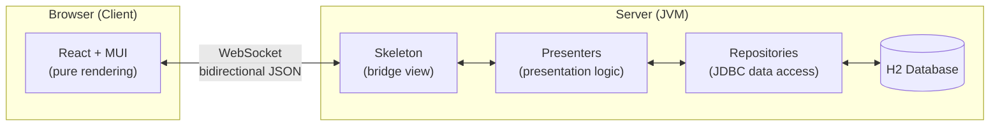
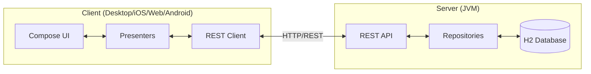
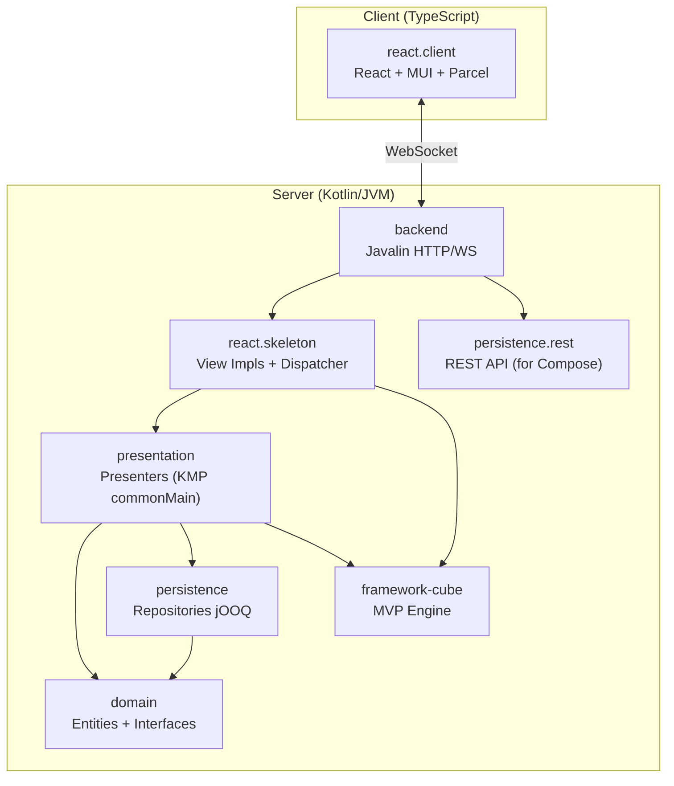
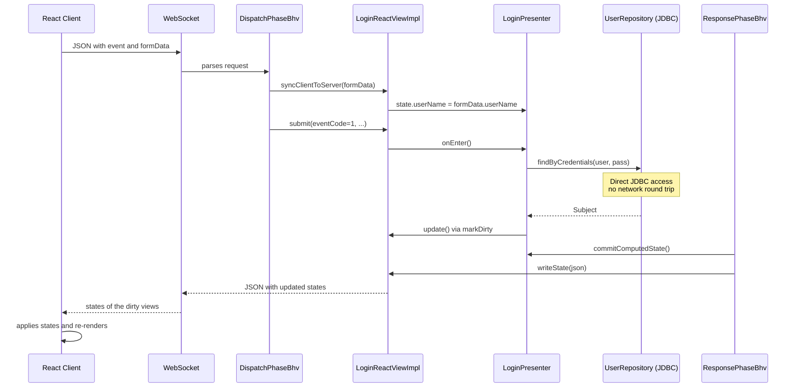
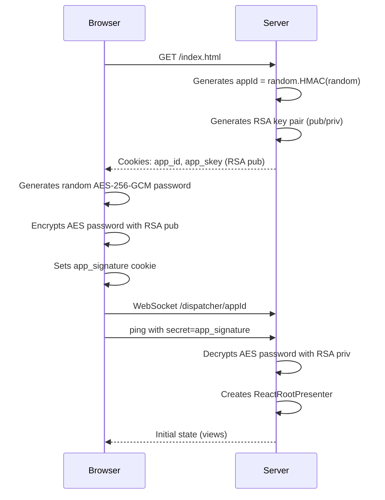
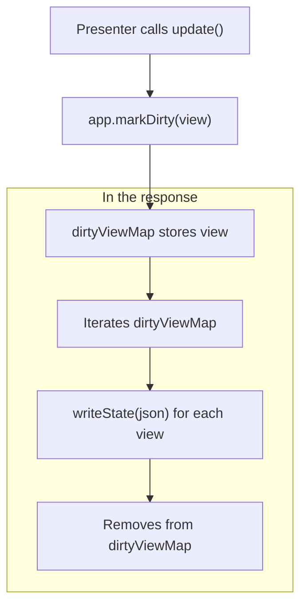
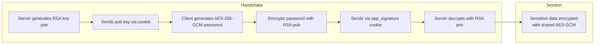
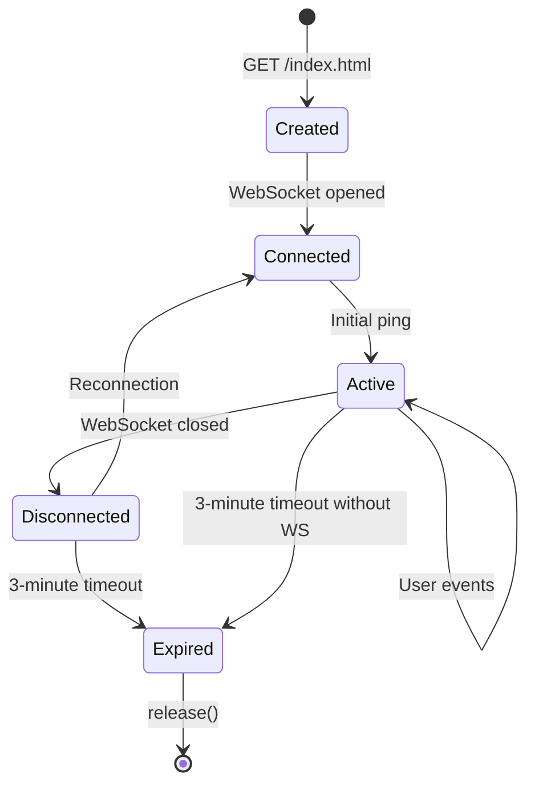
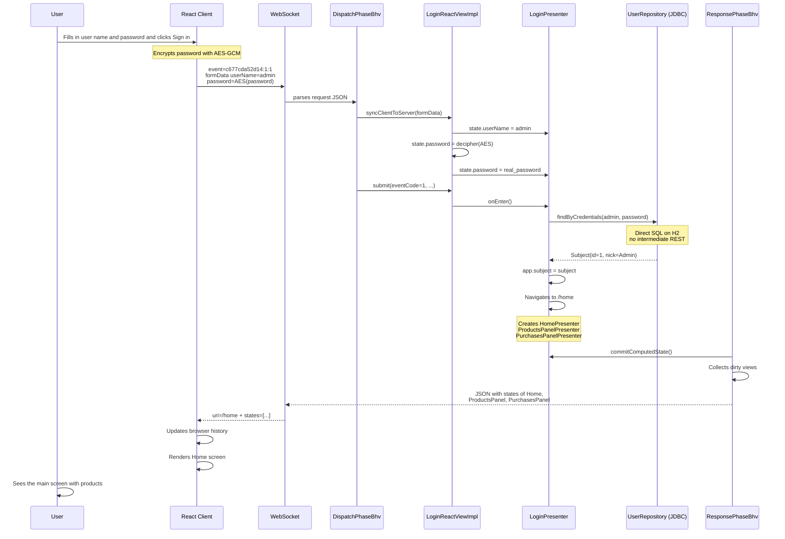

# React Architecture — Remote View with Server-Side Presenters

## Contents

- [Overview](#overview)
- [Comparison: Local View vs Remote View](#comparison-local-view-vs-remote-view)
- [Module Structure](#module-structure)
- [Communication Cycle](#communication-cycle)
- [Session Establishment](#session-establishment)
- [WebSocket Protocol](#websocket-protocol)
- [Skeleton — The Bridge Between Presenter and Client](#skeleton--the-bridge-between-presenter-and-client)
- [State Synchronization](#state-synchronization)
- [Security](#security)
- [Session Management and Lifecycle](#session-management-and-lifecycle)
- [Advantages of the Remote View](#advantages-of-the-remote-view)
- [Ideal Use Cases](#ideal-use-cases)
- [Complete Example: Login Flow](#complete-example-login-flow)

---

## Overview

The React architecture implements a **remote view** in which the presentation layer (presenters) runs entirely on the server. The React client is responsible only for **rendering the interface**, with no business or presentation logic. All user interaction is sent to the server over WebSocket, and the server responds with the new state serialized as JSON.



This contrasts with the Compose Multiplatform architecture, where the presenters run on the client and access data over REST:



---

## Comparison: Local View vs Remote View

| Aspect | Compose (Local View) | React (Remote View) |
|---------|---------------------|---------------------|
| **Presenter execution** | On the client | On the server |
| **Data access** | Via REST (network) | Direct JDBC (in-process) |
| **Data latency** | HTTP round trip | Zero (same JVM) |
| **Session state** | On the device | On the server |
| **Client logic** | Presenters + UI | UI only |
| **Protocol** | HTTP/REST | WebSocket |
| **Data security** | Exposed API | Data never leaves the server |
| **Scalability** | Processing on the client | Processing on the server |
| **Offline operation** | Possible | Requires a connection |

---

## Module Structure



| Module | Role |
|--------|-------|
| **react.client** | Pure rendering in React/TypeScript with Material UI. Receives JSON states and sends user events. Bundled with Parcel. |
| **react.skeleton** | Server-side bridge: each `*ReactViewImpl` translates client events into presenter calls and serializes the ViewState to JSON. |
| **backend** | Javalin server that hosts the WebSocket (`/dispatcher/{id}`), serves the React static files, and exposes the REST API for Compose clients. |
| **presentation** | Shared presenters (KMP commonMain) — the same code used by both React and Compose. |
| **persistence** | jOOQ implementation of the repositories (H2 or PostgreSQL) — used directly by the presenters in the React architecture. |
| **persistence.rest** | REST endpoints — used by Compose clients via `persistence.client`. |

---

## Communication Cycle



The whole cycle happens in a single WebSocket exchange — the client sends the event, the server processes it and responds with the new state. There are no intermediate REST calls.

---

## Session Establishment

The session is established in two steps with a cryptographic key exchange:



The `appId` is self-signed: `{random}.{HMAC(random)}` — this prevents forging session IDs.

---

## WebSocket Protocol

### Client → Server (User Event)

```json
{
  "requestId": 42,
  "event": ["c677cda52d14:1:1"],
  "c677cda52d14:1": {
    "userName": "admin",
    "password": "<AES-GCM encrypted, Base64>"
  }
}
```

- **`event`**: list of `vsid:eventCode` (which view and which action)
- **`vsid`**: view instance identifier (`hexVID:instanceNumber`)
- **Form data**: indexed by `vsid`, sensitive fields encrypted

### Server → Client (State Response)

```json
{
  "requestId": 42,
  "uri": "/home",
  "states": [
    {
      "id": "473dbdd7a36a:3",
      "nickName": "Admin",
      "cartItemCount": 0,
      "productsPanelViewId": "a1b2c3d4e5f6:4",
      "purchasesPanelViewId": "b3c4d5e6f7a8:5"
    },
    {
      "id": "a1b2c3d4e5f6:4",
      "products": [...]
    }
  ]
}
```

- **`states`**: only the views that changed (dirty tracking)
- **`uri`**: new navigation fragment (for the browser history)
- **References between views**: `*ViewId` fields point to other views

---

## Skeleton — The Bridge Between Presenter and Client

Each presenter has a matching `*ReactViewImpl` in the skeleton module. This class implements `GenericViewImpl` and does three things:

### 1. Synchronizes form data (client → server)

```kotlin
override fun syncClientToServer(formData: Map<String, Any?>) {
    val state = presenter.state
    if (formData.containsKey("userName")) {
        state.userName = CoerceUtils.asString(formData["userName"])
    }
    if (formData.containsKey("password")) {
        // Sensitive data is decrypted with AES
        state.password = app.getDataSecurity()
            .b64Decipher(CoerceUtils.asString(formData["password"]) ?: "")
    }
}
```

### 2. Dispatches events to the presenter

```kotlin
override fun submit(eventCode: Int, eventQtde: Int, formData: Map<String, Any?>) {
    if (eventCode == 1) {
        presenter.onEnter()  // Maps the integer code to a presenter method
    }
}
```

### 3. Serializes the state to JSON

```kotlin
override fun writeState(json: ExtensibleObjectOutput) {
    presenter.state.write(instanceId(), json)
}
```

The mapping between hexadecimal View IDs and views is fixed and shared between client and server:

| View | Hex VID | Client (TSX) | Server (Kotlin) |
|------|---------|---------------|-------------------|
| Browser | `7b32e816a191` | BrowserView.tsx | BrowserReactViewImpl.kt |
| Root | `f2d345c4a610` | RootView.tsx | RootReactViewImpl.kt |
| Login | `c677cda52d14` | LoginView.tsx | LoginReactViewImpl.kt |
| Home | `473dbdd7a36a` | HomeView.tsx | HomeReactViewImpl.kt |
| Cart | `7eb485e5f843` | CartView.tsx | CartReactViewImpl.kt |
| Product | `48b693f67410` | ProductView.tsx | ProductReactViewImpl.kt |
| Receipt | `e8d0bd8ae3bc` | ReceiptView.tsx | ReceiptReactViewImpl.kt |
| ProductsPanel | `a1b2c3d4e5f6` | ProductsPanel.tsx | ProductsPanelReactViewImpl.kt |
| PurchasesPanel | `b3c4d5e6f7a8` | PurchasesPanel.tsx | PurchasesPanelReactViewImpl.kt |

---

## State Synchronization

### Dirty Tracking

When a presenter calls `view.update()`, the view is marked "dirty" in `ReactRootPresenter`. In the response, only dirty views are serialized:



### Server Push

When a view is marked dirty outside the request/response cycle (for example, by an asynchronous operation), the server schedules an automatic push over WebSocket after 200ms:

```kotlin
fun markDirty(view: GenericViewImpl) {
    dirtyViewMap[view.instanceId()] = view
    if (!requestInProgress && wsSession != null) {
        schedulePush()  // Push with a 200ms delay
    }
}
```

### View Garbage Collection

The client keeps a reference system for views. When a `*ViewId` field changes in a parent view's state, the previous child view is released automatically after 4 seconds of inactivity.

---

## Security

### Transport Layer



- **Session ID**: self-signed with HMAC — prevents forging
- **Sensitive fields**: encrypted end to end with AES-256-GCM (e.g., passwords)
- **Navigation**: URLs signed with a hash to prevent parameter tampering

### Security Inherent to the Architecture

In the remote view, repository data **never travels directly to the client**. The presenter on the server decides exactly which fields to expose in the ViewState. This eliminates entire classes of vulnerabilities:

- There is no REST API exposed to the React client — no endpoint to attack
- There are no JWT tokens on the client — authentication is managed in the server session
- Sensitive data never leaves the JVM — the presenter filters it before serializing

---

## Session Management and Lifecycle



- **Creation**: when `/index.html` is accessed, session cookies are set
- **Lifetime**: 3 minutes (`DEFAULT_TIME_SPAN`) — extended on every interaction
- **Reconnection**: if the WebSocket drops, the client reconnects and finds the same session (if it has not expired)
- **Cleanup**: expired sessions without an active WebSocket are removed periodically
- **Logout/Disconnection**: an unauthenticated session is released immediately when the WebSocket closes

---

## Advantages of the Remote View

### 1. Zero Data Latency

The presenters access JDBC repositories directly in the same JVM. There is no HTTP serialization, JSON parsing, or network round trip for each database query. An operation that in the Compose model requires:

```
Client → HTTP Request → REST Endpoint → Repository → DB → Response → HTTP Response → Client
```

In the React model is reduced to:

```
Presenter → Repository → DB → Presenter
```

### 2. Minimal Attack Surface

- **No REST API exposed** to the client (the REST endpoints exist only for Compose clients)
- **No sensitive data on the client** — passwords, tokens, and payment data never reach the browser
- **No business logic on the client** — reverse engineering the logic is impossible
- **Server-side session** — no exposed JWT or authentication cookies

### 3. Ultra-Light Client

The React client contains only:
- Rendering components (TSX)
- WebSocket communication logic
- Encryption of sensitive fields

It does not contain: business validations, data access, complex state management, routes, or navigation logic.

### 4. Transactional Consistency

Because presenters and repositories share the same JVM, regular JDBC transactions spanning multiple data operations can be used — something hard to coordinate when data travels over REST.

### 5. Instant Updates

Changes to the presentation logic take effect immediately on server deployment, with no need to update clients. The React client is cache-friendly and rarely changes.

### 6. Native Server Push

The bidirectional WebSocket lets the server send state updates to the client without the client having to ask. This enables real-time notifications, dashboard updates, and synchronization across tabs/users.

---

## Ideal Use Cases

The remote view architecture is especially suited for:

| Use Case | Why |
|-------------|---------|
| **Corporate/internal applications** | Controlled network, critical security, sensitive data |
| **Administrative systems (back office)** | Many CRUD screens, complex logic, few concurrent users |
| **Financial applications** | Data never leaves the server, simplified auditing |
| **Systems with regulated data (LGPD/GDPR)** | Personal data stays on the server, client is stateless |
| **Real-time dashboards** | Server push over WebSocket is native |
| **Applications that require strong consistency** | JDBC transactions coordinated on the server |
| **Low-bandwidth environments** | Only state JSON is transferred, not raw data |

### When NOT to use it

| Scenario | Reason |
|---------|--------|
| **Offline operation** | Requires a permanent WebSocket connection |
| **Massive scale (millions of users)** | Each session consumes server memory |
| **Native mobile apps** | Compose Multiplatform is a better fit |
| **Games or complex animations** | WebSocket latency may be noticeable |

---

## Complete Example: Login Flow



Note that throughout the flow:
1. The **password never travels in clear text** — it is encrypted with AES-GCM on the client and decrypted on the server
2. **Database access is direct** — `UserRepository` runs SQL in the same JVM as the presenter
3. The **client does not know how to navigate** — the server decides that the next screen is Home and sends the corresponding states
4. Only **views that changed** are included in the response (dirty tracking)
