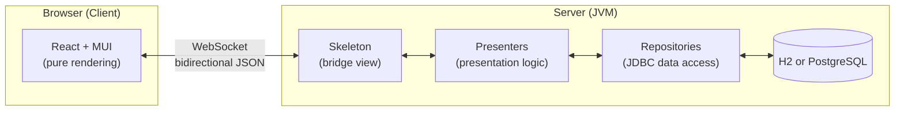
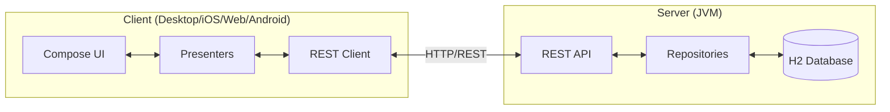
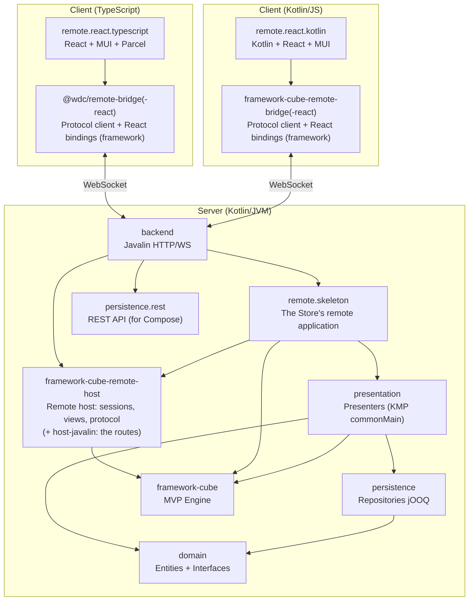
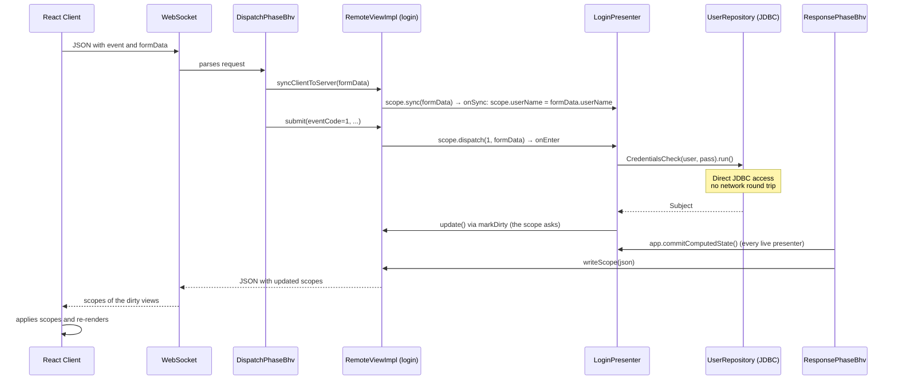
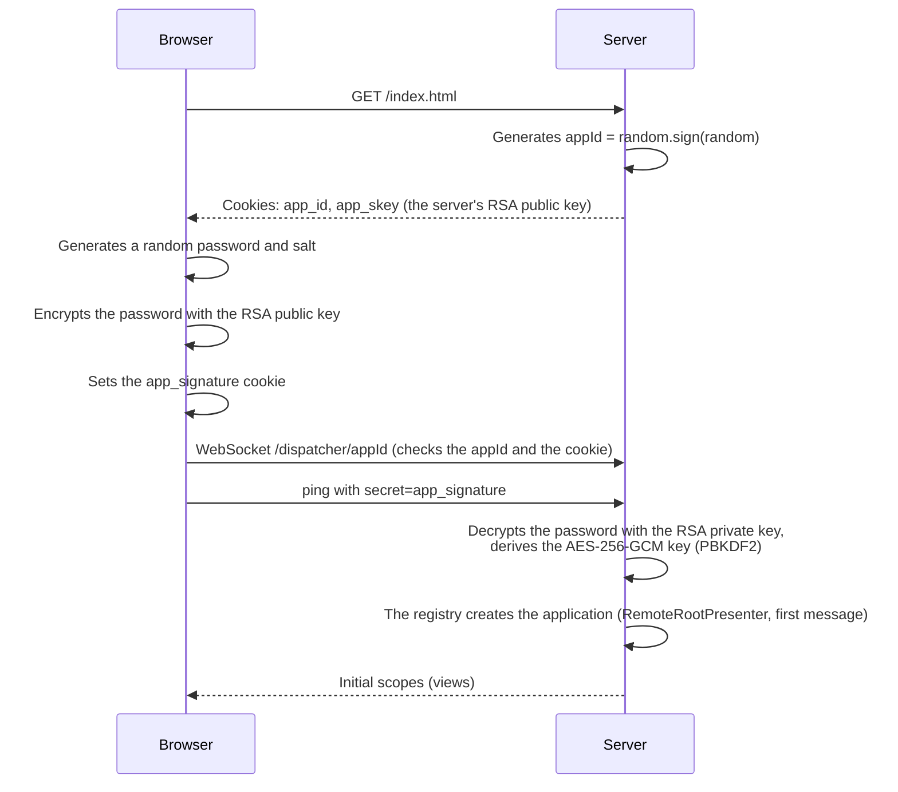
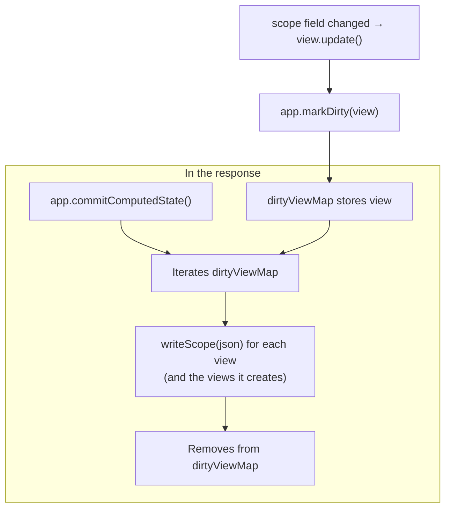
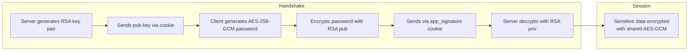
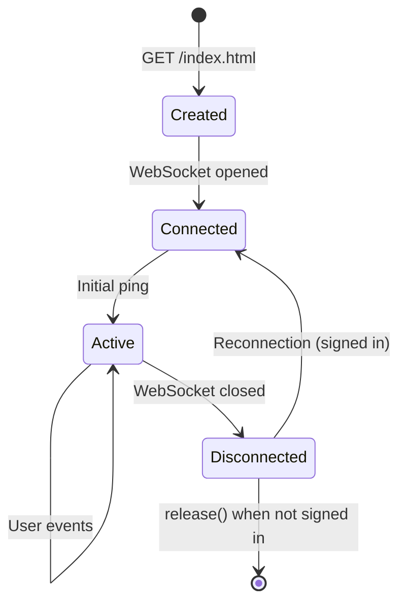
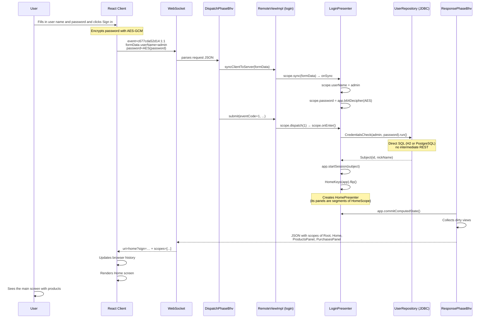

# React Architecture — Remote View with Server-Side Presenters

## Contents

- [Overview](#overview)
- [Comparison: Local View vs Remote View](#comparison-local-view-vs-remote-view)
- [Module Structure](#module-structure)
- [Communication Cycle](#communication-cycle)
- [Session Establishment](#session-establishment)
- [WebSocket Protocol](#websocket-protocol)
- [The Remote Host — The Bridge Between Presenter and Client](#the-remote-host--the-bridge-between-presenter-and-client)
- [Scope Synchronization](#scope-synchronization)
- [Security](#security)
- [Session Management and Lifecycle](#session-management-and-lifecycle)
- [Advantages of the Remote View](#advantages-of-the-remote-view)
- [Ideal Use Cases](#ideal-use-cases)
- [Complete Example: Login Flow](#complete-example-login-flow)

---

## Overview

The React architecture implements a **remote view** in which the presentation layer (presenters) runs entirely on the server. The React client is responsible only for **rendering the interface**, with no business or presentation logic. All user interaction is sent to the server over WebSocket, and the server responds with the new scopes serialized as JSON.



This contrasts with the Compose Multiplatform architecture, where the presenters run on the client and access data over REST:



---

## Comparison: Local View vs Remote View

| Aspect | Compose (Local View) | React (Remote View) |
|---------|---------------------|---------------------|
| **Presenter execution** | On the client | On the server |
| **Data access** | Via REST (network) | Direct JDBC (in-process) |
| **Data latency** | HTTP round trip | Zero (same JVM) |
| **Session state** | On the device | On the server |
| **Client logic** | Presenters + UI | UI only |
| **Protocol** | HTTP/REST | WebSocket |
| **Data security** | Exposed API | Data never leaves the server |
| **Scalability** | Processing on the client | Processing on the server |
| **Offline operation** | Possible | Requires a connection |

---

## Module Structure



| Module | Role |
|--------|-------|
| **remote.react.typescript** (npm) | The Store's views in React/TypeScript with Material UI, registered by vid with the bridge. Bundled with Parcel (`npm run build`) into the skeleton's resources. |
| **TypeScript bridge** (`@wdc/remote-bridge` + `@wdc/remote-bridge-react`, framework, `br.com.wdc.kt.framework.cube.remote/remote.bridge.typescript[.react]`) | The client side of the protocol, with no UI technology: the WebSocket session and reconnection, the security handshake and cipher, the scopes of the views (`ViewBinding`), event delivery, the release of views (`ViewGarbageCollector`). Its React bindings (the default `bridge`, `registerComponents`, the hooks, `BaseViewClass`) are a package of their own. Imported from source by Parcel aliases (and tsconfig `paths`); the peer dependencies (React, history, universal-cookie) come from the shell's `node_modules`. |
| **remote.react.kotlin** (`:view-remote-react-kotlin`) | A second client of the same server, written in Kotlin with React and MUI (kotlin-wrappers) and compiled to JS by the Kotlin toolchain: the same vids, fields and event codes as the TypeScript client. Deployed by its `deploy.sh` to the `remote-kotlin` context (`/remote-kotlin/`). |
| **Kotlin bridge** (`:framework-cube-remote-bridge` + `:framework-cube-remote-bridge-react`, framework) | The client side of the protocol in Kotlin/JS, with no UI technology: `RemoteBridge` (session, handshake, WebSocket, history, events), `RemoteScope` (a scope read by name). Its React bindings (`RemoteViews`, `useView`, `useHold`, `remoteView`, with kotlin-wrappers) are a module of their own. |
| **Remote host** (`:framework-cube-remote-host` + `:framework-cube-remote-host-javalin`, framework) | The server side of the protocol, for any Cube application and free of web-server code: the sessions (`RemoteApplicationRegistry`), each one's work (`RemoteApplicationSupport`: views, dispatch, answer, signed history, life), one `RemoteViewImpl` per scope, the browser tab (`BrowserScope`, `RemoteBrowserPresenter`) and the keys and cipher (`RemoteAppSecurity`, `RemoteDataSecurity`). Its routes on Javalin (`DispatcherController`, `IndexHtmlController`) are a module of their own. |
| **remote.skeleton** (`:view-remote-skeleton`) | The Store as a remote application: `RemoteRootPresenter` (its root presenter, implementing `RemoteApplication`, with the vid of each of its scopes and its registry), plus the Store's own routes (product images, health, stress metrics) and the client bundle. |
| **backend** (`:backend`) | Javalin server that hosts the WebSocket (`/dispatcher/{id}`), serves the React static files, and exposes the REST API for Compose clients. |
| **presentation** (`:store-presentation`) | Shared presenters (KMP commonMain) — the same code used by both React and Compose. |
| **persistence** (`:store-persistence`) | jOOQ implementation of the repositories (H2 or PostgreSQL) — used directly by the presenters in the React architecture. |
| **persistence.rest** (`:persistence-rest`) | REST endpoints — used by Compose clients via `persistence.client` (`:store-persistence-client`). |

---

## Communication Cycle



The whole cycle happens in a single WebSocket exchange — the client sends the event, the server processes it and responds with the new scopes. There are no intermediate REST calls.

---

## Session Establishment

The session is established in two steps with a cryptographic key exchange:



The `appId` is self-signed: `{random}.{signature(random)}` (`RemoteAppSecurity.signAsHash`, Base62) — this prevents forging session IDs. The RSA key pair is the server's, fixed (`wdc.web.public_key` / `wdc.web.private_key`, with a development fallback), not one per session.

---

## WebSocket Protocol

### Client → Server (User Event)

```json
{
  "requestId": 42,
  "event": ["c677cda52d14:1:1"],
  "c677cda52d14:1": {
    "userName": "admin",
    "password": "<AES-GCM encrypted, Base64>"
  }
}
```

- **`event`**: list of `vsid:eventCode` (which view and which action)
- **`vsid`**: view instance identifier (`hexVID:instanceNumber`)
- **Form data**: indexed by `vsid`, sensitive fields encrypted

### Server → Client (Scope Response)

```json
{
  "requestId": 42,
  "uri": "home?sign=…",
  "scopes": [
    {
      "id": "473dbdd7a36a:3",
      "productsPanelViewId": "a1b2c3d4e5f6:4",
      "purchasesPanelViewId": "b3c4d5e6f7a8:5",
      "nickName": "John Smith",
      "cartItemCount": 0,
      "errorCode": 0
    },
    {
      "id": "a1b2c3d4e5f6:4",
      "products": [...]
    }
  ],
  "releasedViews": ["c677cda52d14:1"]
}
```

- **`scopes`**: only the views that changed (dirty tracking)
- **`uri`**: the current navigation fragment, signed (for the browser history)
- **Fields**: in the scope's declaration order, after `id`; `null` and blank strings are left out, numbers and booleans always go, fields declared with `sent = false` (the login's password) never go
- **References between views**: `*ViewId` fields point to other views, `*ViewIds` fields to a list of views (the cart rows, `rowsViewIds`, empty included). A view created while writing a message (a scope sent for the first time) goes out in the same message
- **`releasedViews`**: the ids of the views the server released since the last message (their scopes left the screen), after `scopes`, only when there are any. The server will never send them again; the client drops each one at once, or as soon as it leaves the screen if it is still mounted

---

## The Remote Host — The Bridge Between Presenter and Client

Presenters do not create views; the framework knows only scopes. The remote host (`framework-cube-remote-host`) is a rendering technology of its own. An application becomes remote by implementing `RemoteApplication` and holding a `RemoteApplicationSupport`, which does the session's work: the view of each scope on the client's screen, one `RemoteViewImpl` per scope, carrying the vid of the client component that paints it. Each scope declares its vid (`LoginScope.VID`): the presentation names what paints it in the bridge protocol, and the WDC Store speaks that protocol. What the Store supplies is the vid of each scope class; the browser's is built in. No scope has a view class of its own:

```kotlin
class RemoteRootPresenter(id: String) : RootPresenter(), RemoteApplication {

    companion object {
        val VIDS: Map<KClass<out Scope>, String> = mapOf(
            RootScope::class to RootScope.VID,
            LoginScope::class to LoginScope.VID,
            HomeScope::class to HomeScope.VID,
            // … product, cart, cart row, receipt, the Home's panels
        )

        /** The Store's remote sessions: the backend gives it to the WebSocket route and starts its cleanup and flush. */
        val REGISTRY = RemoteApplicationRegistry(::RemoteRootPresenter)
    }

    override val remote = RemoteApplicationSupport(id, this, VIDS, content = scope)

    override fun keepsSessionWithoutConnection() = subject != null   // a signed-in user's session waits for the client
    override fun b64Decipher(b64Text: String) = remote.dataSecurity.b64Decipher(b64Text)
    override fun updateHistory() = remote.updateHistory()
    // alertUnexpectedError → remote.browser.alertUnexpectedError(text); release → remote.release(), then super.release()
}
```

`viewOf(scope)` creates a view the first time a scope that holds its scope is written: it registers it in the view map by instance id, installs its updater in the scope (`scope.setUpdater(view.updater)`) and marks it dirty for its first drawing. From then on each change of the scope marks it dirty, and it goes out in the next message. The browser's view (instance `:0`) is the top one; every other view is asked for by the view that holds its scope.

**Writing a scope is drawing it**, and that is where a scope that left is noticed. `RemoteViewImpl` does four things, all generic:

```kotlin
open class RemoteViewImpl<S : Scope>(vid: String, protected val app: RemoteViewHost, val scope: S,
                                    instanceId: Int = app.nextInstanceId()) {

    // 1. What the user typed (client → server): what the presenter set with scope.onSync(…); not open — copying
    //    the form into the scope is the presentation's work
    fun syncClientToServer(formData: Map<String, Any?>) {
        scope.sync(formData)
    }

    // 2. The event: runs the action the presenter bound with this code (an unknown code is an error)
    open suspend fun submit(eventCode: Int, eventQtde: Int, formData: Map<String, Any?>) {
        scope.dispatch(eventCode, formData)
    }

    // 3. The scope as JSON, with the ids of the views of the scopes inside it; the views it no longer refers to
    //    are released
    open fun writeScope(json: ExtensibleObjectOutput) {
        val written = LinkedHashSet<RemoteViewImpl<*>>()
        scope.write(instanceId, json) { inner ->
            val child = app.viewOf(inner)
            child.holders += this
            written += child
            child.instanceId
        }
        val before = children
        children = written
        for (child in before) if (child !in written) child.dropHolder(this)
    }

    // 4. Released when no view refers to it any more
    fun release() { /* clearUpdater, app.forgetView, app.removeView(instanceId), then its children */ }
}
```

Each view keeps the views it referred to the last time it was written (`children`) and those that refer to it (`holders`); one is **released only when no view holds it**: it takes its updater back (`scope.clearUpdater(updater)`, the same function), leaves the session's maps and the dirty set (`forgetView`), and its id is queued for the client (`removeView` → `releasedViews` in the next message); then the views it held are dropped in cascade. A view released while an earlier one was being written is skipped by the flush. When the session ends, `RemoteRootPresenter.release()` releases the browser's view and the cascade takes the rest. The presenters take no part. `RemoteViewReleaseTest` covers this.

The event codes live in the presenter, next to the action they fire, with how to read their values from the form data:

```kotlin
// ProductPresenter
scope.onOpenProducts = action(1) { HomeKeys(app).flip() }
scope.onAddToCart = actionOf(2, FormParam.int("p.quantity")) { addToCart(it) }
```

The login's values arrive by sync, not as form parameters of the event, and the presenter copies them into the scope (`scope.onSync(::sync)` in `LoginPresenter`). The password goes ciphered with the session key; the presenter deciphers it with `app.b64Decipher`, which only the remote application implements (`RemoteRootPresenter`, with the session's `RemoteDataSecurity`). The server applies the sync before it dispatches the events, so the presenter binds the action like any other: `scope.onEnter = action(1) { enter() }`, reading the user name and password from the scope.

The browser tab itself is a scope of the remote layer (`BrowserScope`: the alert and the root scope, sent as `contentViewId`), whose actions `RemoteBrowserPresenter` binds with their codes like any presenter; the presentation knows nothing of it.

The mapping between hexadecimal View IDs and views is fixed and shared between client and server; on the server, each is the `VID` of its scope:

| View | Hex VID | Client (TSX) | Server (Kotlin) | Events |
|------|---------|---------------|-------------------|--------|
| Browser | `7b32e816a191` | BrowserView.tsx | `RemoteViewImpl` (`BrowserScope`, actions bound by `RemoteBrowserPresenter`; instance `:0`) | 1 alert OK, 2 keep-alive, -1 start (`p.path`), -2 history changed (`p.path`) |
| Root | `f2d345c4a610` | RootView.tsx | `RemoteViewImpl` (`RootScope`) | |
| Login | `c677cda52d14` | LoginView.tsx | `RemoteViewImpl` (`LoginScope`; `LoginPresenter` deciphers the password on sync) | 1 enter |
| Home | `473dbdd7a36a` | HomeView.tsx | `RemoteViewImpl` (`HomeScope`) | 1 exit, 2 open cart |
| Cart | `7eb485e5f843` | CartView.tsx | `RemoteViewImpl` (`CartScope`) | 1 buy, 3 open products |
| Cart row | `5d9e3c7a1f42` | CartView.tsx (`CartItemView`) | `RemoteViewImpl` (`CartItemScope`) | 1 remove, 2 quantity (`p.quantity`) |
| Product | `48b693f67410` | ProductView.tsx | `RemoteViewImpl` (`ProductScope`) | 1 open products, 2 add to cart (`p.quantity`) |
| Receipt | `e8d0bd8ae3bc` | ReceiptView.tsx | `RemoteViewImpl` (`ReceiptScope`) | 1 open products |
| ProductsPanel | `a1b2c3d4e5f6` | home/ProductsPanel.tsx | `RemoteViewImpl` (`ProductsPanelScope`) | 1 open product (`p.productId`) |
| PurchasesPanel | `b3c4d5e6f7a8` | home/PurchasesPanel.tsx | `RemoteViewImpl` (`PurchasesPanelScope`) | 1 open receipt (`p.purchaseId`), 2 page (`p.page`), 3 capacity (`p.capacity`) |

The products and purchases panels are segments of the Home's scope (no presenter of their own); their events go to the segment's view and run actions the `HomePresenter` bound with `target = products` / `target = purchases`. Each cart row is a segment of the cart's scope with its own view, so changing a quantity repaints that row and the total (computed on the server), not the whole list.

---

## Scope Synchronization

### Dirty Tracking

When a field of a scope changes, the scope calls its updater (the view's `update()`), and the view is marked "dirty" in its session (`RemoteApplicationSupport`). In the response, `app.commitComputedState()` runs first (every live presenter's, once per cycle), then only dirty views are serialized — plus any view created while writing them (a scope sent for the first time), so a parent and its children go out in the same message:



### Server Push

When a view is marked dirty outside the request/response cycle (for example, by an asynchronous operation), the registry pushes it over WebSocket on its next tick, every 50 ms (`RemoteApplicationRegistry.startFlushing`, started by the backend):

```kotlin
override fun markDirty(view: RemoteViewImpl<*>) {
    if (view.released) return
    dirtyViewMap[view.instanceId] = view
    registry?.markDirty(this)  // push when outside a request
}
```

### View Garbage Collection

The client keeps a reference system for views (`ViewGarbageCollector`). A view the server lists in `releasedViews` is dropped at once if it is not on screen, or as soon as it unmounts if it still is (`mount` is recorded when a view's binding mounts). For the rest, when a `*ViewId` field changes in a parent view's scope, the previous child view is released automatically after 4 seconds of inactivity.

---

## Security

### Transport Layer



- **Session ID**: self-signed with HMAC — prevents forging
- **Sensitive fields**: encrypted end to end with AES-256-GCM (e.g., passwords), each value with a random IV of its own sent in front of it (`Base64(IV ‖ ciphertext and tag)`); the handshake (`<password ciphered with RSA>.<salt>`) carries no IV
- **Navigation**: URLs signed with a hash to prevent parameter tampering

### Security Inherent to the Architecture

In the remote view, repository data **never travels directly to the client**. The presenter on the server decides exactly which fields to expose in its scope. This eliminates entire classes of vulnerabilities:

- There is no REST API exposed to the React client — no endpoint to attack
- There are no JWT tokens on the client — authentication is managed in the server session
- Sensitive data never leaves the JVM — the presenter filters it before serializing

---

## Session Management and Lifecycle



- **Creation**: when `/index.html` is accessed, session cookies are set
- **Lifetime**: 3 minutes (`RemoteApplicationSupport.DEFAULT_LIFE_SPAN`) — extended on every message, including the keep-alive event (every 15 s)
- **Reconnection**: if the WebSocket drops, the client reconnects and finds the same session (if it has not expired)
- **Cleanup**: a session ends when its WebSocket closes unauthenticated; an authenticated one lives on without a socket until its life runs out. `RemoteApplicationRegistry.startCleanup`, started by the backend on the Store's registry, runs `removeExpireds()` every 30 seconds: an application past its life with no socket is released, one with a socket gets more life.
- **Logout/Disconnection**: an unauthenticated session is released immediately when the WebSocket closes

---

## Advantages of the Remote View

### 1. Zero Data Latency

The presenters access JDBC repositories directly in the same JVM. There is no HTTP serialization, JSON parsing, or network round trip for each database query. An operation that in the Compose model requires:

```
Client → HTTP Request → REST Endpoint → Repository → DB → Response → HTTP Response → Client
```

In the React model is reduced to:

```
Presenter → Repository → DB → Presenter
```

### 2. Minimal Attack Surface

- **No REST API exposed** to the client (the REST endpoints exist only for Compose clients)
- **No sensitive data on the client** — passwords, tokens, and payment data never reach the browser
- **No business logic on the client** — reverse engineering the logic is impossible
- **Server-side session** — no exposed JWT or authentication cookies

### 3. Ultra-Light Client

The React client contains only:
- Rendering components (TSX)
- WebSocket communication logic
- Encryption of sensitive fields

It does not contain: business validations, data access, complex state management, routes, or navigation logic.

### 4. Transactional Consistency

Because presenters and repositories share the same JVM, regular JDBC transactions spanning multiple data operations can be used — something hard to coordinate when data travels over REST.

### 5. Instant Updates

Changes to the presentation logic take effect immediately on server deployment, with no need to update clients. The React client is cache-friendly and rarely changes.

### 6. Native Server Push

The bidirectional WebSocket lets the server send scope updates to the client without the client having to ask. This enables real-time notifications, dashboard updates, and synchronization across tabs/users.

---

## Ideal Use Cases

The remote view architecture is especially suited for:

| Use Case | Why |
|-------------|---------|
| **Corporate/internal applications** | Controlled network, critical security, sensitive data |
| **Administrative systems (back office)** | Many CRUD screens, complex logic, few concurrent users |
| **Financial applications** | Data never leaves the server, simplified auditing |
| **Systems with regulated data (LGPD/GDPR)** | Personal data stays on the server, client is stateless |
| **Real-time dashboards** | Server push over WebSocket is native |
| **Applications that require strong consistency** | JDBC transactions coordinated on the server |
| **Low-bandwidth environments** | Only the scopes JSON is transferred, not raw data |

### When NOT to use it

| Scenario | Reason |
|---------|--------|
| **Offline operation** | Requires a permanent WebSocket connection |
| **Massive scale (millions of users)** | Each session consumes server memory |
| **Native mobile apps** | Compose Multiplatform is a better fit |
| **Games or complex animations** | WebSocket latency may be noticeable |

---

## Complete Example: Login Flow



Note that throughout the flow:
1. The **password never travels in clear text** — it is encrypted with AES-GCM on the client and decrypted on the server
2. **Database access is direct** — `UserRepository` runs SQL in the same JVM as the presenter
3. The **client does not know how to navigate** — the server decides that the next screen is Home and sends the corresponding scopes
4. Only **views that changed** are included in the response (dirty tracking)
