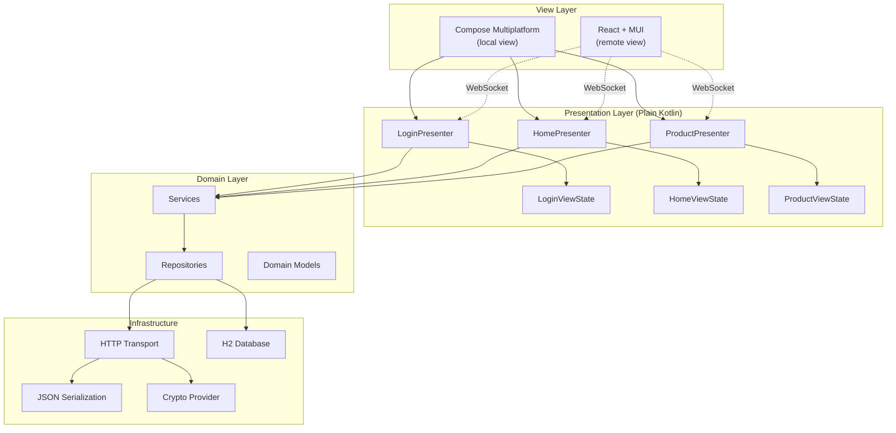
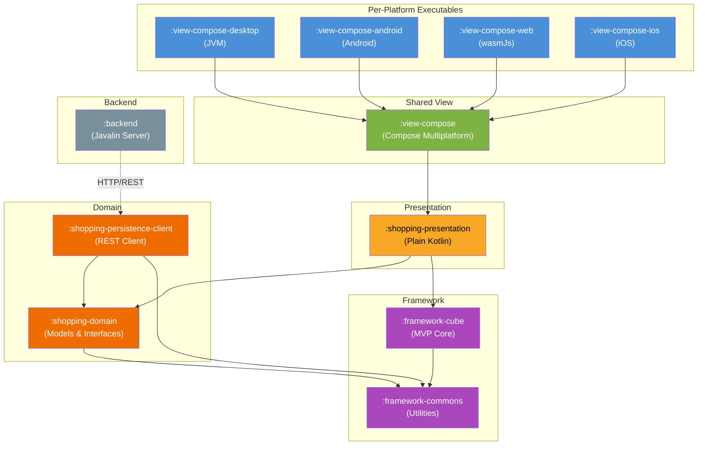
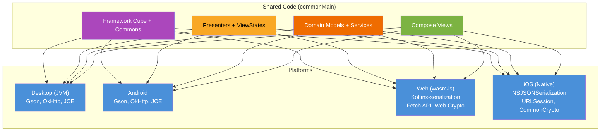
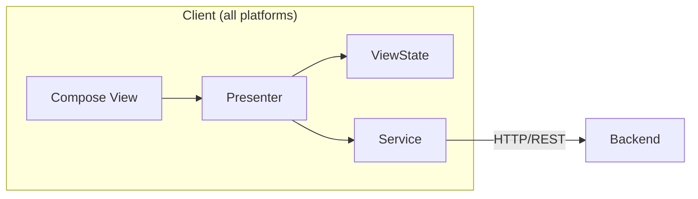
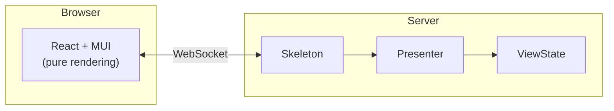
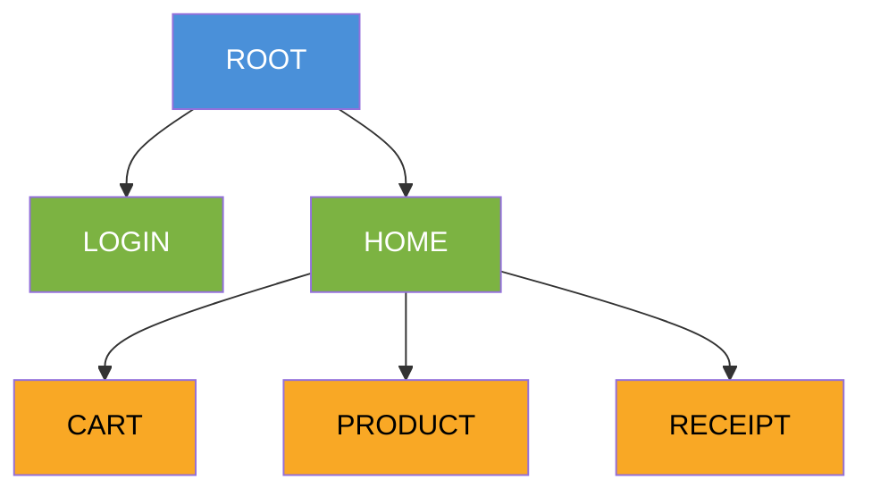
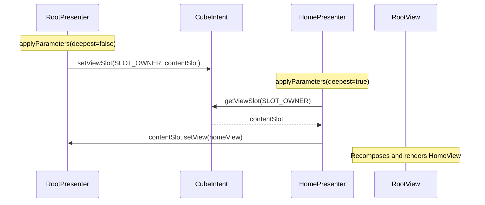
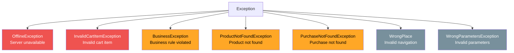
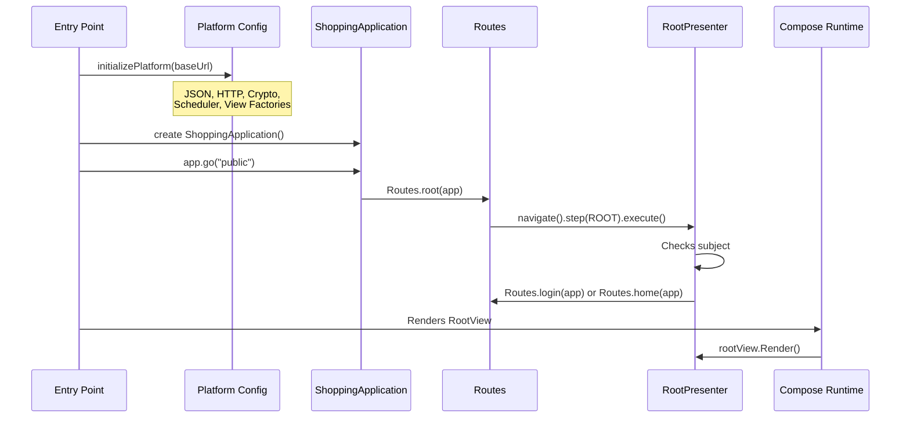
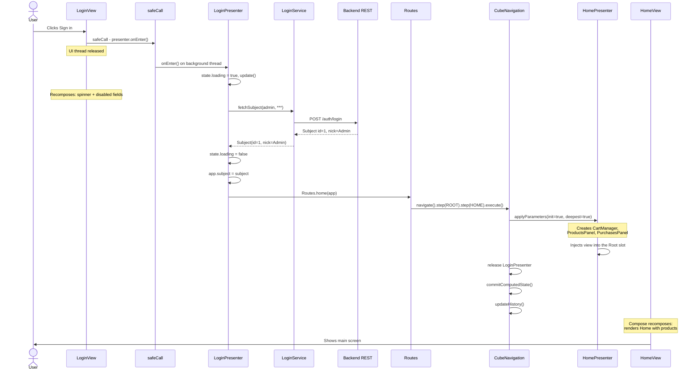

# Project Architecture — Overview

## Contents

- [Introduction](#introduction)
- [Architectural Principles](#architectural-principles)
- [Architecture Layers](#architecture-layers)
- [Module Diagram](#module-diagram)
- [Multiplatform Strategy](#multiplatform-strategy)
- [Two View Modalities](#two-view-modalities)
  - [Local View — Compose Multiplatform](#local-view--compose-multiplatform)
  - [Remote View — React + WebSocket](#remote-view--react--websocket)
- [Presentation Layer](#presentation-layer)
- [Domain Layer](#domain-layer)
- [Persistence Layer](#persistence-layer)
- [Backend](#backend)
- [Compose Multiplatform Integration](#compose-multiplatform-integration)
- [Error Handling](#error-handling)
- [Per-Platform Initialization](#per-platform-initialization)
- [Complete Example: Login Flow](#complete-example-login-flow)
- [Detailed Documentation](#detailed-documentation)
- [Glossary](#glossary)

---

## Introduction

This project is a demo application (**Storefront Demo**) built on the **Cube MVP** framework in **Kotlin Multiplatform**. Its goal is to show how a single presentation codebase can be shared across multiple platforms and distinct view technologies.

The architecture is centered on three fundamental decisions:

1. **State management with mutable objects** — the Cube framework uses mutable `ViewState`s, eliminating the ceremony of immutable copies and reducers
2. **Full decoupling between presentation and UI technology** — presenters are plain Kotlin classes with no dependency on a UI framework; the rendering technology is a project choice
3. **Transactional navigation** — `CubeNavigation` treats each screen transition as an atomic transaction with commit/rollback

---

## Architectural Principles

| Principle | Description |
|-----------|-----------|
| **Separation of concerns** | View renders, Presenter controls, Domain models, Persistence accesses data |
| **UI-agnostic presentation** | Presenters know nothing about Compose, React or any other UI technology |
| **Simple mutable state** | ViewState is a POJO with mutable properties — no reducers, no events, no unidirectional flow |
| **Navigation as a transaction** | Each navigation creates/reuses/discards presenters atomically |
| **True multiplatform** | The same presentation code runs on JVM, Android, iOS and WebAssembly |
| **State serialization** | Each screen persists and restores its state via URL/parameters (deep-linking) |

---

## Architecture Layers



---

## Module Diagram



| Module | Responsibility |
|--------|-----------------|
| `:framework-cube` | MVP engine — transactional navigation, presenter lifecycle, Places, Intent |
| `:framework-commons` | Shared utilities — logging, JSON, HTTP, crypto, schedulers |
| `:shopping-presentation` | Presenters and ViewStates — pure presentation logic (no UI) |
| `:shopping-domain` | Domain models, repository interfaces, services |
| `:shopping-persistence-client` | REST implementation of the repositories and of the transaction service (HTTP client) |
| `:shopping-persistence` | jOOQ implementation of the repositories (direct database access) |
| `:view-compose` | Shared Compose Multiplatform views |
| `:view-compose-desktop` | JVM Desktop entry point |
| `:view-compose-android` | Android entry point |
| `:view-compose-web` | wasmJs (WebAssembly) entry point |
| `:view-compose-ios` | iOS entry point (via Xcode) |
| `:shopping-backend` | Javalin server — REST API, WebSocket, H2 |
| `:shopping-scripts` | Database migrations and scripts |

---

## Multiplatform Strategy

### Supported Platforms



### Per-Platform Implementations

| Component          | JVM / Android         | wasmJs                  | iOS                     |
|--------------------|-----------------------|-------------------------|-------------------------|
| JSON               | Gson                  | Kotlinx-serialization   | NSJSONSerialization     |
| HTTP               | OkHttp                | Fetch API               | URLSession              |
| Crypto             | JCE                   | Web Crypto API          | CommonCrypto            |
| Scheduler          | ScheduledThreadPool   | setTimeout/setInterval  | dispatch_queue          |
| ThreadLocal        | java.lang.ThreadLocal | Global variable         | pthread_key             |

---

## Two View Modalities

The project demonstrates two distinct ways of implementing the view layer, both sharing the **same presentation layer**.

### Local View — Compose Multiplatform

Presenters run on the **client**. The Compose view renders the local presenter's `ViewState` directly. Communication with the backend goes through REST.



### Remote View — React + WebSocket

Presenters run on the **server**. The React client is responsible only for rendering. Every user interaction is sent to the server over WebSocket, and the server responds with the new state serialized as JSON.



See [architecture-react.md](architecture-react.md) for full details of this modality.

---

## Presentation Layer

**Presenters** encapsulate all of a screen's business logic. They are plain Kotlin classes with no dependency on a UI framework:

```kotlin
class LoginPresenter(app: ShoppingApplication) : AbstractCubePresenter<ShoppingApplication>(app) {

    val state = LoginViewState()
    private val loginService = LoginService(app)

    override fun applyParameters(intent: CubeIntent, initialization: Boolean, deepest: Boolean): Boolean {
        if (initialization) {
            ownerSlot = intent.getViewSlot(PlaceAttributes.SLOT_OWNER)
            view = createView?.invoke(this)
        }
        ownerSlot?.setView(view!!)
        return false
    }

    fun onEnter() {
        state.loading = true
        update()

        val subject = loginService.fetchSubject(state.userName ?: "", state.password ?: "")
        state.loading = false

        if (subject?.id != null) {
            app.subject = subject
            Routes.home(app)
        } else {
            state.errorMessage = "Username or password not recognized!"
            update()
        }
    }
}
```

The **ViewState** is a simple mutable object holding the data the view needs to render:

```kotlin
class LoginViewState : ViewState {
    var userName: String? = null
    var password: String? = null
    var errorCode: Int = 0
    var errorMessage: String? = null
    var loading: Boolean = false
}
```

Hierarchical navigation is done through **Places** and **CubeNavigation**. Each route is a sequence of steps:

| Route                     | Steps                            |
|---------------------------|----------------------------------|
| Login                     | `ROOT → LOGIN`                   |
| Home (product list)       | `ROOT → HOME`                    |
| Product detail            | `ROOT → HOME → PRODUCT`          |
| Cart                      | `ROOT → HOME → CART`             |
| Purchase receipt          | `ROOT → HOME → RECEIPT`          |



The mechanism that connects parent and child views uses **ViewSlots** — functional callbacks that fully decouple the parent from the child:



For full details of the transactional navigation mechanism (commit, rollback, interruption, presenter migration), see [architecture-cube.md](architecture-cube.md).

---

## Domain Layer

The domain layer contains:

- **Models** — business entities (`Product`, `Purchase`, `Subject`, etc.)
- **Repository interfaces** — contracts with search criteria (Query Object Pattern)
- **Services** — business operations that coordinate repositories

Models and interfaces are shared across all platforms (`commonMain`). Repository implementations vary: REST client for local views, jOOQ for the backend.

See [architecture-persistence.md](architecture-persistence.md) for details of the criteria-based repository pattern.

---

## Persistence Layer

| Implementation | Module | Use |
|---------------|--------|-----|
| **REST Client** | `:shopping-persistence-client` | Local views (Compose) — calls the backend over HTTP |
| **jOOQ** | `:shopping-persistence` | Backend — direct database access (H2 or PostgreSQL) |

Both implement the same contract. The REST implementation sends the criteria and the projection as JSON, using the same codec the server uses to read them; the jOOQ implementation translates them into a single SQL query with bind parameters.

---

## Backend

HTTP server based on **Javalin** (Java 21) with:

- **REST API** — endpoints for products, cart, purchases, authentication
- **WebSocket** — support for the remote view modality (React)
- **H2 Database** — embedded database with versioned migrations
- **JWT** — authentication with access token + refresh token, sessions persisted in the database

---

## Compose Multiplatform Integration

Cube is integrated with Compose through the `ComposeCubeView` class, which solves three fundamental problems:

- **Recomposition** — a `revision` counter (`MutableState<Int>`) is incremented when the presenter calls `update()`, triggering Compose's automatic recomposition
- **Threading** — `safeCall` dispatches presenter actions to a coroutine with `limitedParallelism(1)`, keeping the UI thread free and guaranteeing serial execution
- **Hierarchical composition** — `RenderSlot(view)` renders a child `CubeView` inside a parent view, with no type coupling

The **view factories** pattern lets each platform register its Compose views in the entry point, keeping presenters free of UI dependencies.

See [architecture-cube-compose.md](architecture-cube-compose.md) for full details: the ComposeCubeView bridge, revision counter, safeCall, RenderSlot, factory registration, per-platform initialization, deep-linking and the loading pattern.

---

## Error Handling

### Exception Hierarchy



### Handling Strategy

Errors are handled at **two levels**:

1. **In the Presenter** — expected errors (failed login, database offline) are handled with friendly messages in the ViewState
2. **In safeCall** — unexpected errors are caught and delegated to `RootPresenter.alertUnexpectedError()`

```kotlin
// Level 1: Specific handling in the Presenter
fun onBuy() {
    try {
        val purchaseId = cart.commit(app.subject!!)
        Routes.receipt(app, intent)
    } catch (caught: InvalidCartItemException) {
        state.errorMessage = "Some products have a quantity of less than one item. Unable to purchase."
        update()
    } catch (caught: OfflineException) {
        state.errorMessage = "The database is currently offline. Please wait a moment and try again."
        update()
    }
}

// Level 2: safeCall catches any unhandled exception
protected fun safeCall(action: () -> Unit) {
    presenterScope.launch {
        try {
            action()
        } catch (e: Exception) {
            app.alertUnexpectedError(LOG, "Unexpected error", e)
        }
    }
}
```

---

## Per-Platform Initialization

Each platform has an entry point that:

1. **Configures** platform-specific **dependencies** (JSON, HTTP, Crypto, Scheduler)
2. **Registers view factories** (binding Presenters to Compose Views)
3. **Creates the application** and triggers the initial navigation
4. **Renders** using Compose



---

## Complete Example: Login Flow

The diagram below shows the complete flow from the click on the "Sign in" button to the display of Home with the products:



---

## Detailed Documentation

| Document | Content |
|-----------|----------|
| [architecture-cube.md](architecture-cube.md) | Cube framework — transactional navigation mechanism, presenter lifecycle, interruption and migration, commit/rollback, guarantees |
| [architecture-cube-compose.md](architecture-cube-compose.md) | Cube + Compose integration — ComposeCubeView, revision counter, safeCall, RenderSlot, view factories, per-platform initialization |
| [architecture-react.md](architecture-react.md) | Remote view modality — React + WebSocket, Skeletons, state synchronization, security |
| [architecture-persistence.md](architecture-persistence.md) | Persistence layer — repositories, criteria, projection, transactions (local and remote), REST API |

---

## Glossary

| Term                 | Definition |
|----------------------|-----------|
| **Place**            | Navigation destination with id, name and presenter factory |
| **CubeIntent**       | Container of parameters (serializable) and attributes (ephemeral) for a navigation transaction |
| **CubeViewSlot**     | Functional callback for injecting a child view into a parent view |
| **Presenter**        | Controller that encapsulates a screen's presentation logic (plain Kotlin, no UI dependency) |
| **ViewState**        | Mutable object with the data the view needs to render |
| **ComposeCubeView**  | Bridge between CubeView and Jetpack Compose, with a revision counter mechanism |
| **safeCall**         | Serialized asynchronous dispatch (limitedParallelism=1) for presenter actions |
| **CubeNavigation**   | Atomic navigation transaction with commit, rollback and support for interruptions |
| **CubeApplication**  | Global container of active presenters and entry point for navigation |
| **Skeleton**         | Server-client bridge in the React modality — serializes ViewState for WebSocket |
| **revision**         | MutableState counter that triggers Compose recomposition |
