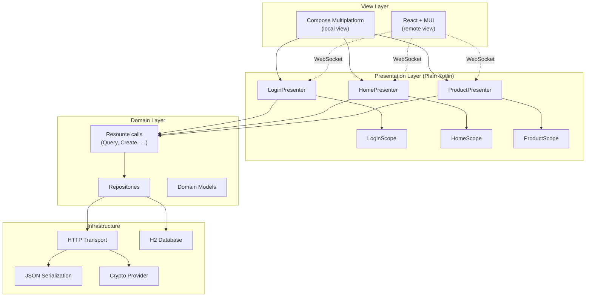
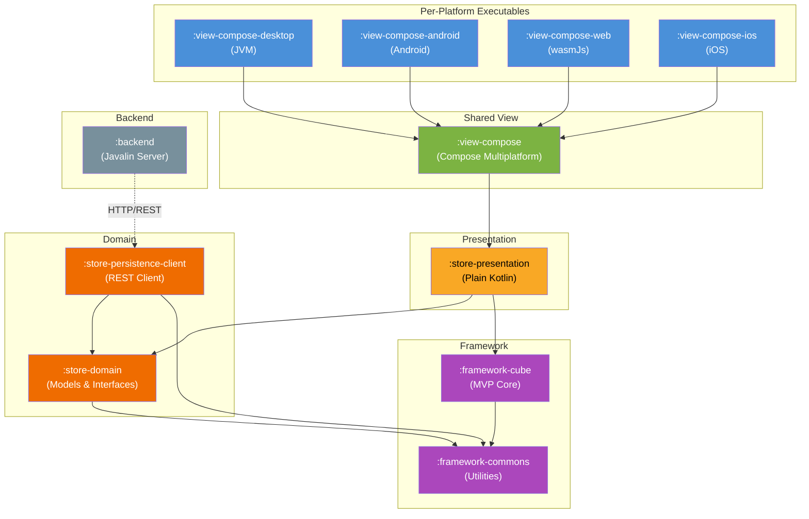
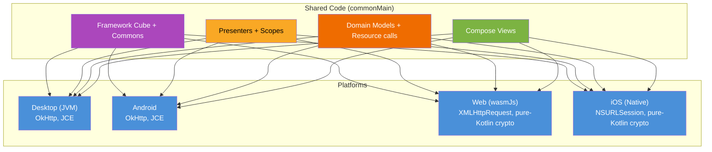
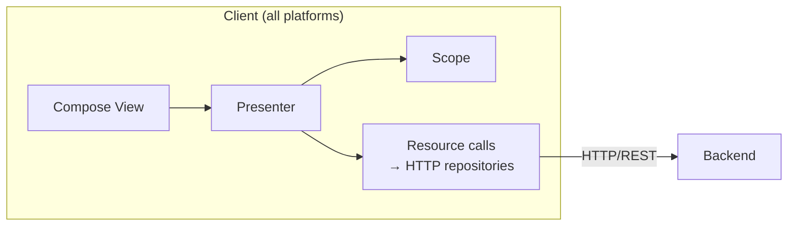
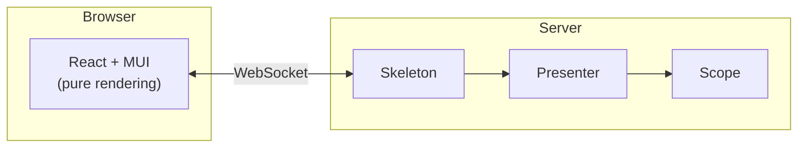
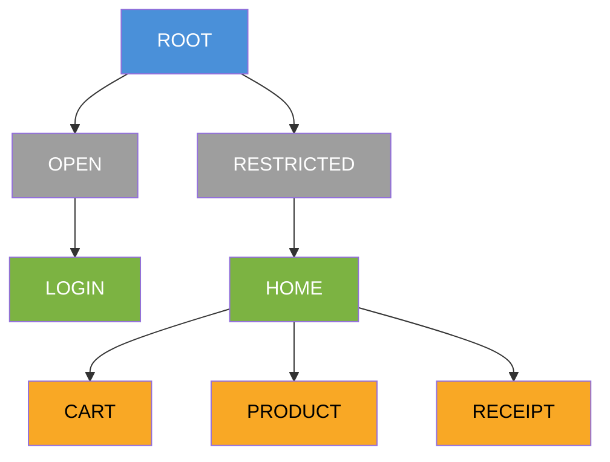
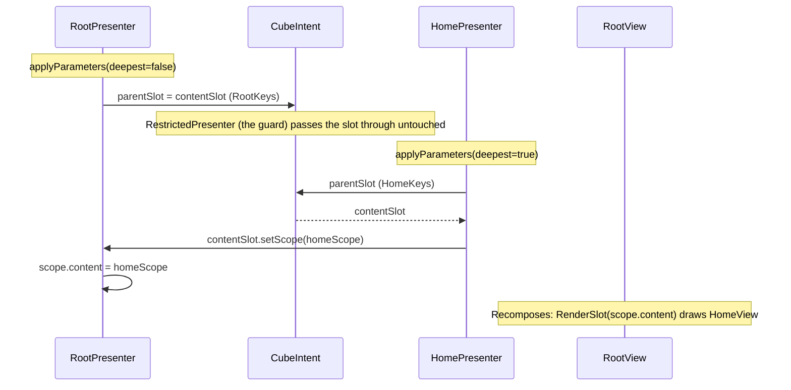
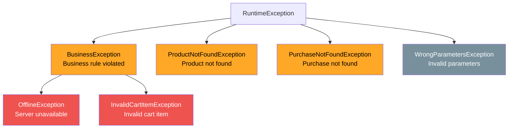
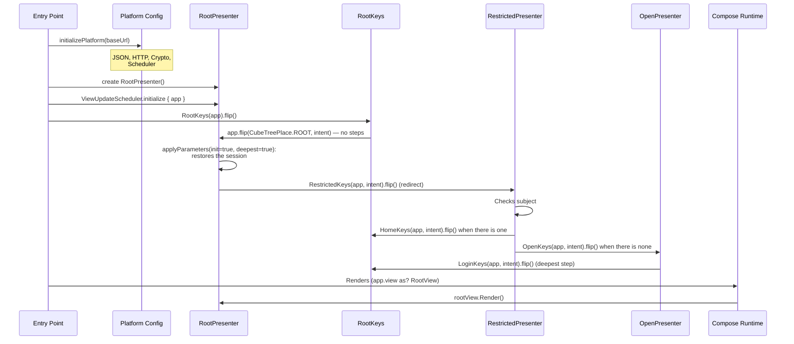

# Project Architecture — Overview

## Contents

- [Introduction](#introduction)
- [Architectural Principles](#architectural-principles)
- [Architecture Layers](#architecture-layers)
- [Module Diagram](#module-diagram)
- [Multiplatform Strategy](#multiplatform-strategy)
- [Two View Modalities](#two-view-modalities)
  - [Local View — Compose Multiplatform](#local-view--compose-multiplatform)
  - [Remote View — React + WebSocket](#remote-view--react--websocket)
- [Presentation Layer](#presentation-layer)
- [Domain Layer](#domain-layer)
- [Persistence Layer](#persistence-layer)
- [Backend](#backend)
- [Compose Multiplatform Integration](#compose-multiplatform-integration)
- [Error Handling](#error-handling)
- [Per-Platform Initialization](#per-platform-initialization)
- [Complete Example: Login Flow](#complete-example-login-flow)
- [Detailed Documentation](#detailed-documentation)
- [Glossary](#glossary)

---

## Introduction

This project is a demo application (**WDC Store Demo**) built on the **Cube MVP** framework in **Kotlin Multiplatform**. Its goal is to show how a single presentation codebase can be shared across multiple platforms and distinct view technologies.

The architecture is centered on three fundamental decisions:

1. **State management with mutable objects** — the Cube framework keeps what each presenter shows in a mutable `Scope`, eliminating the ceremony of immutable copies and reducers
2. **Full decoupling between presentation and UI technology** — presenters are plain Kotlin classes with no dependency on a UI framework; the rendering technology is a project choice
3. **Transactional navigation** — `CubeNavigation` treats each screen transition as an atomic transaction with commit/rollback

---

## Architectural Principles

| Principle | Description |
|-----------|-----------|
| **Separation of concerns** | View renders, Presenter controls, Domain models, Persistence accesses data |
| **UI-agnostic presentation** | Presenters know nothing about Compose, React or any other UI technology |
| **Simple mutable state** | A presenter's scope is a plain object with mutable properties — no reducers, no events, no unidirectional flow |
| **Navigation as a transaction** | Each navigation creates/reuses/discards presenters atomically |
| **True multiplatform** | The same presentation code runs on JVM, Android, iOS and WebAssembly |
| **State serialization** | Each screen persists and restores its state via URL/parameters (deep-linking) |

---

## Architecture Layers



---

## Module Diagram



| Module | Responsibility |
|--------|-----------------|
| `:framework-cube` | MVP engine — transactional navigation, presenter lifecycle, Places, Intent |
| `:framework-commons` | Shared utilities — logging, JSON, HTTP, crypto, schedulers |
| `:store-presentation` | Presenters and their scopes — pure presentation logic (no UI) |
| `:store-domain` | Domain models, repository interfaces, security contracts |
| `:store-persistence-client` | REST implementation of the repositories and of the transaction service (HTTP client) |
| `:store-persistence` | jOOQ implementation of the repositories (direct database access) |
| `:view-compose` | Shared Compose Multiplatform views |
| `:view-compose-desktop` | JVM Desktop entry point |
| `:view-compose-android` | Android entry point |
| `:view-compose-web` | wasmJs (WebAssembly) entry point |
| `:view-compose-ios` | iOS entry point (via Xcode) |
| `:persistence-rest` | The WDC Store's REST API (repository RPC per entity, authentication, data policies) over `:framework-rest` |
| `:view-remote-react-skeleton` | Server side of the remote React view (WebSocket, one view per scope) |
| `:backend` | Javalin server — REST API, WebSocket, H2 or PostgreSQL |
| `:store-scripts` | Database creation (`DBCreate`), migrations and jOOQ schema generation |

---

## Multiplatform Strategy

### Supported Platforms



### Per-Platform Implementations

| Component          | JVM / Android                                   | wasmJs                                   | iOS                                   |
|--------------------|-------------------------------------------------|------------------------------------------|---------------------------------------|
| JSON               | Framework's pure-Kotlin reader/writer (`installCommon()`) | same                           | same                                  |
| HTTP               | `OkHttpTransport` (OkHttp)                      | `WasmHttpTransport` (synchronous XMLHttpRequest) | `IosHttpTransport` (NSURLSession) |
| Crypto             | `JceCryptoProvider` (JCE)                       | `WasmCryptoProvider` (pure Kotlin MD5/SHA-256/HMAC, no RSA) | `IosCryptoProvider` (pure Kotlin MD5/SHA-256/HMAC, no RSA) |
| Scheduler          | Swing `Timer` (desktop), `Handler` (Android)    | `setTimeout`                             | `dispatch_after` on the main queue    |
| ThreadLocalRef     | `java.lang.ThreadLocal`                         | Plain field                              | Plain field                           |

---

## Two View Modalities

The project demonstrates two distinct ways of implementing the view layer, both sharing the **same presentation layer**.

### Local View — Compose Multiplatform

Presenters run on the **client**. The Compose view renders the local presenter's `scope` directly. Communication with the backend goes through REST.



### Remote View — React + WebSocket

Presenters run on the **server**. The React client is responsible only for rendering. Every user interaction is sent to the server over WebSocket, and the server responds with the new scopes serialized as JSON.



See [architecture-react.md](architecture-react.md) for full details of this modality.

---

## Presentation Layer

**Presenters** encapsulate all of a screen's business logic. They are plain Kotlin classes with no dependency on a UI framework:

```kotlin
class LoginPresenter(app: RootPresenter) : AbstractCubePresenter<RootPresenter>(app) {

    val scope = bind(LoginScope()) // a field change repaints the view: no update() calls
    private var ownerSlot: ScopeSlot? = null

    init {
        // the init only binds: the action is a field of the scope, bound once and guarded (an unhandled failure →
        // "Unexpected error: …"); what a remote view typed comes by sync, handled by a method of the presenter
        scope.onEnter = action(1) { enter() }
        scope.onSync(::sync)
    }

    override suspend fun applyParameters(intent: CubeIntent, initialization: Boolean, deepest: Boolean): Boolean {
        // read on every call: a reused presenter goes where its parent puts it now
        ownerSlot = LoginKeys(app, intent).parentSlot
        ownerSlot?.setScope(scope) // the presenter shows its scope; it never creates a view
        return false
    }

    private suspend fun enter() {
        scope.loading = true

        // a resource call: a new instance per use, the request in its constructor
        val subject = CredentialsCheck(
            userName = scope.userName ?: "",
            password = scope.password ?: "",
        ).run()
        scope.loading = false

        if (subject?.id != null) {
            app.startSession(subject) // the user and the session's tokens, kept between runs
            HomeKeys(app).flip()
        } else {
            scope.errorMessage = "Username or password not recognized!"
        }
    }

    // a remote view's form: the password comes ciphered with the session's key, which only the remote host holds
    private fun sync(formData: Map<String, Any?>) {
        if (formData.containsKey("userName")) scope.userName = CoerceUtils.asString(formData["userName"])
        if (formData.containsKey("password")) {
            scope.password = app.b64Decipher(CoerceUtils.asString(formData["password"]) ?: "")
        }
    }
}
```

The **scope** is what a presenter shows: a simple mutable object holding the data its view paints, and the actions the view calls. Its fields are observed: assigning one a different value asks for a repaint; it also writes itself as JSON for the remote view, field by field, with no code per scope ([details](architecture-cube.md#scope)):

```kotlin
class LoginScope : Scope() {
    var userName: String? by field(null)
    var password: String? by field(null, sent = false) // never sent to a remote view
    var errorCode: Int by field(0)
    var errorMessage: String? by field(null)
    var loading: Boolean by field(false)

    /** Signs in with the user name and password the view put in this scope. */
    var onEnter: Action = Action.NOOP
}
```

The view puts what the user typed in the scope and calls the action inside its own launch: `safeCall { scope.onEnter() }`. A piece of the screen without navigation of its own — the Home's products and purchases panels, each cart row — is a **segment**: a smaller scope in a field of the owner's, with a view of its own and no presenter ([details](architecture-cube.md#segments)).

Hierarchical navigation is done through **Places** and **CubeNavigation**. Each route is a sequence of steps. `ROOT` (`CubeTreePlace.ROOT`) is the application itself: it is not a step, but `RootPresenter.applyParameters` runs before the first step of every navigation (a navigation to the root alone goes on to the restricted area). The first level holds two **guard places**, as in the Java version: `OPEN` (`OpenPresenter`) and `RESTRICTED` (`RestrictedPresenter`), with no scope and no view. `RESTRICTED` sends a user without a subject to `OPEN`; `OPEN` sends a signed-in user to `RESTRICTED`; each, as the deepest step, goes on to its area's screen (the home, the login). The screens' addresses are still `public/login`, `home`, …:

| Route                     | Steps                            |
|---------------------------|----------------------------------|
| Login                     | `ROOT → OPEN → LOGIN`                   |
| Home (product list)       | `ROOT → RESTRICTED → HOME`              |
| Product detail            | `ROOT → RESTRICTED → HOME → PRODUCT`    |
| Cart                      | `ROOT → RESTRICTED → HOME → CART`       |
| Purchase receipt          | `ROOT → RESTRICTED → HOME → RECEIPT`    |



The mechanism that connects parent and child presenters uses **ScopeSlots** — functional callbacks that fully decouple the parent from the child. The child hands its scope to the parent, which keeps it in a field of its own scope; the parent's view draws that scope with the view its layer registered for it:



For full details of the transactional navigation mechanism (commit, rollback, interruption, presenter migration), see [architecture-cube.md](architecture-cube.md).

---

## Domain Layer

The domain layer contains:

- **Models** — business entities (`Product`, `Purchase`, `Subject`, etc.)
- **Repository interfaces** — contracts with search criteria (Query Object Pattern)

Models and interfaces are shared across all platforms (`commonMain`). Repository implementations vary: REST client for local views, jOOQ for the backend.

The presentation reaches the repositories through **resource calls** (`framework-domain`, package `resource`): one class per operation, named by its verb (`ProductQuery`, `PurchaseCreate`, …), in a `calls/` package next to the presenter; a write's `run()` opens a transaction. See the [framework-domain README](../fontes/br.com.wdc.kt.framework/br.com.wdc.kt.framework.domain/README.md#resource-calls).

See [architecture-persistence.md](architecture-persistence.md) for details of the criteria-based repository pattern.

---

## Persistence Layer

| Implementation | Module | Use |
|---------------|--------|-----|
| **REST Client** | `:store-persistence-client` | Local views (Compose) — calls the backend over HTTP |
| **jOOQ** | `:store-persistence` | Backend — direct database access (H2 or PostgreSQL) |

Both implement the same contract. The REST implementation sends the criteria and the projection as JSON, using the same codec the server uses to read them; the jOOQ implementation translates them into a single SQL query with bind parameters.

---

## Backend

HTTP server based on **Javalin** (Java 21) with:

- **REST API** — repository RPC per entity (`/api/repo/…`: users, products, purchases, purchase items), remote transactions (`/api/tx/…`) and authentication (`/api/auth/…`, only with security on)
- **WebSocket** — support for the remote view modality (React)
- **Database** — embedded H2 (or PostgreSQL) with versioned migrations
- **JWT** — authentication with access token + refresh token, sessions persisted in the database
- **Data policies** — per role, the rows and fields of each entity the REST API reads and writes ([security architecture](security-architecture.md))

---

## Compose Multiplatform Integration

A Compose view is a **function of its scope** (`@Composable fun CartView(scope: CartScope)`), with no object behind it. A small bridge solves the rest:

- **Recomposition and lifecycle** — `useScope(scope)` installs the view as its scope's updater as it starts drawing and takes it back when it leaves the composition; a change marks the view dirty and the paint cycle (once per cycle, after `app.commitComputedState()`) recomposes it. No view is released by hand
- **Threading** — `safeCall` dispatches presenter actions to a coroutine with `limitedParallelism(1)`, keeping the UI thread free and guaranteeing serial execution
- **Hierarchical composition** — `RenderSlot(scope)` draws the view of a child scope inside a parent view, with no type coupling

The **view catalog** (`storeViews`: scope class → composable) is provided by `StoreApp(app)`, which every Compose entry point shows; presenters never create views, and the framework knows only scopes.

See [architecture-cube-compose.md](architecture-cube-compose.md) for full details: `useScope`, the paint cycle, safeCall, RenderSlot, the view catalog, per-platform initialization, deep-linking and the loading pattern.

---

## Error Handling

### Exception Hierarchy



### Handling Strategy

Errors are handled at **two levels**:

1. **In the Presenter** — expected errors (failed login, database offline) are handled with friendly messages in the presenter's scope
2. **In the action's guard** — every action bound with `action { … }` / `actionOf { … }` catches what its body did not handle and hands it to `RootPresenter.alertUnexpectedError()`, which sets the root view's `scope.errorMessage` (`"Unexpected error: <cause>"`) and logs the stack trace; then it republishes the address (`app.updateHistory()`). The view's `safeCall` keeps a last `catch` for failures of the view's own code

```kotlin
// Level 1: Specific handling in the Presenter (the body of scope.onBuy = action(1) { buy() })
private suspend fun buy() {
    try {
        val purchaseId = cart.commit(app.subject!!)
        ReceiptKeys(app).apply { this.purchaseId = purchaseId }.flip()
    } catch (caught: InvalidCartItemException) {
        scope.errorMessage = "Some products have a quantity of less than one item. Unable to purchase."
    } catch (caught: OfflineException) {
        scope.errorMessage = "The database is currently offline. Please wait a moment and try again."
    }
}

// Level 2: the guard of every action (AbstractPresenter)
private suspend fun guard(block: suspend () -> Unit) {
    try {
        block()
    } catch (e: CancellationException) {
        throw e
    } catch (e: Exception) {
        onActionFailure(e) // app.alertUnexpectedError(log, "Unexpected error", e)
    } finally {
        app.updateHistory()
    }
}
```

---

## Per-Platform Initialization

Each platform has an entry point that:

1. **Configures** platform-specific **dependencies** (JSON, HTTP, Crypto, Scheduler)
2. **Creates the application** and hands it to the paint cycle (`ViewUpdateScheduler.initialize { app }`)
3. Triggers the initial navigation
4. **Renders** using Compose (`StoreApp(app)`)



---

## Complete Example: Login Flow

The diagram below shows the complete flow from the click on the "Sign in" button to the display of Home with the products:

```mermaid
sequenceDiagram
    actor User as User
    participant LV as LoginView
    participant SC as safeCall
    participant LP as LoginPresenter
    participant LS as CredentialsCheck
    participant API as Backend REST
    participant Keys as HomeKeys
    participant Nav as CubeNavigation
    participant HP as HomePresenter
    participant HV as HomeView

    User->>LV: Clicks Sign in
    LV->>SC: safeCall - scope.onEnter()
    Note over LV: UI thread released

    SC->>LP: onEnter → enter() on background thread (guarded)
    LP->>LP: scope.loading = true (the scope asks for the repaint)
    Note over LV: Recomposes: spinner + disabled fields

    LP->>LS: CredentialsCheck(admin, ***).run()
    LS->>API: POST /api/auth/challenge, POST /api/auth/login (SCRAM-SHA-256)
    API-->>LS: tokens + user id + server signature (checked; then the name, via the user repository)
    LS-->>LP: Subject(id, nickName)

    LP->>LP: scope.loading = false
    LP->>LP: app.subject = subject

    LP->>Keys: HomeKeys(app).flip()
    Keys->>Nav: navigate().step(RESTRICTED).step(HOME).execute()

    Nav->>Nav: app.applyParameters() — offers the content slot
    Nav->>Nav: RestrictedPresenter — there is a subject: goes on
    Nav->>HP: applyParameters(init=true, deepest=true)
    Note over HP: Creates CartManager, loads the products<br/>(its panels are segments of HomeScope)
    HP->>HP: Hands its scope to the Root slot

    Nav->>Nav: release LoginPresenter, then OpenPresenter
    Nav->>Nav: updateHistory()
    Note over HV: Next paint: app.commitComputedState(),<br/>then RenderSlot(HomeScope) draws HomeView

    Note over HV: Compose recomposes:<br/>renders Home with products
    HV->>User: Shows main screen
```

---

## Detailed Documentation

| Document | Content |
|-----------|----------|
| [architecture-cube.md](architecture-cube.md) | Cube framework — transactional navigation mechanism, presenter lifecycle, interruption and migration, commit/rollback, guarantees |
| [architecture-cube-compose.md](architecture-cube-compose.md) | Cube + Compose integration — views as functions of the scope, useScope, the paint cycle, safeCall, RenderSlot, the view catalog, per-platform initialization |
| [architecture-react.md](architecture-react.md) | Remote view modality — React + WebSocket, Skeletons, scope synchronization, security |
| [architecture-persistence.md](architecture-persistence.md) | Persistence layer — repositories, criteria, projection, transactions (local and remote), REST API |
| [security-architecture.md](security-architecture.md) | Security — trust boundaries, authentication, data policies of the REST API, limitations |

---

## Glossary

| Term                 | Definition |
|----------------------|-----------|
| **Place**            | Navigation destination with id, name and presenter factory; declared by the keys class of the place (`CubeTreePlace`, child of the place of the keys it extends) |
| **CubeIntent**       | Container of parameters (serializable) and attributes (ephemeral) for a navigation transaction |
| **ScopeSlot**        | Functional callback through which a child presenter hands its scope to the parent |
| **Action**           | An entry point of a presenter kept in a field of its scope (`Action`, `ActionOf`, `ActionOf2`), bound with a guard and, for remote views, an event code |
| **Segment**          | A smaller scope that the owner creates and keeps in a field of its scope (a panel, a list row), with its own view and no presenter |
| **Presenter**        | Controller that encapsulates a screen's presentation logic (plain Kotlin, no UI dependency) |
| **Scope**            | What a presenter shows: a mutable object with the data its view paints, with one updater installed by whatever draws it (a change repaints that view), and serializable to JSON; the framework knows no views — each rendering technology keeps and releases its own |
| **useScope**         | The hook of Compose and the native web that makes a view its scope's updater while it is on screen |
| **safeCall**         | Serialized asynchronous dispatch (limitedParallelism=1) of the scope's actions from the view |
| **CubeNavigation**   | Atomic navigation transaction with commit, rollback and support for interruptions |
| **CubeApplication**  | Global container of active presenters and entry point for navigation |
| **Skeleton**         | Server-client bridge in the React modality — serializes each view's scope for WebSocket |
