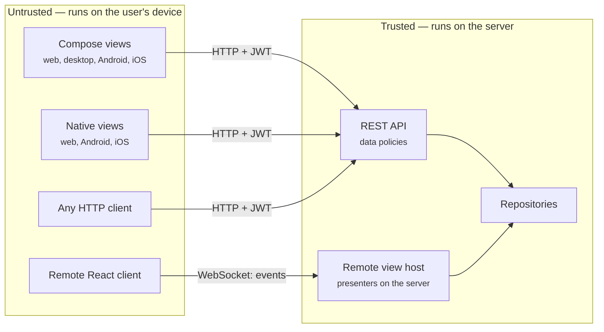
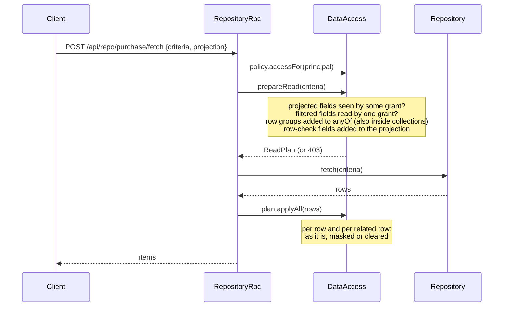

# Security Architecture

How WDC Store protects its data and its sessions, and why it is built this way: the trust boundaries of each kind of view, authentication, the authorization of the REST API by data policies, what the presenters must do where they run on the server, and the limitations an adopter has to weigh. It is written for whoever evaluates or extends the design; the API reference of the policies is in [`framework-rest`'s README](../fontes/br.com.wdc.kt.framework/br.com.wdc.kt.framework.rest/README.md#data-policy), and the persistence side in [Persistence architecture — Security](architecture-persistence.md#security).

## Contents

- [Scope and threat model](#scope-and-threat-model)
- [Trust boundaries per view](#trust-boundaries-per-view)
- [Two modes: with and without security](#two-modes-with-and-without-security)
- [Authentication](#authentication)
- [Authorization at the REST API — data policies](#authorization-at-the-rest-api--data-policies)
- [Authorization where the presenters run on the server](#authorization-where-the-presenters-run-on-the-server)
- [Navigation signing](#navigation-signing)
- [Remote transactions](#remote-transactions)
- [Known limitations and hardening](#known-limitations-and-hardening)
- [Decisions](#decisions)

---

## Scope and threat model

**What is protected:** the users' credentials and personal data, each customer's purchases, the catalog (against unauthorized changes), and the integrity of what is recorded — a customer must not set the price it pays, nor record a purchase in someone else's name.

| Actor | Can do | Must not be able to |
|-------|--------|---------------------|
| Anonymous client | Reach the login, the product images, `/openapi.json` and the static pages | Read or write any repository |
| Authenticated customer with a **modified client** | Send any request its token allows — any criteria, any projection | Read other users' data, write beyond its role, choose prices |
| Manager | Run the catalog | Change purchases or users |
| Administrator | Everything on the data | Read passwords back |
| Network observer | See the traffic | Read credentials — assumes TLS in production (the login exchange can't be replayed, but a captured one lets an observer guess the password offline at a PBKDF2 run per guess) |

Every client is assumed to be modifiable. The Compose and native views run the presenters **on the user's device** and reach the data through the REST API, so their code is no more trustworthy than a hand-written HTTP call.

Out of scope: denial of service, the hosting infrastructure, and the security of the database server itself.

---

## Trust boundaries per view

The same presenters run in every view, and the boundary between trusted and untrusted code is not in the same place for each:



| View | Where the presenters run | What crosses the boundary | Who authorizes |
|------|--------------------------|---------------------------|----------------|
| **Compose** (web, desktop, Android, iOS) and **native** (web, Android, iOS) | On the device | Repository calls: criteria, projections, entities | The **data policy** of each entity, at the REST API |
| **Remote React** | On the server | Events with their form data; scopes back | The **presenter**: it builds every query; the ids it receives are untrusted |
| **External HTTP clients** | — | Repository calls | The data policies |

Hence the two authorization mechanisms below: **data policies** where the client composes the request, and **presenter responsibility** where the server does. **The repositories check nothing**: inside the server their caller is the presentation, which the user cannot tamper with.

---

## Two modes: with and without security

Security is switched on by `security.jwt.secret` in `config/application.toml` of the backend's working directory. With it, `StoreRepositoryBootstrap.initializeSecurity` registers the `AuthenticationService`, and `RepositoryApiRoutes.create()` builds the API with a bearer authenticator: `Authorization: Bearer` on everything except `/api/auth/**`, `GET /api/repo/product/{id}/image` and `GET /openapi.json`.

Without the secret — a fresh clone, and the tests that don't deal with security — the API is open, `/api/auth` does not exist, and there is no caller: the data policies reach every row and every field and do not check writes, **except the password, which is refused and never returned in either mode**.

---

## Authentication

### Login by challenge and response: SCRAM-SHA-256

The login is SCRAM-SHA-256 (RFC 5802, RFC 7677), the scheme PostgreSQL uses. The password never travels, and what the server keeps does not let anyone sign in:

```
1. POST /api/auth/challenge { userName }   → { nonce, salt, iterations, expiresAt }   nonce: single use, this user, 60 s
2. SaltedPassword = PBKDF2-HMAC-SHA256(password digest, salt, iterations)
   ClientKey = HMAC(SaltedPassword, "Client Key")     StoredKey = SHA-256(ClientKey)
   AuthMessage = "n=<userName>,r=<nonce>"
   proof = ClientKey XOR HMAC(StoredKey, AuthMessage)
3. POST /api/auth/login { userName, proof, nonce }
                                           → { userId, accessToken, refreshToken, expiresAt, publicKey, intentSignKey,
                                               serverSignature }
4. the client checks serverSignature = HMAC(ServerKey, AuthMessage), ServerKey = HMAC(SaltedPassword, "Server Key")
5. Authorization: Bearer <accessToken>     on every repository call
```

**What the server stores** (`EN_USER.PASSWORD`) is a verifier, in PostgreSQL's encoding: `SCRAM-SHA-256$<iterations>:<salt>$<StoredKey>:<ServerKey>` (`ScramVerifier`). The salt is random per user (`PasswordVerifiers`), and the iteration count (4096, RFC 7677's minimum and PostgreSQL's default) is kept per verifier, so it can be raised later. From the verifier, `AuthenticationServiceImpl` checks a proof — `SHA-256(proof XOR HMAC(StoredKey, AuthMessage))` must be the StoredKey, compared in constant time — but cannot produce one: a leak of the user table does not let anyone sign in, and guessing a password from it costs a PBKDF2 run per guess.

**The password digest.** The password goes into PBKDF2 as its MD5 digest in base 36 (`PasswordUtil.hashPassword`), the form the application stored before SCRAM. That is what let migration 0009 turn every stored digest into a verifier without knowing the passwords, so no user had to change theirs. The digest neither adds nor removes security: the salted PBKDF2 is what protects the password.

**Both sides prove something.** The client proves it knows the password; the server's signature proves it holds the verifier. A client that does not get the signature it expects drops the session (`RestAuthClient.login`, `CredentialsCheck`): it is not talking to the real server.

**What a refusal does not tell.** An unknown user gets a challenge with a made-up salt — derived from the JWT secret, the same for the same name — and the default iteration count, and the server checks the proof against a decoy verifier: the answers and the work are the same as for a wrong password. The nonce is bound to the user it was made for, consumed on use and expires in 60 seconds, so a captured proof cannot be replayed, nor used for another account.

**Failed sign-ins slow down, per user.** `LoginThrottle`, inside `AuthenticationServiceImpl`: five failures in a row are free; then each attempt on that account waits 30 seconds, doubling with each failure up to 15 minutes, and a success clears the count. It applies whichever way the login comes — `/api/auth` or a remote view whose presenters call the service in the server's own process. A wait, not a lock: nobody can lock an account out for good by failing on purpose. The refusal is `TooManyRequestsException`: 429 with `Retry-After` at the API, and the login screen says how long to wait. `/api/auth` also keeps its limit per client address and minute (`AuthRateLimit`).

**Who runs the exchange.** `CredentialsCheck` (the login's resource call), wherever the presenters run: in a client app it goes through `RestAuthenticationService` to `/api/auth`; in the remote view, in the server's process, straight to `AuthenticationServiceImpl`. `RestAuthClient.login(userName, password)` runs the same exchange for code that talks to the API directly (the tests, the live smoke test).

### Sessions and tokens

| Token | Form | Lifetime | Where it lives |
|-------|------|----------|----------------|
| Access token | JWT, HS256 signed with `security.jwt.secret`; claims `sid` (session id), `sub` (user id), `usr` (login), `iat`, `exp` | 30 minutes | Client memory and the app's session storage (`RestAuthenticationService.writeAuthState`; see below) |
| Refresh token | Random UUID, one per session | **Rotated** on each refresh: a new session id, refresh token and RSA key pair | Server; the app's session storage |

**Where an app keeps its session.** The tokens and the intent signing key survive a restart of the app in its `SessionStorage`, which is protected on each platform: on **iOS**, the Keychain (`IosPersistentSessionStorage`: generic-password items readable only on this device after its first unlock, left out of backups); on **Android**, `SharedPreferences` with every value AES-256-GCM-encrypted under a key that lives in the Android Keystore and never leaves it (`AndroidPersistentSessionStorage`; a value that does not decrypt reads as absent). The **web** apps use the browser's `sessionStorage`, which a script running in the page can read — see the limitations. The desktop app keeps the session only in memory.

**How an app follows its session** (`SessionListener`, heard by `RootPresenter`). When the server refuses an access token (401), the transport renews the session once and repeats the call. Because the refresh token is rotated, the app writes the new tokens to its session storage on every renewal: the old refresh token no longer works, and a restart would otherwise find a dead session. When the server refuses the renewal (the refresh token expired or was revoked, or the server no longer knows the session), the client forgets the tokens, and the app forgets the user and goes to the login, saying the session expired. The saved cart stays, so the same user finds it after signing in. A server that cannot be reached is not a lost session: the call fails, and the session is kept. Signing out (`AuthenticationService.signOut`) revokes the session on the server by its refresh token, a public call that works even after the access token expired. Then the app clears its session storage.

Each login creates a **session** (`AccessContext`): user id, login, the user's **role names**, an RSA-2048 key pair of its own, and the refresh token. Sessions are kept in memory (`AccessContextCache`) and persisted in the `EN_USER_SESSION` table (`SessionStore`), so a server restart does not sign anyone out. A token is accepted only while **its own session** (the `sid` claim) is alive and unexpired; logout removes the session of its refresh token, and that session's access token stops working at once.

On the server, the authenticated caller is a `StorePrincipal` over the session's `SecurityContext`; the data policies read its `roles`. The role names are taken when the user signs in and carried on refresh: a change in a user's roles takes effect at the next sign-in. Sessions stored before the role names (with `entity:operation` permissions) are not restored — their clients sign in again.

### Passwords sent by clients

When a client creates or changes a user, the password goes encrypted with the session's RSA public key (RSA-OAEP with SHA-256; the `publicKey` of the login response; `RestAuthClient.encryptPassword`). `UserApiController` decrypts it with the session's private key and stores its digest, in `beforeInsert`/`beforeUpdate`, after the policy's check. One that does not decrypt is refused (400), never stored as it came. Without security there is no key, and the password comes as typed.

---

## Authorization at the REST API — data policies

### The problem

The REST repository API is flexible on purpose: the client sends any criteria and any projection, and gets back exactly the fields it asked for. That is what lets the Compose and native views run the same presenters as the server without a transfer object per screen. At a boundary open to modified clients, the same flexibility means that a check written by hand per endpoint — "remove the password from this projection", "add `userId = me` to that criteria" — has to be remembered for every new field and endpoint, and gives no way to say that a role reads a field only partially, or only on some rows. That is how the API was protected until 0.5.0 (`entity:operation` permissions per role, a `data:all` permission, a per-user scope and a password filter in each controller); the data policies replaced all of it.

**The design:** one declaration per entity — per role, which rows, which fields, which masks, which writes — applied to every request by the generic RPC. **The projection stays the contract**: no transfer object is created; the client asks with the projection it already uses, and the policy decides whether it may.

### The model

A **`DataPolicy`** gives each **role** one or more **`DataGrant`s** over an entity:

| Part | Meaning |
|------|---------|
| `rows(scope)` | Which rows it reaches — every row by default, or a `RowScope` (the requester's own user, their purchases) |
| `read(fields…)` | Fields read as they are. Only these can be used in filters and orderings |
| `mask(mask, fields…)` | Fields read through a `Mask` (`keepFirst`, `keepLast`) — text fields only |
| `create(fields…)` | Fields that may be set when creating a row |
| `update(fields…)` | Fields that may be changed in a reachable row |
| `delete()` | The reachable rows may be deleted |

Fields are named by **property reference** (`User::name`). The key is never declared: whoever reads a row reads its key. A field is a value, a **relation** to one row of another entity (`purchase.user`) or a **collection** (`purchase.items`); in a grant, a relation or a collection is one field — reading it means reading the related key. An **`EntityDescriptor`**, a Kotlin DSL, tells the policy what it cannot infer: each field and its kind, the write-only fields, the criteria field → entity field mapping, the fields each ordering sorts by, the related entities' policies, and the default shape of a read.

```kotlin
val USER: EntityDescriptor<User, UserCriteria> = EntityDescriptor("user", ::User, ::UserCriteria) {
    projection(UserCriteria::projection, UserCriteria::withProjection)
    anyOf(UserCriteria::anyOf, UserCriteria::withAnyOf)
    key(User::id, PV.i64)
    value(User::userName, PV.str)
    writeOnly(User::password, PV.str)
    value(User::name, PV.str)
    value(User::roles, PV.str)
    criterion("userId", User::id)
    orderings { c -> /* NAME_A_TO_Z → name, LOGIN_A_TO_Z → userName */ }
}

val POLICY: DataPolicy<User, UserCriteria> = DataPolicy(USER) {
    grant(Role.ADMIN.name) {
        read(User::userName, User::name, User::roles)
        create(User::userName, User::password, User::name, User::roles)
        update(User::userName, User::password, User::name, User::roles)
        delete()
    }
    grant(Role.CUSTOMER.name, Role.MANAGER.name) {
        rows(OWN)
        read(User::userName, User::name, User::roles)
    }
    grant(Role.MANAGER.name) {
        read(User::name)
        mask(Mask.keepFirst(1), User::userName)
    }
}
```

The WDC Store's policies (`:persistence-rest`, package `security`):

| Role | Users | Products | Purchases and items |
|------|-------|----------|---------------------|
| ADMIN | Every user: login, name, roles; creates, updates, deletes | Reads and writes, image included | Every purchase and item: reads, creates, updates, deletes |
| CUSTOMER | Its own user | Reads | Its own: reads and creates — a purchase is a receipt; no price on items |
| MANAGER | Its own user in full; the others by name, login masked (`f*****`) | Reads and writes | Its own: reads |

No grant reads a password: it is declared `writeOnly`, written when a user is created or changed, and never read back.

A role carries no permissions of its own (`Role` is just `ADMIN`, `CUSTOMER`, `MANAGER`); the policies grant by role name.

### Rules

**Roles combine row by row.** The model is *allow-wins* — a user gets every grant of every role — but the fields of a returned row are those the grants **that reach that row** allow. Adding up the fields of every role and the rows of every role would hand a user who reads everyone's name in one role and their own document in another **everyone's document**; per row, the other users' rows are reached only by the first role. Per field of each row: read as it is by a reaching grant → as it is; else masked by a reaching grant → masked; else → absent. The MANAGER reads its own login in full (the `OWN` grant) and the others' masked.

Each `RowScope` is written twice, and both must agree: `restrict(group, requester)` as criteria, so the database returns only reachable rows; `covers(row, requester)` in memory, on each returned row and on each row written. What `covers` reads is declared as a projection (`RowScope.projection()`), possibly through relations, fetched for the check.

**Filtering and sorting count as reading.** `startingWith("1")`, `startingWith("12")`, … reads a value one character at a time without ever projecting it. Every field the criteria filters or sorts by must be **read as it is** by one grant, and only the rows of the grants that read all of them are returned. A MANAGER filtering users by login reaches only its own row.

**Writing.**

- Create: one grant allows every field sent, and reaches the new row. The server **does not force the owner**: a CUSTOMER's purchase for someone else, or without a user, is a 403.
- Update: one grant reaches the **stored** row, allows every changed field, and **still reaches the row after the change** — a grant over one's own rows cannot hand a row to someone else. A caller with no update grant on the entity gets a 403 at once. When they have one but it does not reach the row, the answer is **404 if they cannot read the row either** (the same answer as a missing row: a 403 would tell the row exists) and **403 if they can**. In the WDC Store purchases and items are updated only by ADMIN, over every row, so a CUSTOMER or MANAGER update of them is always a 403 — their own purchase included.
- Delete: only the rows of grants that delete, filtered by fields those grants read; a caller with no delete grant gets a 403.
- A grant that masks a field cannot write it, so a masked value echoed back is a 403, never an overwrite.
- A relation is written by its key only.
- What the server decides is not writable: the price of an item a customer buys is the price of its product, read by the item repository right before each `INSERT` (`PurchaseItemRepositoryImpl`), on every path; a CUSTOMER that sends a price gets a 403 naming `price`. An update that touches an item's price or product gets the product's current price (`ItemPrices`, a `beforeUpdate` hook — only ADMIN updates items).

**Refusing, not trimming.** A forbidden request is a **403 naming the fields** (`{"error": "not allowed to read user fields [password]"}`). Quietly trimming would make a screen show blanks with nobody knowing why. The client is not sent the policy: a correct client never asks for what its roles do not allow, so a 403 is an unexpected error, and the field list serves whoever reads the log.

**No projection means "the default shape, trimmed".** A read without a projection gets the entity's default shape (`defaultShape` in the descriptor; every field but the collections and write-only ones when none is declared), trimmed to what the requester may read — never refused, since the client asked for nothing in particular. A purchase's default shape is its receipt (date, buyer's name, and the items with quantity, price, and the product's name and price); an item's is its quantity, price, and product. Without security, the repository's own default (`ownFieldsProjection()`).

**Hooks are transformations.** `RepositoryRpc.policy`, when set, is the only authorization of the routes: `rule`, `scope` and the `sanitize*` hooks are not consulted. `beforeInsert`/`beforeUpdate` still run, after the policy's check, inside the write's transaction — the WDC Store keeps two: the password digest (`UserApiController`) and `ItemPrices` (`PurchaseItemApiController`).

### Relations

Each entity has **one set of rules wherever it appears**: a purchase's buyer goes through the user policy, its items through the item policy, an item's product through the product policy. Otherwise the same row would have two sets of rules, and the looser would win.

- **Reading.** The owner's grant decides whether the relation is read (its key). The fields asked inside go through the related entity's policy, row by row — `purchase.user.password` is a 403 even for an ADMIN. The rows of a collection are restricted by the related policy too.
- **Writing.** A relation is written by its key only. The rows of a collection sent with a new owner — the items of a new purchase — are created through the related policy **as children of that owner** (the descriptor names the back-reference: `collection(Purchase::items, inverse = PurchaseItem::purchase)`), so "items of my purchases" reaches the items of the purchase being created. An item inserted on its own comes with its purchase by key, and `PurchaseItemDataPolicy.OWN` looks up that purchase's owner, inside the write's transaction.

### Alternative groups in the criteria, server side only

Restricting rows by several scopes needs a disjunction **across fields**; the fields of a criteria join with `AND`, and `or()` only joins the requests of one field. So a `Criteria` may have **alternative groups** (`anyOf`, in `framework-domain`): the criteria matches when its fields match and at least one group matches. The policy adds one group per distinct row scope, each carrying the groups the criteria already had:

```
criteria: fields AND (a1 OR a2)
policy:   fields AND ( (own AND (a1 OR a2)) OR (other AND (a1 OR a2)) )
```

The repository translates them with `CriterionTranslator.anyOf` (`framework-jooq`). **The groups do not travel**: the codecs refuse them on both sides of the wire (`CriterionCodec.refuseAnyOf` when writing; an `anyOf` key reaching the server is a 400). A client free to send any tree of `OR`s over any columns sends, sooner or later, the query no index supports — the same reason the orderings are named, not free. A client's search over several columns is a criteria field of its own, translated by the repository with `CriterionTranslator.translateAny`.

### How a request flows



`RepositoryRpc` calls one `DataAccess` method per operation — `prepareRead`, `restrictCount`, `checkCreate`, `checkUpdate` (with a loader for the stored row), `restrictDelete`, and `readBack` for the entity an insert answers with. A handler of one's own uses the same methods: `PUT /api/repo/product/{id}/image` calls `ProductDataPolicy.POLICY.accessFor(principal).checkUpdate(…)` as an update of the `image` field.

### Where the pieces live

| Piece | Module | Why there |
|-------|--------|-----------|
| `DataPolicy`, `DataGrant`, `DataAccess`, `RowScope`, `Mask`, `EntityDescriptor` | `framework-rest` (`policy`) | They apply at the REST boundary, next to `RestPrincipal` and `RepositoryRpc` |
| `Criteria.anyOf`, `CriterionCodec.refuseAnyOf` | `framework-domain` (`criteria`) | Every criteria may have them on the server; the wire refuses them |
| `CriterionTranslator.anyOf`, `translateAny` | `framework-jooq` | The single translation to SQL |
| `UserDataPolicy`, `ProductDataPolicy`, `PurchaseDataPolicy`, `PurchaseItemDataPolicy` | `:persistence-rest` (`security`) | The WDC Store's rules, applied only at its REST API |
| Price of a new item | `:store-persistence` (`PurchaseItemRepositoryImpl`) | The server decides it, in every view |
| `Role`, `SecurityContext` | `:store-domain` (`security`) | Role names only; no permissions |

### What the policies refuse (tested)

`SecuredRestUserRepositoryTest`, `SecuredRestPurchaseRepositoryTest`, `SecuredRestProductRepositoryTest` and `RestUserRepositoryTest` (in `:store-tests`) run against the REST API, and `DataPolicyTest` covers the framework:

| Request | Answer |
|---------|--------|
| A customer reads, counts or fetches by id another user, purchase or item | Not found / not counted |
| Any role projects a password, directly or through `purchase.user` — with security on or off | 403 naming `password` |
| A customer updates or deletes a purchase or an item, its own included, or moves its item to someone else's purchase | 403 |
| A customer writes products or uploads a product image; a manager writes purchases | 403 |
| A manager reads other users | Name, and the login masked |
| A customer creates a purchase for someone else, or without a user | 403 |
| A customer sends the price of an item | 403 naming `price`; the price comes from the product |
| A criteria with an `anyOf` key | 400 |

---

## Authorization where the presenters run on the server

In the remote React view there is no policy: the presenter is server code, and it chooses every query, every projection, and what goes into its scope. Two duties come with that:

1. **Ids that come from the client are untrusted.** A route parameter, or an id in an event, is chosen by the user. Every query that takes one must be restricted to whoever is logged in: `ReceiptQuery(purchaseId, userId)` looks up a purchase by id **and** buyer, so another user's receipt is "not found". The user's identity never comes from the address; it comes from the session.
2. **The scope crosses the wire.** Whatever the presenter puts in its scope reaches the browser. It must not carry a field the screen does not show; a field that must never be sent is declared `field(initial, sent = false)` (the password the user types in `LoginScope`).

The remote channel itself — the HMAC-SHA256-signed session id, the per-connection ECDH handshake that sets up an AES-256-GCM key for sensitive values, the HMAC-signed navigation — is described in [React architecture — Security](architecture-react.md#security).

Access to the restricted screens goes through a guard place, as in the Java version: every restricted screen is below `restricted` (`RestrictedKeys`), whose `RestrictedPresenter` — no scope, no view — redirects to the open area (`OpenKeys`, and from there to the login) when there is no signed-in subject. Its counterpart, `OpenPresenter`, sends a signed-in user back to the restricted area.

---

## Navigation signing

In the Compose web view, every navigation in the address is signed with HMAC-SHA256 (Base62, the `sign` parameter), with the per-user `intentSignKey` returned at login (`IntentSecretStore`, table `EN_USER_INTENT_SECRET`) or, for public screens, a fixed anonymous key. The client signs and verifies by itself, with no call to the server. It guards against hand-edited addresses in the UI; **it does not replace the server's authorization** — the data policies are what protect the data. Details: [compose.web README](../fontes/br.com.wdc.kt.store/br.com.wdc.kt.store.view.compose/compose.web/README.md#navigation-security--hmac-signing-of-intents).

---

## Remote transactions

A REST client can make several calls atomic (`/api/tx/begin`, `commit`, `rollback`, `status`, with the `X-Tx-Id` header). A transaction belongs to whoever opened it — `user:<id>/client:<X-Client-Id>` when authenticated, the `X-Client-Id` alone without security — and no one else may use it (403); an unknown or expired one answers 410; the cap on open transactions counts per user. The policies check each call inside the transaction like any other: a row created earlier in it is seen by the row checks. Details: [Persistence architecture — Remote transaction](architecture-persistence.md#remote-transaction).

---

## Known limitations and hardening

The reference implementation favors clarity over a hardened deployment. Before production, weigh these:

| Area | As implemented | Consequence | Hardening |
|------|----------------|-------------|-----------|
| Password storage | SCRAM-SHA-256 verifier: salted PBKDF2-HMAC-SHA256, 4096 iterations, derived in each client's own code | A leak of the user table lets no one sign in; guessing a password costs a PBKDF2 run per guess — 4096 iterations is the standard minimum, cheap next to a memory-hard hash | Raise the iteration count of new verifiers (each keeps its own); a memory-hard hash (Argon2) or OPAQUE, if the clients can afford it |
| Login attempts | Per **user** (`LoginThrottle`, every way in: five free failures, then a wait from 30 s doubling up to 15 min) and, at `/api/auth`, per client **address** and minute (`security.auth.requestsPerMinute`, default 60); both 429 with `Retry-After`, in memory, per instance; the address is the connection's | Guessing one account is slow from any number of addresses; someone who knows a login can make its owner wait, never lock them out; behind a proxy every client shares the proxy's address | Share the counts between instances; the client address from a trusted proxy header |
| Session in web apps | The browser's `sessionStorage` holds the tokens and the intent signing key | A script injected into the page (XSS) can read and use them | A strict Content Security Policy; the refresh token in an `HttpOnly` cookie, out of the script's reach |
| Session storage | `EN_USER_SESSION` keeps each session's RSA private key **encrypted** (AES-256-GCM with a key derived from the JWT secret; sessions stored in the clear before 0.5.0 are not restored) | A leak of the table alone does not expose the keys; a leak of the table **and** the JWT secret does | Keep the keys only in memory, or in a key store |
| Expiry of refresh tokens and nonces | A refresh token is refused (and its session removed) past `security.refresh.token.ttl.days` after the access token it came with; the backend evicts expired sessions and unanswered nonces every minute (`AuthenticationServiceImpl.startCleanup`) | The window slides with each refresh: an active user stays signed in, an idle one signs in again after the TTL | An absolute maximum session age, if the deployment needs one |
| Roles | Read at sign-in and carried by the session | Removing a role, or a user, does not end their live sessions | End the user's sessions when their roles change |
| Navigation signing | Signed and verified on the client; the anonymous key is fixed and known | Protects the UI from stale or edited addresses, not the data | Nothing to add: the data policies protect the data |
| Data policies | Apply only at the REST API | Server-side presenters must restrict client-provided ids themselves | Review each query that takes an id from the client |

---

## Decisions

| Topic | Decision |
|-------|----------|
| Where authorization lives | At the REST API, by data policies; where the presenters run on the server, in the presenter. Never in the repositories (no `SecuredXxxRepository`) |
| Roles | ADMIN, CUSTOMER, MANAGER; a role carries no permissions — the policies grant by role name |
| Policy declaration | Kotlin DSL over property references (`EntityDescriptor`, `DataPolicy`) |
| Several roles | Allow-wins, resolved row by row |
| Forbidden request | 403 naming the fields; the client is not sent the policy |
| Update outside the reach | No update grant: 403. A grant that does not reach the row: 404 when the row cannot be read either, 403 when it can |
| Filter and ordering | Only fields read as they are |
| Writing | Fields per grant for create and update; the row scope on create, on update (before and after) and on delete; masked values never written; relations by key; the owner is not forced |
| No projection | The entity's default shape, trimmed to what the requester may read |
| Password | Write-only, with or without security; stored as a SCRAM-SHA-256 verifier; sent encrypted with the session key when written |
| Purchases | A receipt: customers read and create their own; only an ADMIN changes or deletes them or their items |
| Price of an item | Decided by the server, from the product, on every insert; `ItemPrices` on update |
| Disjunction of row scopes | Alternative groups (`anyOf`), server side only; a client's search over columns is a field of its own (`translateAny`) |
