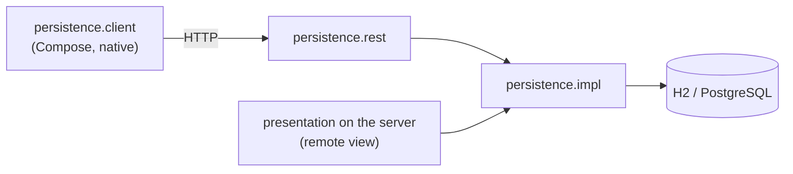

# persistence

The Storefront persistence layer: how data is stored on the server, exposed over HTTP and consumed by the clients.

Each of the three subprojects implements, on its own side, the contracts of [shopping-domain](../br.com.wdc.kt.shopping.domain/) — the same repositories and the same transaction service hold on server and client.

## Subprojects

| Subproject | Gradle project | Platform | Role |
|---|---|---|---|
| [persistence.impl/](persistence.impl/) | `:shopping-persistence` | JVM | Repositories over jOOQ (H2 and PostgreSQL), schema classes, authentication |
| [persistence.rest/](persistence.rest/) | `:persistence-rest` | JVM | REST API of the repositories, with access control; remote transaction; OpenAPI |
| [persistence.client/](persistence.client/) | `:shopping-persistence-client` | KMP | Repositories and transaction service over HTTP, with one transport per platform |

The database schema and migrations live in [shopping-scripts](../br.com.wdc.kt.shopping.scripts/).

See the [persistence architecture](../../../docs/architecture-persistence.md).
