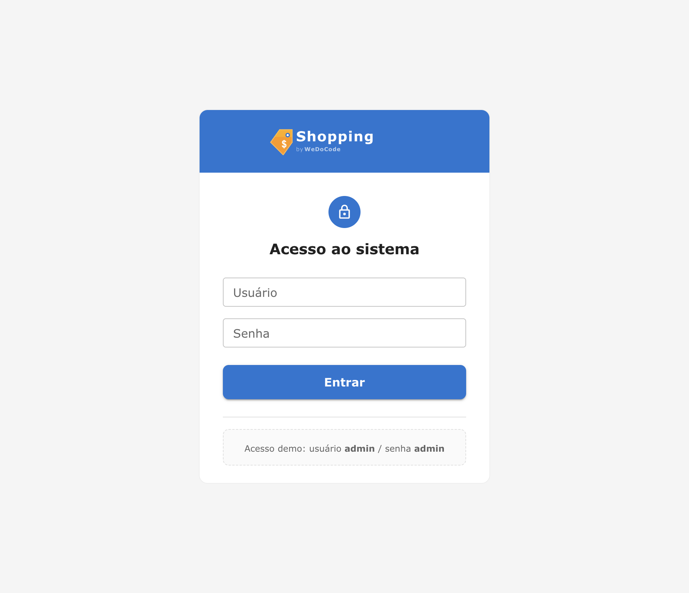
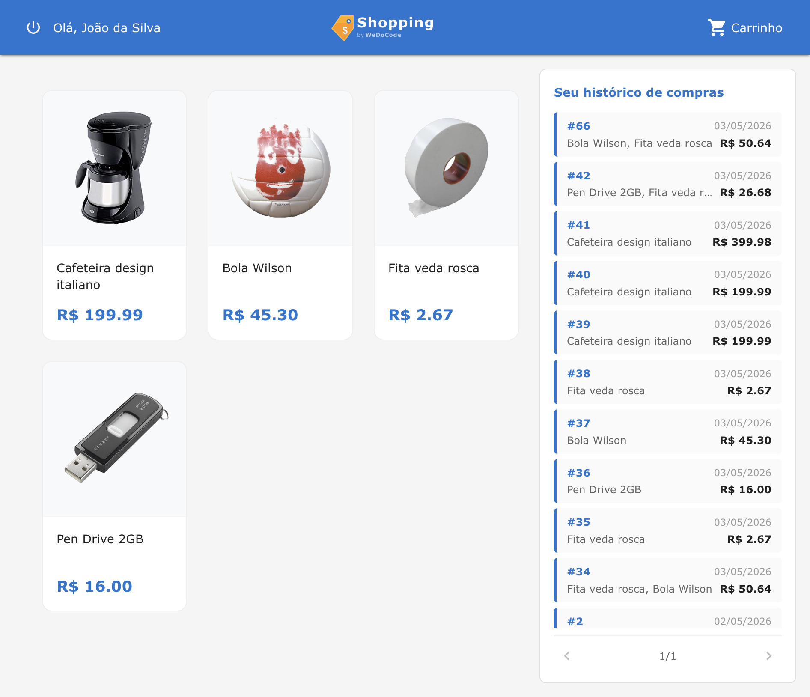
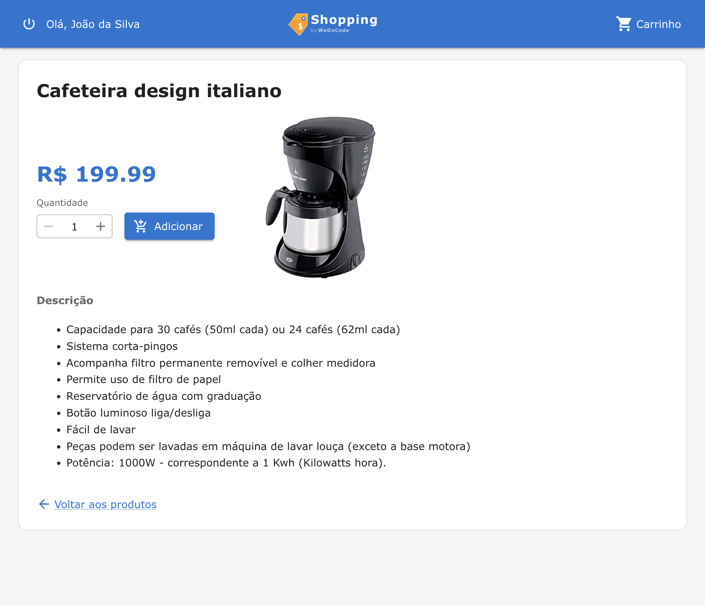
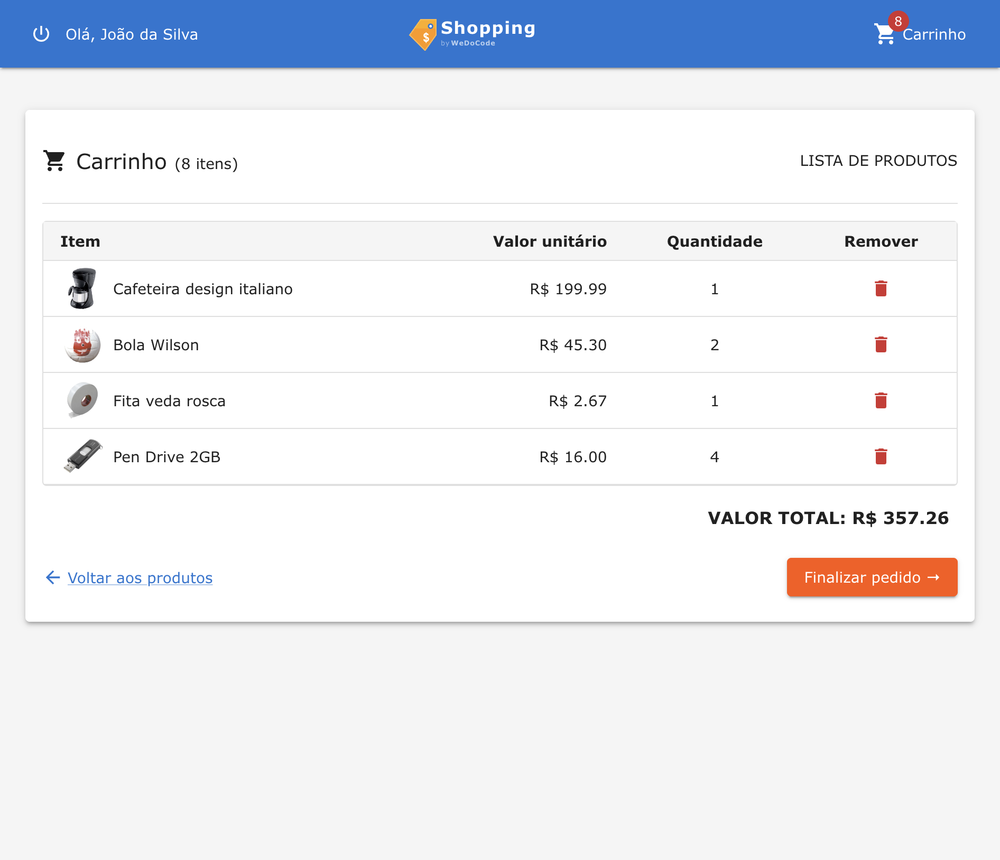
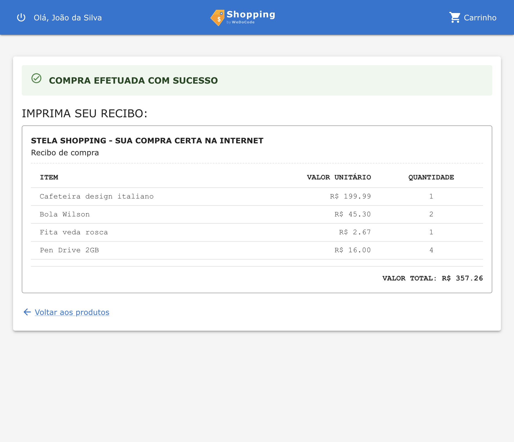

# remote.react

Remote view implementation using **React** — the presenters run on the server and talk to the client over WebSocket.

See the [architecture documentation](../../../../docs/architecture-react.md) for the full details.

## Subprojects

- [remote.react.skeleton/](remote.react.skeleton/) — Server-side bridge (Kotlin/JVM) between the presenters and the React client
- [remote.react.client/](remote.react.client/) — React/TypeScript application (pure rendering)

## Screens

| Login | Home (Products + Purchases) |
|:---:|:---:|
|  |  |

| Product Details | Cart |
|:---:|:---:|
|  |  |

| Receipt |
|:---:|
|  |
