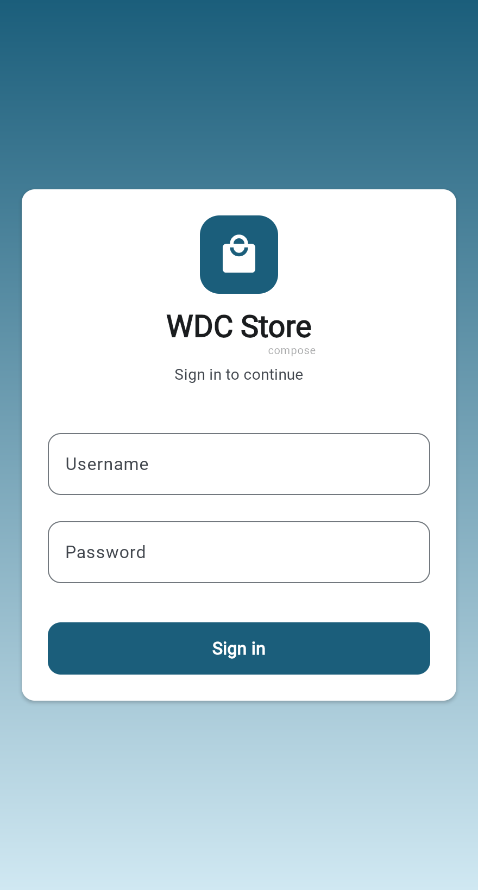
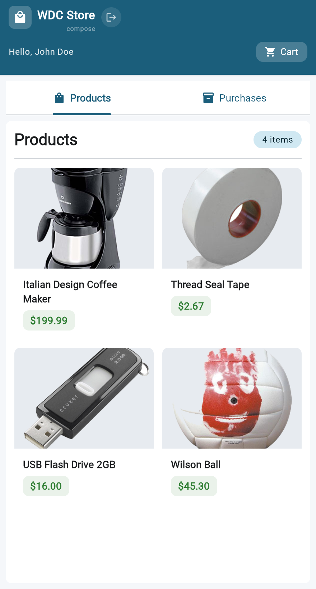
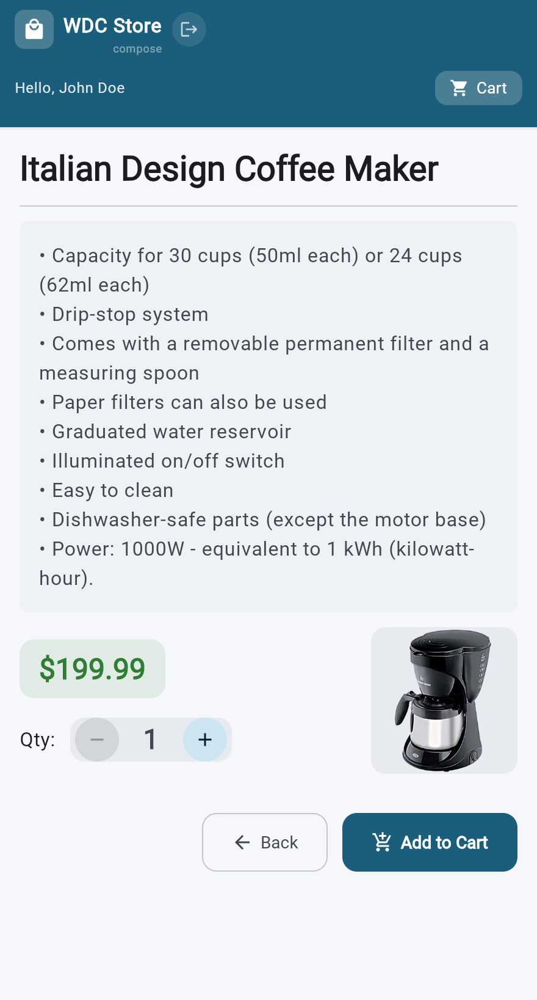
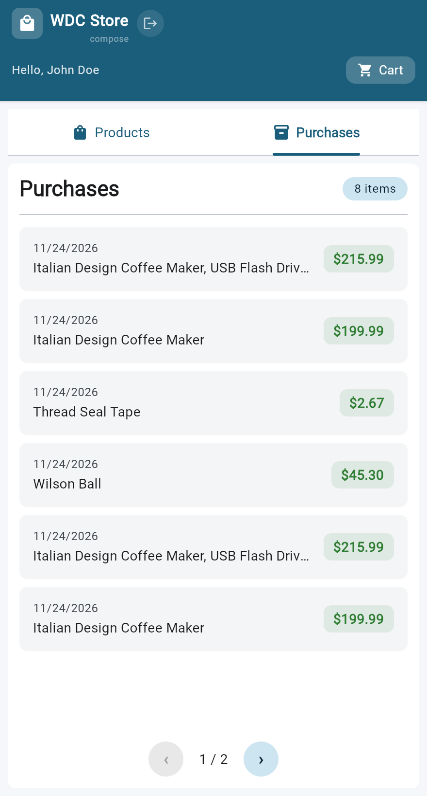
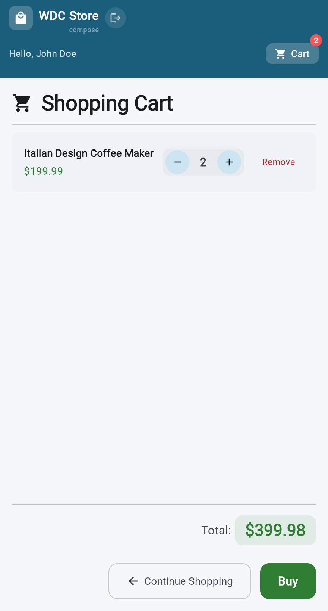
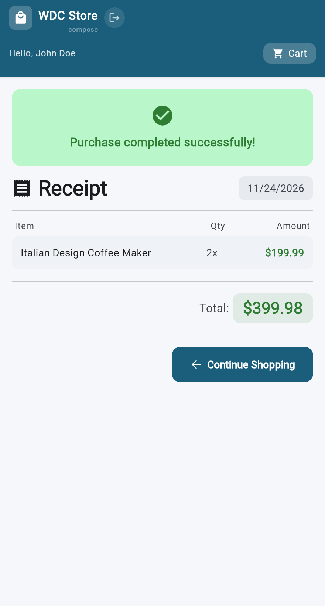

# view-compose

Shared UI in **Compose Multiplatform** with Material 3. Holds all the screens and common components, consumed by the platform modules.

**Platforms:** JVM, Android, iOS, wasmJs

See the [Cube + Compose architecture](../../../docs/architecture-cube-compose.md) for details on the integration (views as functions of the scope, `useScope`, the paint cycle, safeCall, slots, the view catalog, per-platform startup) and the [architecture overview](../../../docs/architecture.md) for the project context.

## Platform Subprojects

- [compose.web/](compose.web/) — Web entry point (wasmJs/browser)
- [compose.ios/](compose.ios/) — iOS entry point (native framework)
- [compose.android/](compose.android/) — Android entry point (app)
- [compose.desktop/](compose.desktop/) — Desktop entry point (JVM)

## How to run

```bash
cd fontes

# Desktop
./gradlew :view-compose-desktop:run

# Web (port 8082)
./gradlew :view-compose-web:wasmJsBrowserDevelopmentRun

# Android
./gradlew :view-compose-android:assembleDebug

# iOS (through Xcode)
./gradlew :view-compose-ios:linkDebugFrameworkIosSimulatorArm64
```

## Screens (Compose Web at phone width; Android and iOS draw the same screens)

| Login | Products |
|:---:|:---:|
|  |  |

| Product Details | Purchases |
|:---:|:---:|
|  |  |

| Cart | Receipt |
|:---:|:---:|
|  |  |
