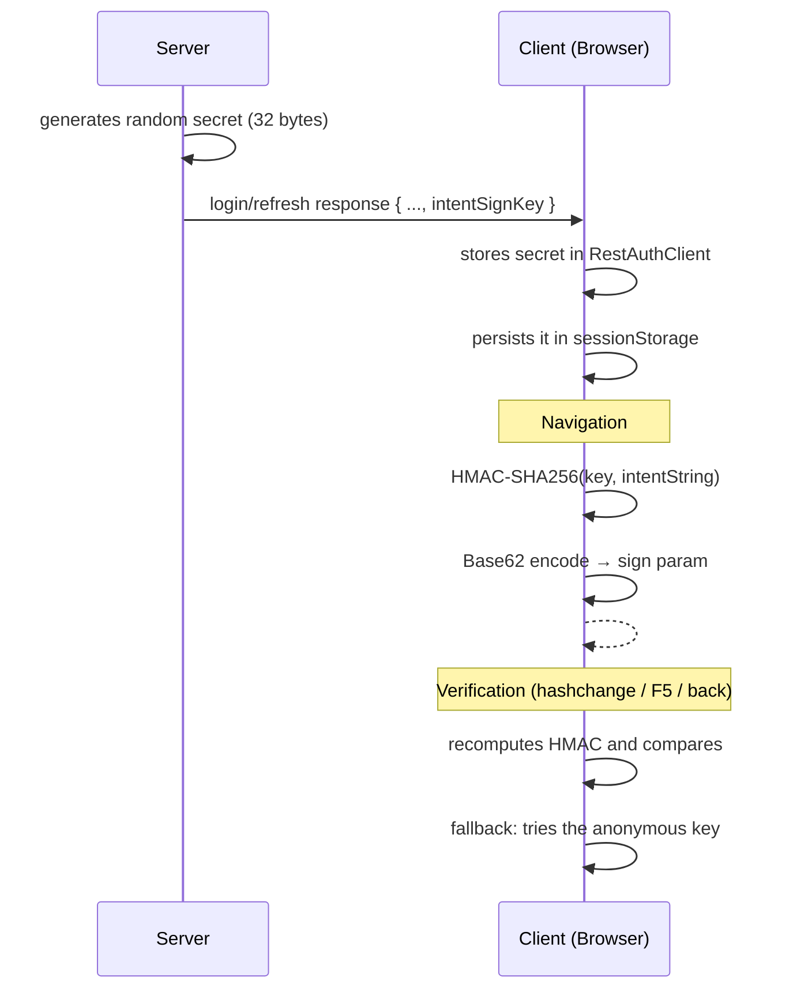

# compose.web

**Web** entry point of the Compose application. Compiles to **wasmJs** and runs in the browser through the webpack dev server (port 8082).

```bash
cd fontes && ./gradlew :view-compose-web:wasmJsBrowserDevelopmentRun
```

The webpack proxy forwards `/api/*` to the backend on port 8080 (another one: the `BASE_URL` environment variable).

`./deploy.sh` builds the production bundle (`wasmJsBrowserDistribution`) and copies it, pre-compressed with gzip, to `fontes/work/deployment/compose/`; the backend serves it at `http://localhost:8080/compose/`.

## Navigation Security — HMAC Signing of Intents

In a SPA (Single Page Application), the navigation state is exposed in the URL
(hash fragment). A malicious user could edit the hash by hand to reach screens
or parameters the application never offered them.

To mitigate this, every navigation is signed with **HMAC-SHA256** and the signature
is included as the `sign` parameter in the hash fragment. When a navigation arrives
(including F5 or the back button), the signature is verified locally before
access to the screen is allowed.

### Model: Per-Session HMAC Secret

The design follows the **AWS Signature V4** model — one shared secret per
session, with no round trips to the backend to sign or verify:



1. **On login/refresh**, the backend loads (or generates and persists) the user's
   secret in the `EN_USER_INTENT_SECRET` table through `IntentSecretStore`. The
   secret is permanent per user — once created, it never changes. It is returned
   in the `intentSignKey` field of the JSON response.
2. **The client** stores the secret in `RestAuthClient.intentSignSecret` and
   persists it in session storage (through `writeAuthState`/`readAuthState`).
3. **When navigating**, `Main.kt` computes `HMAC-SHA256(key, intentString)` and
   encodes the result in Base62 (URL-safe). The resulting hash looks like:
   `#product?pr-id=42&sign=7kT9x...`
4. **When verifying** (hashchange, F5, back/forward), the HMAC is recomputed and
   compared — all locally, with no call to the server.

### Anonymous User

Before login, a fixed key (`ANONYMOUS_SIGN_KEY`) signs the public screens.
After login, the session key takes over. On verification, both keys are tried
to support the transition (e.g. a public URL signed with the anonymous key and
verified after login).

### Session Restore (F5)

On page refresh, the auth state (including `intentSignSecret`) is restored
from session storage **before** the first navigation (`restoreAuthState` in
`main()`). This ensures that URLs signed with the session key are verified
correctly, without falling back to the anonymous key.

### Flow in the Code

| Step | File | Function/Field |
|---|---|---|
| Secret generation | `IntentSecretStore.kt` | `getOrCreate(userId)` — persists in `EN_USER_INTENT_SECRET` |
| Transport in auth | `AuthResult.intentSignKey` | field in the login/refresh JSON |
| Client storage | `RestAuthClient.kt` | `intentSignSecret` |
| F5 persistence | `RestAuthenticationService.kt` | `writeAuthState()` / `readAuthState()` |
| Restore before go | `Main.kt` | `restoreAuthState()` in `main()` |
| Local signing | `Main.kt` | `signIntent()` → `CryptoProvider.hmacSha256()` + `Base62` |
| Local verification | `Main.kt` | `verifyIntent()` — tries the session key, anonymous fallback |

### Limitations

- **It does not replace server-side authorization.** Each REST call carries the
  JWT, and the entity's data policy decides what the caller's roles may read and
  write (see [Security architecture](../../../../docs/security-architecture.md)).
  Intent signing is a defense-in-depth layer in the UI.
- **The anonymous key is fixed and known.** Public screens have no real protection
  against URL tampering — which is acceptable, since they are public.

### Session Persistence

Authentication sessions (RSA key pairs, the private key encrypted; refresh
tokens; role names) are persisted in the database's `EN_USER_SESSION` table. This means that **restarting the
server does not invalidate existing sessions** — the client keeps navigating
normally without having to re-authenticate.

Each login creates an independent session identified by a UUID (`sessionId`),
which is included as the `sid` claim in the JWT. This allows **multiple
simultaneous sessions per user** (e.g. different tabs, different devices).

The intent HMAC secret is also permanent per user (persisted in
`EN_USER_INTENT_SECRET`), so signed URLs stay valid even after a server
restart.
