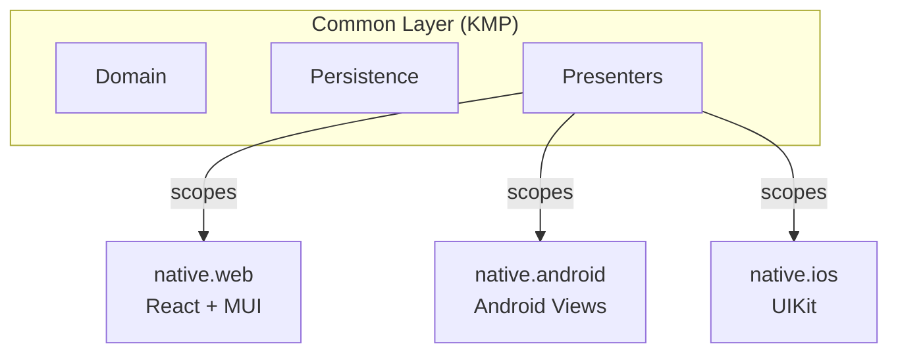
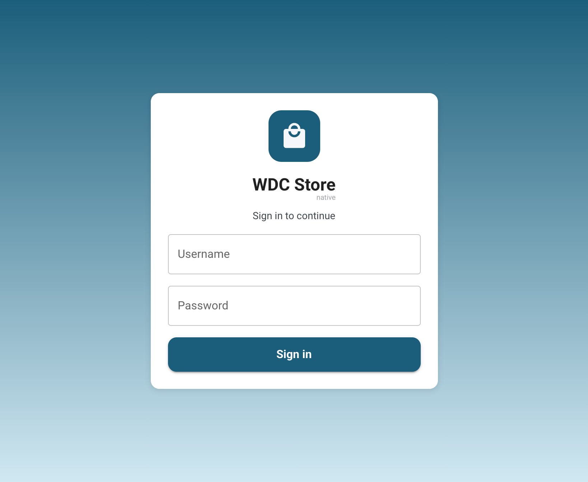
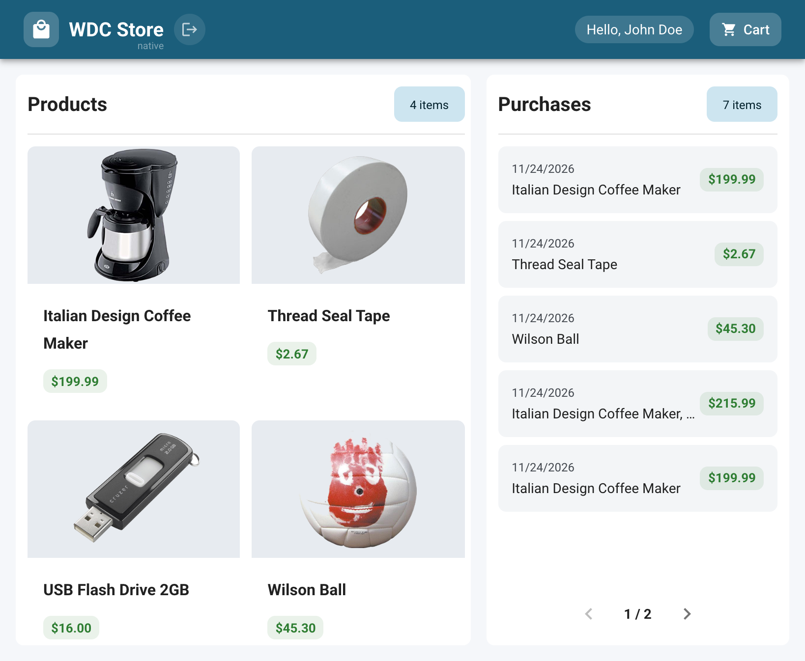
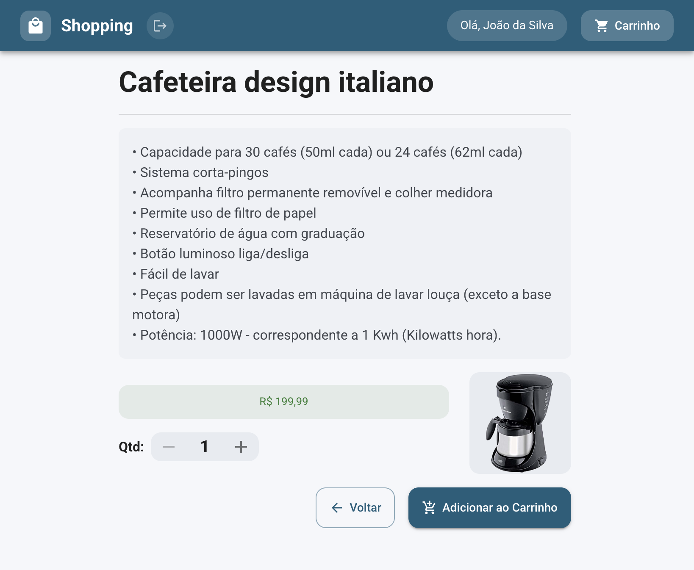
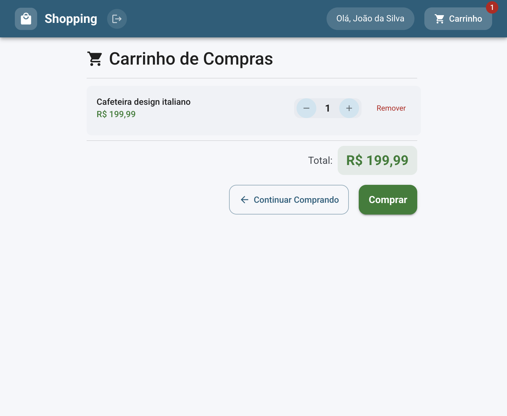
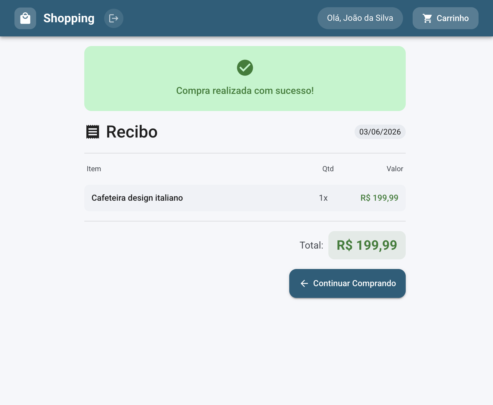

# view-native

Views built with each **platform's native toolkit**, without abstraction frameworks such as Compose Multiplatform.

## Motivation

The main motivation for building native interfaces is to show that, using only each platform's native toolkit, you can build interfaces of the same quality as the versions built with declarative frameworks.

The cost is building with what the target platform offers — which may have no native reactive solution, or may lack some helpers that make assembling views easier. In return, the native versions **will always drain less battery** and **will stay aligned with the platform's evolution**, without depending on third-party updates.

## Subprojects

| Subproject | Platform | UI technology |
|---|---|---|
| [native.web/](native.web/) | Web (Kotlin/JS) | React + MUI through kotlin-wrappers |
| [native.android/](native.android/) | Android | Android Views (programmatic) |
| [native.ios/](native.ios/) | iOS | UIKit through Kotlin/Native |

## Common Architecture

The three subprojects share the same **presenters**, **domain** and **persistence** layers — only the view layer is platform-specific. The architecture follows the **Cube MVP** pattern:

### Cross-cutting Patterns

- **View catalog**: the framework knows only scopes; each platform keeps its own catalog (scope class → native view) — in the application on Android and iOS, in a `ScopeComponents` on the web — and owns its views; presenters never create views, and views take the scope (and, on Android and iOS, the application)
- **Slots**: a child view is shown through a slot — `ViewSlot` on Android and iOS, the memoized `RenderSlot` component on the web; the slot swaps the view on navigation. On Android and iOS a view whose scope left (the parent's drawing no longer asks for it) is released, in cascade; on the web React drops what unmounts
- **ListSlot** (Android, iOS): efficient list synchronization with view recycling (grow/shrink/update-in-place)
- **FlowLayout** (Android `FlowLayout`, iOS `FlowLayoutView`): responsive grid that redistributes children according to the available width
- **Dirty-flag coalescing**: each platform has a `ViewUpdateScheduler`; several `update()` calls are merged into a single repaint per flush, which first runs `app.commitComputedState()` once
- **Responsive layout**: breakpoints (web 518px, Android 480dp, iOS 700pt) detect the available width and switch between compact (mobile) and wide (tablet/desktop) layouts

## Screens (Native Web version as reference)

| Login | Home (Products + Purchases) |
|:---:|:---:|
|  |  |

| Product Details | Cart |
|:---:|:---:|
|  |  |

| Receipt |
|:---:|
|  |

> The three platforms (Web, Android, iOS) produce visually equivalent screens, with small nuances due to the native toolkits available.

## References

- [Cube Architecture](../../../docs/architecture-cube.md) — navigation mechanism and lifecycle
- [Architecture overview](../../../docs/architecture.md) — project context
