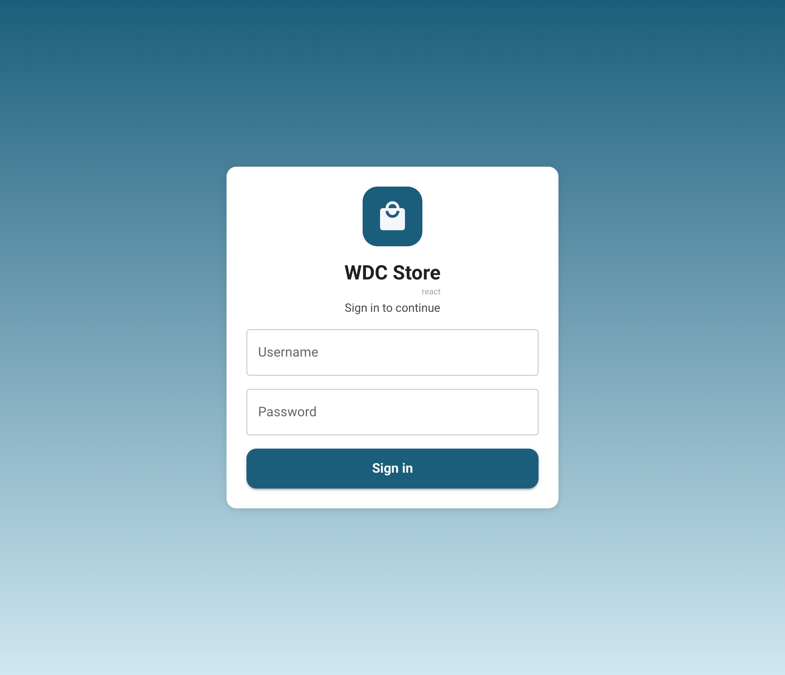
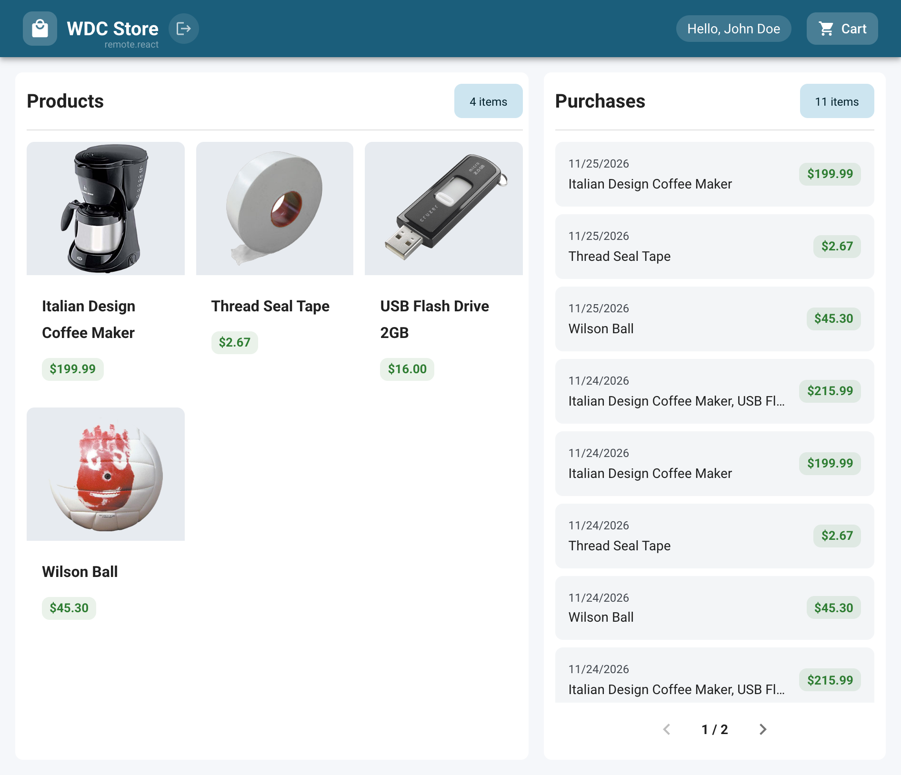
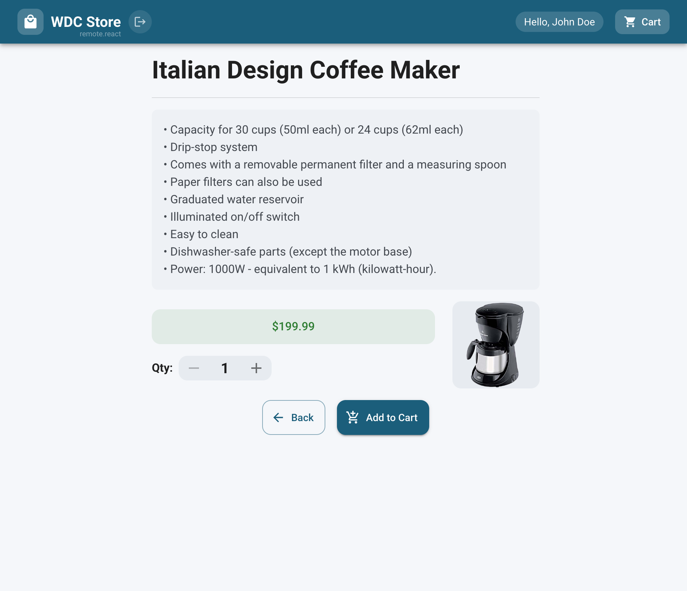
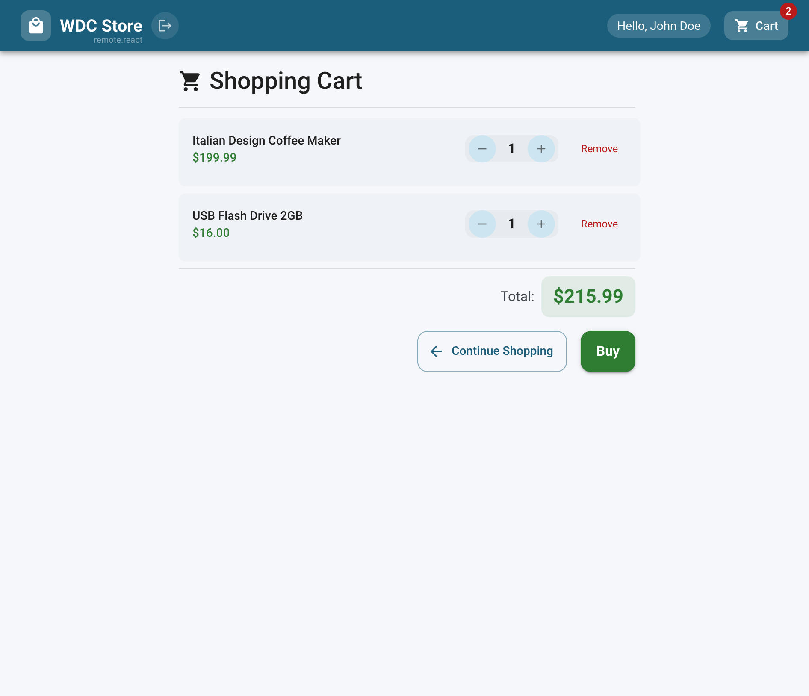
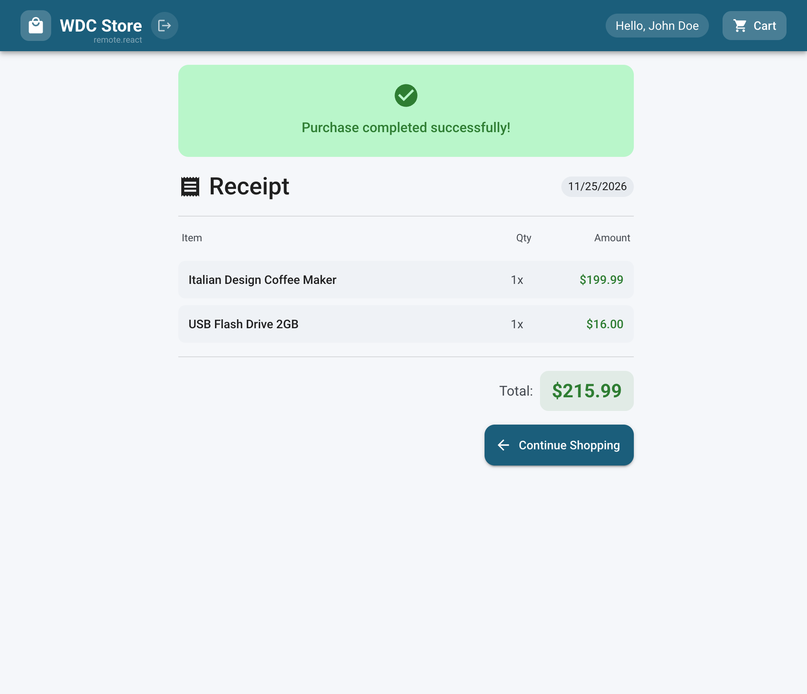

# remote.views

The clients of the remote view: each paints the scopes the server sends and sends back form data and events, speaking the same protocol to the same server ([remote.host](../remote.host/)).

See the [architecture documentation](../../../../docs/architecture-react.md) for the full details.

## Subprojects

- [remote.react.typescript/](remote.react.typescript/) — React in TypeScript (npm, Parcel), served at the root (`/index.html`): the Store's views, theme and texts over the framework packages [`@wdc/remote-bridge`](../../../br.com.wdc.kt.framework/br.com.wdc.kt.framework.cube.remote/remote.bridge.typescript/) and [`@wdc/remote-bridge-react`](../../../br.com.wdc.kt.framework/br.com.wdc.kt.framework.cube.remote/remote.bridge.typescript.react/), imported from source through an alias
- [remote.react.kotlin/](remote.react.kotlin/) — React in Kotlin/JS (React + MUI through kotlin-wrappers, `:view-remote-react-kotlin`), over the framework modules [`framework-cube-remote-bridge`](../../../br.com.wdc.kt.framework/br.com.wdc.kt.framework.cube.remote/remote.bridge.kotlin/) and [`framework-cube-remote-bridge-react`](../../../br.com.wdc.kt.framework/br.com.wdc.kt.framework.cube.remote/remote.bridge.kotlin.react/); published at `/remote-kotlin/`

## Screens

| Login | Home (Products + Purchases) |
|:---:|:---:|
|  |  |

| Product Details | Cart |
|:---:|:---:|
|  |  |

| Receipt |
|:---:|
|  |
