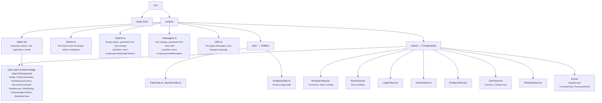

# WDC Store — React Client

SPA frontend of the WDC Store system, built with **React 19**, **TypeScript** and **MUI 9**. It talks to the backend over a **bidirectional WebSocket**, receiving the presenters' scopes serialized and sending events back.

See the [architecture documentation](../../../../../docs/architecture-react.md) for details of the protocol and the communication cycle.

## Stack

| Technology | Version | Purpose |
|-----------|--------|------------|
| React | 19 | Reactive UI |
| TypeScript | ES2024 target | Static typing (no `typescript` dependency: Parcel compiles it) |
| MUI (Material UI) | 9 | Visual components |
| Emotion | 11 | CSS-in-JS (MUI engine) |
| Parcel | 2.13.3 | Bundler |
| Prettier | 3.10.1 | Code formatting |
| Oxlint | 1.93.0 | Linting |
| history | 5.3.0 | Hash-based navigation |
| universal-cookie | 8.1.2 | Cookie management |

The protocol client (coordinator, WebSocket, security handshake, view bindings) is the framework package [`wdc-cube-remote-bridge`](../../../../br.com.wdc.kt.framework/br.com.wdc.kt.framework.cube.remote/remote.bridge.typescript/), and its React bindings (the `bridge` object, the hooks, the view base classes) are [`wdc-cube-remote-bridge-react`](../../../../br.com.wdc.kt.framework/br.com.wdc.kt.framework.cube.remote/remote.bridge.typescript.react/); both are imported from source through aliases. This client supplies the views, the theme and the texts.

## Project Structure



## How It Works

### Lifecycle

1. **Bootstrap** (`index.tsx`): Creates the MUI theme, registers all views with `bridge.registerComponents(...)` and renders `bridge.createBrowserView()`
2. **Connection** (`BrowserView`): On mount, calls `bridge.onStart()`, which opens the WebSocket
3. **Receiving scopes**: The backend sends the serialized scopes (`scopes`) over the WebSocket → the bridge's `ScopeCoordinator.applyScopes()` updates the `ViewBinding`s → React re-renders; the ids in `releasedViews` (views the server let go of) go to its `ViewGarbageCollector`, which drops each at once, or when it unmounts if it is still on screen
4. **Sending events**: User actions call `bridge.submit(vsid, eventId)` (values first with `bridge.setFormField(vsid, 'p.name', value)`), which sends the event over the WebSocket; on the backend the view's scope runs the action the presenter bound with that code

### View Pattern

Each view is a class that extends the bridge's `BaseViewClass<Props, Scope>` and is turned into a Functional Component via `BaseViewClass.FC()`:

```typescript
class LoginViewClass extends BaseViewClass<ViewProps, LoginScope> {
  override render({ className }: ViewProps): React.ReactNode {
    const { scope } = this
    // ... rendering based on the scope received from the backend
  }
}

export default BaseViewClass.FC(LoginViewClass, 'c677cda52d14')
```

- The **scope** (`scope`) comes from the backend (presenter); it is not managed locally
- **Events** are sent to the backend via `bridge.submit(vsid, eventId)`
- **Form data** is attached via `bridge.setFormField(vsid, field, value)` before the submit
- Each view is identified by a unique **VIEW_ID** (hash) that maps to a kind of scope on the backend (the vid each scope declares, read by the remote host). A list of child views arrives as `<name>ViewIds` (the cart rows, `rowsViewIds`, each painted by `CartItemView`)

### WebSocket Communication

- **Protocol**: WebSocket with the `wdc` subprotocol
- **Keep-alive**: Automatic every 15 seconds to keep the connection alive
- **Reconnection**: Progressive backoff (2s, 4s, 6s, ... up to 120s) with an option to reconnect right away
- **Security**: Sensitive data encrypted with AES-256-GCM, with a key agreed on each connection by ECDH P-256 (see the bridge's README)

### Activity Indicator

The bridge sets `submitting` on the browser scope, and `BrowserView` shows a `LinearProgress` (MUI) at the top of the page during user submits. Characteristics:

- `position: fixed` — does not affect the layout
- 200ms delay — does not flicker on fast operations
- 15s timeout — clears itself if the response never arrives
- User actions only — keep-alive and ping are silent

## Import Aliases

- `@root/*` maps to `./src/scripts/*`.
- `wdc-cube-remote-bridge` and `wdc-cube-remote-bridge-react` map to the source entries of the two framework packages (`src/index.ts`, `src/index.tsx`).
- `react`, `history` and `universal-cookie` map to this client's `node_modules`: the bridge packages' own `node_modules` are only for building, testing and linting, and their files, outside this folder, resolve these peer dependencies here (one copy of React for both).

```typescript
import bridge, { BaseViewClass, type ViewProps } from 'wdc-cube-remote-bridge-react'
import * as NumberUtils from '@root/utils/NumberUtils'
```

Configured in `package.json` (Parcel `alias`) and `tsconfig.json` (`paths`, for TypeScript and the IDE).

## Build Output

The compiled assets are written straight into the `remote.host` module:

```
../../remote.host/src/main/resources/META-INF/resources/
```

This lets the Javalin server serve the static files automatically from the classpath. The bundle is generated, not versioned (the host's `.gitignore` excludes it): run `npm run build` after cloning and after changing the client, before starting the backend; without it, the backend starts without the React view.

## Commands

```bash
# Install dependencies
npm install

# Development (watch mode with hot reload)
npm run watch

# Production build
npm run build

# Format code
npm run format

# Check formatting
npm run format:check
npm run lint                # Oxlint: the TypeScript rules and the rules of React hooks
```
